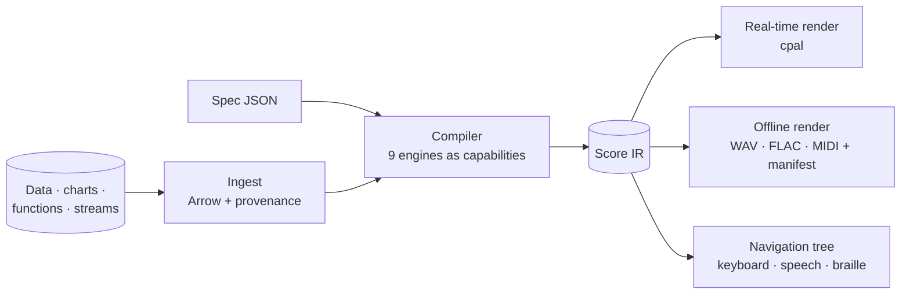

# SONARITHM

**An interactive framework for the auditory exploration of graphs and multivariate data.**

*Hear the patterns.*

SONARITHM turns charts, spreadsheets, mathematical functions and live data streams into **structured, navigable sound**. A declarative spec describes how data becomes sound, and the engine compiles it into a reproducible score. That score plays in real time, can be explored point by point from the keyboard, and exports to audio and MIDI with a full provenance record. It is designed from the start for blind and low-vision screen-reader users, as well as for analysts, scientists, educators and researchers.

> **Project status: planning complete, implementation starting.** The repository currently holds the research, architecture, roadmap and process documentation. Code begins with Stage A (see the [roadmap](docs/planning/roadmap.md) and [status](docs/sdlc/status.md)). Nothing is installable yet.

---

## Why

- **Charts exclude people.** In a controlled study, screen-reader users were 61% less accurate and took 211% longer extracting information from online charts (Sharif et al., ASSETS 2021).
- **No maintained native sonification tool exists.** The desktop tools are abandoned. The active tools are web libraries or notebooks, and none combines accessible navigation, a declarative spec, live streams, chart ingestion and reproducible export ([research report](docs/research/research-report.md)).
- **The science exists but is under-used.** Evidence-backed defaults are known: pitch for value, about 400–1400 Hz, 2–4 points per second, dynamic reference tones. Yet only about 6% of published mappings were ever evaluated. SONARITHM builds those defaults in, traces each one to its source, and ships an evaluation harness to test them.

## What makes it different

| | |
|---|---|
| **One deterministic core** | The same spec gives the same score on desktop, CLI, Python and (later) the web |
| **Spec in, Score out** | Declarative JSON specs (aligned with visualization grammars; Erie-importable) compile to a canonical, testable Score IR |
| **Accessible by construction** | Hierarchical keyboard navigation, earcons, auditory axes, screen-reader announcements, braille review line, an always-available data table |
| **Evidence-backed defaults** | Every default cites a design rule ([SDR/A11Y catalogue](docs/research/design-rules.md)). Every override is one keystroke away |
| **Honest about uncertainty** | Chart data is extracted exactly when possible, and every estimated value is labelled in sound, speech and table |
| **Reproducible** | Every export ships with a manifest: spec hash, data fingerprint, seed, engine versions |
| **Private** | Offline by default, no telemetry |

## Engines

SONARITHM is one platform with nine engines. Each engine is a capability inside a single compiler, not a separate program ([engine catalogue](docs/product/engines.md)).

| Engine | Role | Stage |
|---|---|---|
| **NUMISONA** | Maps any numeric field to pitch, duration, timbre, pan and loudness with perceptual scales and polarity | A |
| **AUDAXIS** | Auditory axes, navigation, earcons, speech and spatial cues | B |
| **SONOTRACE** | Time series, transport and live streams; ambient monitoring | B |
| **PLOTSONA** | "Bring any chart": exact-first chart ingestion and chart-type templates | C |
| **CURVASONA** | Math functions, critical-point cues and audification | C |
| **AXONOTE** | Musical mapping, instruments, MIDI and OSC output | C |
| **ECHOMETRIC** | Pattern analytics, descriptions, perceptual lint and the evaluation harness | A (harness) → C |
| **TONALENS** | Multivariate exploration lens with linked selection | D |
| **RESONUM** | Model-based sonification: data as an instrument | D |

## Architecture at a glance

Rust workspace core · Tauri 2 + React 19 + React Aria desktop app · CLI · Python (PyO3) · WebAssembly later. Details: [architecture](docs/architecture/README.md), [tech stack](docs/engineering/tech-stack.md), [decisions](docs/decisions/README.md).

## Roadmap

| Stage | Promise | Release |
|---|---|---|
| **A · Foundation** | Spec → sound from the CLI and Python, reproducibly | `v0.1`–`v0.2` alpha |
| **B · Accessible desktop** | A desktop app a screen-reader user can drive end to end | `v0.5` beta |
| **C · Bring any chart** | Charts, functions and musical output; general availability | `v1.0` |
| **D · Discover** | Multivariate and model-based engines, spatial audio, AI assist, plugins, web | `v1.x`/`v2.0` |

Full plan: [roadmap](docs/planning/roadmap.md) · [implementation plan](docs/planning/implementation-plan.md) · [status](docs/sdlc/status.md).

## Documentation

Start with the [documentation map](docs/README.md). Key entry points:

- [Research report](docs/research/research-report.md) and [design rules](docs/research/design-rules.md)
- [Product vision](docs/product/vision.md) and [requirements](docs/product/requirements.md)
- [Architecture](docs/architecture/README.md) and [ADRs](docs/decisions/README.md)
- [Research paper track](docs/research-paper/README.md)
- [AGENTS.md](AGENTS.md) for AI coding agents

## Contributing

Contributions are welcome, from code, sound design, research and documentation to testing with assistive technology. Read [CONTRIBUTING.md](CONTRIBUTING.md) and the [Code of Conduct](CODE_OF_CONDUCT.md). Security issues: see [SECURITY.md](SECURITY.md).

## Citing

Citation metadata is in [CITATION.cff](CITATION.cff). A Zenodo DOI will be minted with the first release.

## Licence

- **Code** is licensed under either of [Apache License 2.0](LICENSE-APACHE) or [MIT License](LICENSE-MIT), at your option (`MIT OR Apache-2.0`).
- **Documentation, example datasets and study stimuli** are licensed under [Creative Commons Attribution 4.0](LICENSES/CC-BY-4.0.txt) (`CC-BY-4.0`).

Each file's licence is declared by its SPDX header or in [REUSE.toml](REUSE.toml) ([ADR-0010](docs/decisions/0010-licensing.md)).

Unless you explicitly state otherwise, any contribution you intentionally submit for inclusion in SONARITHM is licensed as above, without any additional terms or conditions. Contributions require a [DCO](CONTRIBUTING.md) sign-off.

## Acknowledgements

SONARITHM builds on decades of auditory-display research and on open tools that showed the way, including the Sonification Handbook (Hermann, Hunt & Neuhoff), Erie, Umwelt, MAIDR, Chart2Music, Highcharts Sonification, STRAUSS and the Data Sonification Archive. Full references are in [docs/research](docs/research/README.md).
