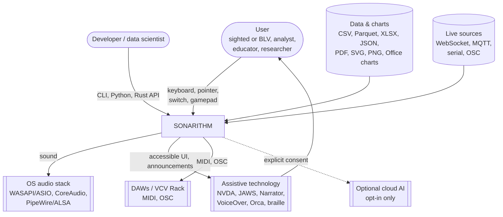
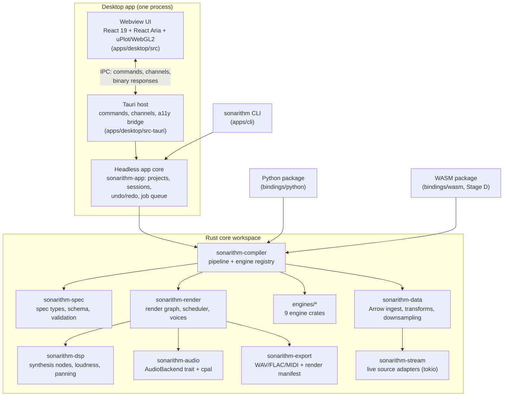
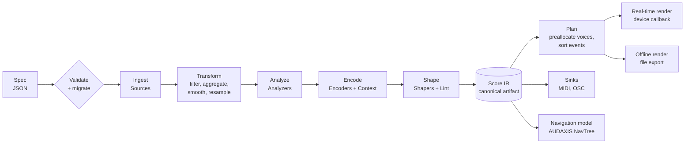
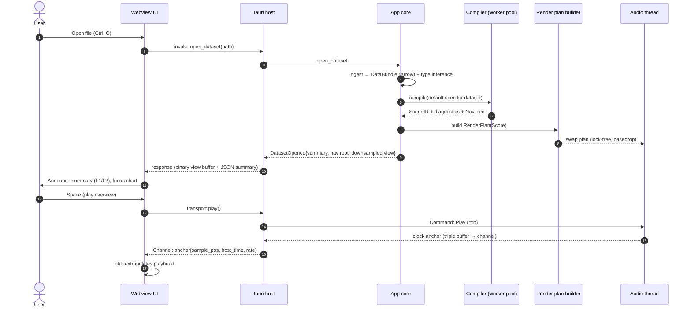

# 01 · Architecture Overview

> **Status:** Baseline v1 (2026-10-18), accepted for Stage A. Some decisions stay provisional until the A02 prototype gate ([roadmap](../planning/roadmap.md#a02--technical-spikes-and-prototype-gate)).
> **Owner:** Architecture lead. **Decisions:** [docs/decisions](../decisions/README.md).

## 1. What we are building

SONARITHM turns **data, graphs and charts into structured, navigable sound**. It is delivered as:

| Deliverable | Audience | Built from |
|---|---|---|
| **Desktop app** (Windows, macOS, Linux) | Analysts, scientists, educators, blind and low-vision (BLV) users, journalists | Tauri 2 shell + React/React Aria UI + Rust core in-process |
| **CLI** (`sonarithm`) | Pipelines, CI, batch rendering, researchers | Rust core |
| **Python package** (`sonarithm` on PyPI) | Data scientists, notebook users, researchers | Rust core via PyO3 (abi3 wheels) |
| **Rust crates** (`sonarithm` facade on crates.io) | Developers embedding sonification | Rust core |
| **WebAssembly build** (Stage D) | Web embedding, interop with MAIDR/Erie-style web tools | Rust core → wasm32 + WebAudio host |

All five share **one deterministic core**. This is the project's most defensible differentiator: the same spec renders the same Score on desktop, CLI, Python and web ([research report §"Nine engines…"](../research/research-report.md)).

## 2. Architectural principles

| # | Principle | Consequence |
|---|---|---|
| P1 | **Spec in, Score out.** Every sonification is a declarative spec compiled to an intermediate representation (the Score IR) before any sound is made. | Reproducibility (SDR-01), testability (snapshot the Score, not audio bytes), multi-target rendering. |
| P2 | **One compiler, nine engines.** Engines are capabilities registered in a single pipeline, not separate programs. | Prevents the feature sprawl and abandonment that killed prior tools. See [ADR-0007](../decisions/0007-engines-as-pipeline-capabilities.md). |
| P3 | **The audio thread is sacred.** No allocation, locks, I/O, logging or unbounded work on the real-time thread. | Lock-free queues, preallocated voices, plan swapping. See [06-audio-engine.md](06-audio-engine.md). |
| P4 | **Same code path, real-time and offline.** One render graph `process()` drives both the device callback and file export. | Deterministic exports; golden tests exercise the shipping code. |
| P5 | **Accessible by construction.** Navigation, announcements and non-audio equivalents are architecture, not features. | AUDAXIS owns a navigation model; every Score event links to its data row. See [08-interaction-and-accessibility.md](08-interaction-and-accessibility.md). |
| P6 | **Exact before estimated; label every estimate.** Data carries provenance and confidence to the sound and to the speech. | Provenance columns in the data model; PLOTSONA prefers exact extraction. See [10-ingestion-and-extraction.md](10-ingestion-and-extraction.md). |
| P7 | **Evidence-backed defaults, user-owned overrides.** Defaults come from the [design rules](../research/design-rules.md); every default is overridable and traceable. | Concept table, polarity flip, lint diagnostics carry rule IDs. |
| P8 | **Offline-first, private by default.** No network access without explicit, per-action consent; no default telemetry. | Optional cloud features behind an opt-in gate. See [ADR-0012](../decisions/0012-privacy-and-telemetry.md). |
| P9 | **Permissive and clean licensing.** Only permissive dependencies in default builds; copyleft only behind non-default features. | `cargo-deny` licence allowlist in CI. |
| P10 | **Boring core, swappable edges.** Volatile third-party pieces (cpal, Firewheel, Tauri, ML runtimes) sit behind our own traits. | Backend traits; Electron fallback possible without touching the frontend. |

## 3. System context (C4 level 1)

## 4. Containers (C4 level 2)

Notes:

- The **headless app core** (`sonarithm-app`) holds everything the desktop app does that is not UI: project management, session state, undo/redo, background jobs, settings and profiles. The CLI and the integration tests use the same core, so app behaviour is testable without a webview.
- **Python** binds the compiler and render layers directly. It does not need the app core's project and session machinery, but it may use it for project files.
- Only `sonarithm-audio` depends on `cpal`. Only `sonarithm-stream`, `sonarithm-app` and app crates depend on `tokio`. The compiler and engines stay synchronous and wasm-compatible.

## 5. The pipeline at a glance

Every stage is described in its own document:

| Stage | Document |
|---|---|
| Spec language | [04-sonification-spec.md](04-sonification-spec.md) |
| Data model, ingest, transforms | [03-data-model.md](03-data-model.md), [10-ingestion-and-extraction.md](10-ingestion-and-extraction.md) |
| Compiler, engine registry, Score IR | [05-compiler-and-score-ir.md](05-compiler-and-score-ir.md) |
| Engines | [07-engines.md](07-engines.md) |
| Render graph, audio backends, export | [06-audio-engine.md](06-audio-engine.md) |
| Navigation, speech, accessibility | [08-interaction-and-accessibility.md](08-interaction-and-accessibility.md) |
| Desktop app, IPC, frontend | [09-desktop-app.md](09-desktop-app.md) |
| CLI, Python, WASM, plugins | [11-bindings-cli-plugins.md](11-bindings-cli-plugins.md) |
| Cross-cutting concerns | [12-cross-cutting-concerns.md](12-cross-cutting-concerns.md) |

## 6. Key runtime scenarios

### 6.1 "Open a CSV and hear the overview" (desktop)

### 6.2 Keyboard exploration (point stepping)

1. The user presses → in the chart. The UI sends `nav.move(Next)` to the host.
2. AUDAXIS resolves the next `NavNode` and returns `{node, announcement, sonify: PointCue}`.
3. The host enqueues a **one-shot cue** to the audio thread. This is a short tone for the point's value, rendered by the same voice as playback. The UI updates the visual highlight and sends the announcement text to the platform announcer: a managed ARIA live region by default, a native notification plugin where A02 shows it is needed (OD-05), or self-voicing ([08 §4](08-interaction-and-accessibility.md#4-announcement-pipeline)).
4. The cue and the speech are **sequenced, not overlapped** (A11Y-20): the speech starts after the cue, or the cue is ducked.

### 6.3 Batch render (CLI)

`sonarithm render spec.json --data temps.csv --out temps.flac` loads the spec, compiles it, then runs the **offline renderer**. This is the same graph as real time, driven by a loop at a fixed block size. The command writes `temps.flac` and `temps.render.json` (the provenance manifest: engine version, spec hash, data fingerprint, seed, sample rate, block size). The exit code is non-zero on validation errors. `--deny-warnings` also fails on lint warnings.

## 7. Quality attributes and budgets

All budgets are **targets for reference hardware**, defined in [12-cross-cutting-concerns.md §8 Performance budgets](12-cross-cutting-concerns.md#8-performance-budgets). They are verified by benchmarks in CI (A05, B01) and re-baselined at each stage gate.

| Attribute | Target | Verified by |
|---|---|---|
| Interactive response (key press → cue onset) | ≤ 50 ms p95 at 48 kHz with a 256-frame buffer | Loopback latency harness (A02, B03) |
| Audio robustness | 0 xruns in a 10-min soak at 128-frame buffers on reference HW | Soak test (A05) |
| Offline render speed | ≥ 50× real time for a 4-track, 10k-event Score | Criterion bench (A05) |
| Compile time | ≤ 200 ms for 100k rows × 4 tracks; ≤ 1 s for 1M rows | Criterion bench (A06) |
| Determinism | Byte-identical Score IR across OS/CPU (Score-affecting maths via pure-Rust libm); audio within tolerance (peak null-test residual ≤ −90 dBFS, LUFS Δ ≤ 0.1) | Golden tests (A05) |
| UI frame time | 60 fps playhead; ≤ 8 ms scripting per frame with 1M-point series (downsampled in Rust) | Frontend perf test (B04) |
| Accessibility | WCAG 2.2 AA via WCAG2ICT; manual SR matrix passes every release | ACR + SR test matrix (B07, C06) |
| Startup | Cold start to interactive ≤ 2 s | Startup bench (B01) |
| Footprint | Desktop installer ≤ 40 MB without ML models | Release CI (C06) |
| Privacy | Zero network calls without explicit consent | Network-deny integration test (B01) |

## 8. Technology summary

The full rationale is in [engineering/tech-stack.md](../engineering/tech-stack.md) and the ADRs.

| Layer | Choice |
|---|---|
| Language/toolchain | Rust 2024 edition; core MSRV 1.88; CI on latest stable |
| Audio I/O | cpal 0.18 behind `AudioBackend` trait |
| Render graph | SONARITHM-owned graph; Firewheel 0.14 evaluated behind the same trait (A02) |
| DSP | fundsp 0.23 + custom nodes (granular, wavetable, modal); rubato; rustfft/realfft; ebur128 |
| Real-time comms | rtrb, triple_buffer, basedrop, atomic_float, assert_no_alloc (debug) |
| Data | Apache Arrow 60 (+ parquet), csv, calamine, jiff; Polars optional adapter |
| Export | hound (WAV), flacenc (FLAC), midly (SMF); symphonia for decoding |
| Expressions/scripts | exmex (behind a facade), rhai |
| Analytics | statrs, augurs, ndarray |
| Desktop shell | Tauri 2.12 (Electron fallback per ADR-0002) |
| Frontend | React 19.2 + TypeScript + Vite; React Aria Components; Zustand + XState v5; CSS Modules + OKLCH tokens; uPlot + custom WebGL2; CodeMirror 6 |
| Typed IPC | ts-rs-generated TypeScript + schemars JSON Schema |
| Python | PyO3 0.29 + maturin (abi3, CPython 3.10 and later; F-101) |
| WASM | wasm-bindgen (Stage D) |
| Plugins | wasmtime + WIT, compile-time only (Stage D) |
| ML (optional) | tract (default), ort (opt-in), llama.cpp sidecar for local VLMs (Stage D) |
