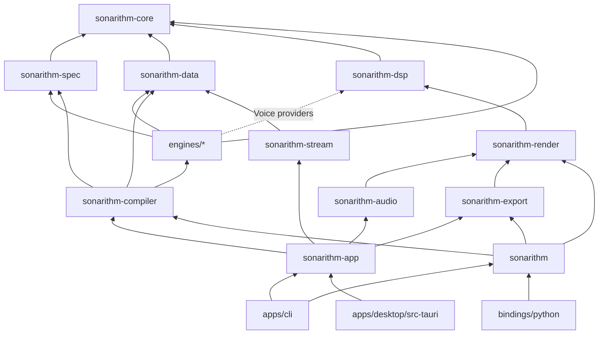

# 02 · Repository and Crate Layout

> **Status:** Baseline v1 (2026-10-18). This is the **target** layout. Phase A01 creates the skeleton, and each crate appears in the phase that first needs it (see the "Introduced" column).
> **Rule:** A new top-level directory or crate needs an ADR or an approved PR that updates this document.

## 1. Repository tree (target)

```text
SONARITHM/
├── AGENTS.md                  # Instructions for coding agents (canonical)
├── CLAUDE.md                  # Imports AGENTS.md for Claude Code
├── README.md  CHANGELOG.md  CONTRIBUTING.md  CODE_OF_CONDUCT.md
├── SECURITY.md  GOVERNANCE.md  CITATION.cff
├── LICENSE-MIT  LICENSE-APACHE        # code licence: MIT OR Apache-2.0 (ADR-0010)
├── LICENSES/  REUSE.toml              # REUSE licence texts (incl. CC-BY-4.0 for docs and data) and annotations
├── Cargo.toml                 # [workspace], [workspace.dependencies], [workspace.lints]
├── Cargo.lock                 # committed (we ship binaries)
├── rust-toolchain.toml        # pinned stable for CI reproducibility
├── deny.toml                  # cargo-deny: licences, advisories, bans, sources
├── rustfmt.toml  clippy.toml  .editorconfig  .gitattributes  .gitignore
├── package.json  pnpm-workspace.yaml  # JS workspace root (apps/desktop, packages/*)
│
├── crates/
│   ├── sonarithm/                    # Facade crate: curated public API re-exports
│   ├── sonarithm-core/               # Units, IDs, errors, Score IR, engine traits, provenance
│   ├── sonarithm-spec/               # Spec types (serde+schemars), validation, migrations, importers
│   ├── sonarithm-data/               # Arrow-backed DataBundle, file sources, transforms, downsampling
│   ├── sonarithm-compiler/           # Pipeline orchestration, engine registry, diagnostics
│   ├── sonarithm-dsp/                # Synthesis nodes, envelopes, panning, loudness (ISO 226), metering
│   ├── sonarithm-render/             # Render graph, scheduler, RenderPlan, real-time + offline driver
│   ├── sonarithm-audio/              # AudioBackend trait, cpal backend, device management
│   ├── sonarithm-export/             # WAV/FLAC/MIDI writers, render manifest, cue sidecar
│   ├── sonarithm-stream/             # Live sources: WebSocket, MQTT, serial, OSC-in, file tail (tokio)
│   ├── sonarithm-speech/             # Optional self-voicing via platform TTS (tts crate)
│   ├── sonarithm-app/                # Headless app core: projects, sessions, undo/redo, jobs, profiles
│   ├── sonarithm-plugin-host/        # wasmtime + WIT plugin host (Stage D)
│   └── engines/
│       ├── sonarithm-numisona/
│       ├── sonarithm-audaxis/
│       ├── sonarithm-sonotrace/
│       ├── sonarithm-plotsona/
│       ├── sonarithm-plotsona-ml/    # Optional ML extraction (tract/ort), Stage D
│       ├── sonarithm-curvasona/
│       ├── sonarithm-axonote/
│       ├── sonarithm-echometric/
│       ├── sonarithm-tonalens/
│       └── sonarithm-resonum/
│
├── apps/
│   ├── cli/                          # crate `sonarithm-cli`, binary `sonarithm`
│   └── desktop/
│       ├── src-tauri/                # crate `sonarithm-desktop` (Tauri host)
│       └── src/                      # React + TypeScript UI
│
├── bindings/
│   ├── python/                       # crate `sonarithm-py` + Python package `sonarithm` (maturin)
│   └── wasm/                         # crate `sonarithm-wasm` (Stage D)
│
├── packages/                         # Frontend workspace packages (pnpm)
│   ├── ui/                           # @sonarithm/ui: tokens + React Aria-based components
│   ├── viz/                          # @sonarithm/viz: uPlot wrappers, WebGL2 layers, playhead
│   └── ipc/                          # @sonarithm/ipc: generated TS types + typed client
│
├── schemas/                          # Generated JSON Schema (spec, manifest), committed and CI-checked
├── wit/                              # WIT worlds for plugins (Stage D)
├── assets/                           # Earcons, instrument samples, fonts (with licences)
├── examples/                         # Example datasets (CC BY 4.0) + specs + notebooks
├── replication/                      # Replication gallery (A08): published designs as specs, stimuli and render records, checked by `cargo xtask replication`
├── benches/                          # Cross-crate benchmarks and soak tests
├── tests/                            # Workspace-level integration and golden tests
│   └── golden/                       # Golden Score snapshots and reference audio (storage decided in A05, OD-08)
├── xtask/                            # `cargo xtask`: codegen, schema export, golden updates, release helpers
├── docs/                             # All documentation (see docs/README.md)
├── paper/                            # JOSS paper.md + paper.bib (created at JOSS submission)
└── .github/                          # Workflows, issue forms, PR template, CODEOWNERS
```

## 2. Crate catalogue

| Crate | Purpose | Key dependencies | wasm32 | MSRV | Introduced |
|---|---|---|---|---|---|
| `sonarithm-core` | Foundational types: units (`Hz`, `Cents`, `Db`, `Seconds`, `Frames`), IDs, `Score` IR, `EngineCapability` traits, `Provenance`, `Diagnostic`, error types. **No I/O.** | serde, thiserror, arrow-schema | Yes | 1.88 | A03 |
| `sonarithm-spec` | Spec structs, JSON (de)serialization, JSON Schema export, semantic validation, version migration, Erie/Vega-Lite importers | core, serde_json, schemars | Yes | 1.88 | A03 |
| `sonarithm-data` | `DataBundle` over Arrow, file sources (CSV, JSON, Parquet, Arrow IPC, XLSX/ODS), type and concept inference, transforms, M4/LTTB downsampling, fingerprints | core, arrow, parquet, csv, calamine, jiff | Partial (no fs) | 1.88 | A04 |
| `sonarithm-compiler` | Pipeline orchestration, engine registry, diagnostics aggregation, spec → Score | core, spec, data | Yes | 1.88 | A03 (skeleton), A06 |
| `sonarithm-dsp` | Oscillators, envelopes, filters, panners, granular, wavetable, modal nodes; ISO 226 compensation; EBU R128 meter | core, fundsp, rubato, realfft, ebur128 | Yes | 1.88 | A05 |
| `sonarithm-render` | RenderGraph, Scheduler, `RenderPlan`, voice pool, transport, real-time-safe command and telemetry channels; offline driver | core, dsp, rtrb, triple_buffer, basedrop, atomic_float | Yes | 1.88 | A05 |
| `sonarithm-audio` | `AudioBackend` trait; cpal backend; device enumeration and hot-plug; latency reporting | render, cpal | Via cpal WebAudio | 1.88 | A05 |
| `sonarithm-export` | WAV/FLAC/MIDI writers; render manifest (`*.render.json`); speech/cue sidecar | core, render, hound, flacenc, midly, sha2 | Yes | 1.88 | A05 |
| `sonarithm-stream` | Live source adapters with backpressure and reconnect | core, data, tokio, tokio-tungstenite, serialport, rumqttc, rosc | No | 1.88 | B06 |
| `sonarithm-speech` | Optional self-voicing; screen-reader routing where the platform allows | tts | No | 1.88 | B03 |
| `sonarithm-app` | Projects (`.sonarithm` bundles), sessions, undo/redo (command pattern), job queue, profiles, settings | compiler, render, audio, export, data | No | 1.88 | B01 |
| `sonarithm` | Facade: stable public API (`Sonarithm::compile`, `render_to_file`, builders) | all library crates (feature-gated) | Yes | 1.88 | A07 |
| `sonarithm-cli` | `sonarithm` binary: `render`, `play`, `validate`, `schema`, `describe`, `lint`, `inspect` | facade, app, clap, miette | No | 1.88 | A07 |
| `sonarithm-py` | Python module (`sonarithm._core`) | facade, pyo3, numpy, arrow (C Data Interface) | No | 1.88 | A07 |
| `sonarithm-desktop` | Tauri host: commands, channels, a11y bridge, menus, updater | app, tauri | No | 1.90 (Tauri) | B01 |
| `sonarithm-plugin-host` | wasmtime component host for engine plugins (compile-time only) | core, wasmtime | No | 1.96 (wasmtime) | D05 |
| `sonarithm-wasm` | Browser build: compile + WebAudio render | facade, wasm-bindgen | Yes | 1.88 | D05 |
| Engine crates (9) | One per engine (see [07-engines.md](07-engines.md)) | core, spec, data (+ dsp for Voice providers) | Yes (except stream-facing parts) | 1.88 | Per roadmap |
| `sonarithm-plotsona-ml` | ML-assisted chart extraction | plotsona, tract-onnx; ort (feature) | No | ≥1.88 | D04 |

## 3. Dependency rules (enforced)



1. **`sonarithm-core` depends on nothing project-internal**, and on no async runtime, audio device, file system or network crate.
2. **Engines never depend on each other.** They communicate only through core types (`DataBundle`, `Annotations`, `Score`). Where one engine consumes another's output (for example SONOTRACE running ECHOMETRIC detectors), the compiler wires them through the registry. Enforced by `cargo xtask check-deps` (A01).
3. **Only `sonarithm-audio` may depend on `cpal` or `wasapi`** (the Windows backend of [ADR-0016](../decisions/0016-windows-low-latency-backend.md)). Only `sonarithm-stream`, `sonarithm-app` and app or binding crates may depend on `tokio`.
4. **The compiler, engines, render and DSP crates must build for `wasm32-unknown-unknown`.** CI builds them (A01 onward).
5. **Heavy or exotic dependencies live in leaf crates behind features:** ML runtimes, wasmtime, MQTT, SQL, LGPL codecs, and `allocation-counter`, whose counting global allocator stays in tests and in `sonarithm-audio`'s opt-in `count-allocations` feature (A05-T10). Default features stay permissively licensed (see [supply chain policy](../engineering/supply-chain-and-licensing.md)).
6. **Apps contain no business logic.** If the CLI and the desktop app both need it, it goes in `sonarithm-app` or below.
7. **`xtask` never ships.** It may depend on the compiler, `sonarithm-export` and the crates below them (`sonarithm-render`, `sonarithm-dsp`), to read code tables and generate schemas (A03, A05); no crate depends on it.

## 4. Feature flags (planned)

| Crate | Feature | Default | Effect |
|---|---|---|---|
| `sonarithm-audio` | `asio` | off | ASIO backend on Windows (needs the ASIO SDK at build time) |
| `sonarithm-audio` | `jack` | off | JACK backend on Linux |
| `sonarithm-data` | `polars` | off | Polars DataFrame adapter (its Rust API is unstable) |
| `sonarithm-data` | `xlsx` | on | calamine spreadsheet support |
| `sonarithm-export` | `mp3` | off | MP3 via LAME (**LGPL**, never on by default) |
| `sonarithm-export` | `opus`, `vorbis` | off | Lossy codecs that need C libraries |
| `sonarithm-stream` | `mqtt`, `serial`, `websocket`, `osc` | websocket, osc on | Live source adapters |
| `sonarithm-plotsona-ml` | `ort` | off | ONNX Runtime (load-dynamic) instead of tract |
| `sonarithm` | `full` | off | Everything non-copyleft |

## 5. Naming conventions

| Thing | Convention | Example |
|---|---|---|
| Crates | `sonarithm-<area>`; engines `sonarithm-<engine>` | `sonarithm-audaxis` |
| Engine IDs (spec, CLI, logs) | lowercase engine name | `"engine": "axonote"` |
| Rust modules | snake_case nouns | `score::event` |
| Public types | Nouns; units as newtypes | `Hz(f64)`, `ScoreEvent` |
| Errors | `<Crate>Error` enums with `thiserror`; user-facing diagnostics with `miette` codes `SNR-<area>-<nnn>` | `SNR-SPEC-012` |
| Lint diagnostics | Rule ID + code | `SDR-19 / SNR-LINT-003` |
| JS packages | `@sonarithm/<name>` | `@sonarithm/viz` |
| Commit scopes | crate area or engine name | `feat(numisona): add mel scale` |

## 6. Versioning

- All library crates share **one workspace version** until v1.0, to keep the facade coherent. After v1.0, crates may version independently through release-plz. See [engineering/release-process.md](../engineering/release-process.md).
- The **spec version** (`specVersion`) is independent of crate versions and follows its own compatibility policy ([04-sonification-spec.md §Versioning](04-sonification-spec.md#7-versioning-and-compatibility)).
- The **Score IR version** is internal and bumps whenever the snapshot format changes. Golden files record it.
