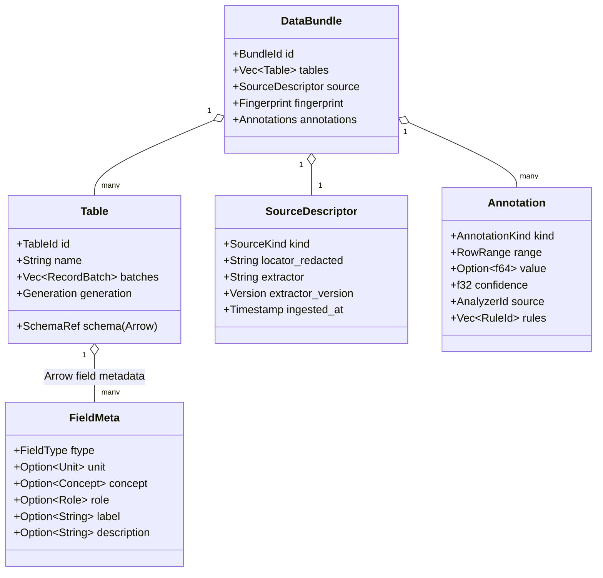

# 03 · Data Model

> **Status:** Baseline v1 (2026-10-18). Implemented in A03 (core types) and A04 (`sonarithm-data`).
> **Decision:** [ADR-0006 Arrow data model](../decisions/0006-arrow-data-model.md). **Related:** [10-ingestion-and-extraction.md](10-ingestion-and-extraction.md), [05-compiler-and-score-ir.md](05-compiler-and-score-ir.md).

## 1. Goals

1. **One columnar model for every source.** Files, charts, functions and live streams all become the same structure.
2. **Zero-copy across boundaries.** Python (pyarrow, pandas, polars) and, later, JavaScript exchange data through the Arrow C Data Interface without copying.
3. **Semantics travel with the data.** Field type, unit, concept and role drive mapping defaults ([SDR-12..14](../research/design-rules.md#c-polarity)).
4. **Provenance travels with every value.** Exact and estimated numbers must never become indistinguishable ([P6](01-overview.md#2-architectural-principles)).
5. **Stable identity.** Every sound event can point back to the row that produced it, so navigation, announcements and linked selection work.

## 2. Core structures

| Type | Notes |
|---|---|
| `DataBundle` | The unit the compiler consumes. It usually holds one table. Multi-table bundles cover cases like a chart with several series sources, or functions sampled on several domains. |
| `Table` | An Arrow schema plus record batches. It is **immutable** once published. Edits produce a new `Generation`. |
| `FieldMeta` | Stored in Arrow field metadata under the `snr.` prefix (`snr.type`, `snr.unit`, `snr.unit.ucum`, `snr.concept`, `snr.role`, `snr.label`, `snr.description`), so it survives Parquet and Arrow IPC round trips. Values use the spec vocabulary (`quantitative`, `x`, …). An unreadable value is ignored with warning `SNR-DATA-040`; other keys, including unknown `snr.*` keys, are preserved. |
| `RowRef` | `(TableId, Generation, row: u64)`. It is stable for the life of a generation and is used by Score events, the NavTree and selections. |
| `RowRange` | A half-open range over one table generation. |
| `Fingerprint` | SHA-256 over a canonical Arrow IPC serialization: schema with sorted metadata, then batches in order. It is recorded in render manifests ([ADR-0013](../decisions/0013-determinism-and-provenance.md)). Implementation (A04): the batches are concatenated first and every array is rebuilt with zeroed slots under nulls, so chunking and computation history do not change it; table name, ID and generation are not covered. A bundle's fingerprint hashes a version tag and its tables' fingerprints in order. Pinned digests for the test corpus are checked on all three CI operating systems. |
| `Annotations` | Analyzer output (extrema, outliers, change points, periodicity, critical points, insights). It is separate from the tables, so re-analysis never mutates data. |

## 3. Field semantics

### 3.1 Field types

| `FieldType` | Arrow storage | Typical channel | Inference heuristics (A04) |
|---|---|---|---|
| `quantitative` | Int*, UInt*, Float*, Decimal | pitch, duration, loudness (never precise, SDR-23) | Numeric with more than 12 distinct values, or a declared unit |
| `temporal` | Date32/64, Timestamp, Duration; numeric years | time substrate | ISO-8601 parse success above 95%; integer column named `year` |
| `ordinal` | Dictionary or Int with declared order | pitch steps, duration | Declared, or small integer range with an ordered label set |
| `nominal` | Utf8, Dictionary | timbre (SDR-25), pan, series split | Strings, or low-cardinality integers named `*id`, `*type`, `*group` |

Inference is a **suggestion**. Users or specs override it, and every inference is reported as an `Info` diagnostic so screen-reader users hear what was assumed.

Implementation notes (A04): declarations in the spec's `data.fields` are merged before inference, which fills only what is left and reports each part it fills (`SNR-DATA-030` type, `031` role, `032` concept). Text whose values all belong to one ordered label set (months, weekdays, low–medium–high, Likert scales and similar) becomes `ordinal` and is stored as `Dictionary<UInt8, Utf8>` with the labels in rank order, so a key is the rank. An integer field is `ordinal` when it has at most 12 levels in a contiguous range and each level occurs about twice on average. Roles come from names first (`x`, `y`, `lower`, `upper`, `id`, `label`, `weight`), then `x` goes to the first temporal field, a field named like an axis, or the first strictly increasing number field (four rows or more); `y` goes to the first quantitative field. Concepts come from units first, then name tokens. The precision on the inference corpus (`crates/sonarithm-data/tests/corpus/csv`) is checked by a test (A04-T05: at least 95% for each of type, role and concept).

### 3.2 Units

Units are free text plus an optional UCUM code (`°C` / `Cel`). They are used in announcements ("0.42 degrees Celsius"), in axis legends (SDR-18) and in unit-aware lints.

### 3.3 Concepts and the concept table

A **concept** names what a field measures in perceptual terms (for example `temperature`, `velocity`, `mass`, `money`). It indexes the **concept table**, which supplies evidence-backed defaults:

| Concept | Default polarity | Ambiguity flag | Psychophysical exponent hint | Evidence |
|---|---|---|---|---|
| `velocity` | positive | — | per Walker 2007 table | SDR-12 |
| `pressure`, `urgency`, `danger`, `proximity` | positive | — | per table | SDR-12 |
| `temperature` | positive | — (flippable) | per table | SDR-12 |
| `mass` | negative | — | per table | SDR-13 |
| `size` | negative | **flagged** (split 9/0/10) | per table | SDR-13 |
| `money` | positive | **flagged** (BLV listeners lean negative) | 0.93 (Smith & Walker dollars) | SDR-14, SDR-11 |
| `attractiveness` | — (avoid pitch) | **flagged** | — | SDR-14 |
| `generic` (default) | positive | — | — | SDR-12 |
| `graph.degree`, `graph.centrality`, `graph.edge_weight`, `graph.path_length` | **unknown**; requires study before becoming defaults | **flagged** | — | SDR-41, H-05 |

The concept table is **data, not code**. It lives in `crates/engines/sonarithm-numisona/data/concepts.toml`, and each row cites its evidence. Changing a row follows the [design-rules change control](../research/design-rules.md#how-to-read-and-use-this-catalogue).

### 3.4 Roles

`x`, `y`, `series`, `category`, `weight`, `id`, `label`, `time`, `lower`/`upper` (intervals, error bars). Chart-type templates (PLOTSONA) and default specs use roles to pick encodings.

## 4. Provenance and confidence

Every table may carry two reserved columns:

| Column | Arrow type | Meaning |
|---|---|---|
| `__snr_prov` | `Dictionary<UInt8, Utf8>` (or UInt8 enum) | `exact`, `vector`, `cv_estimate`, `ml_estimate`, `cloud_estimate`, `user_edited`, `derived`, `synthetic`. A UInt8 column stores the position in this list (0 = `exact`). Sources also accept text; all forms are rewritten to the canonical dictionary over the eight names in this order, so a key equals the UInt8 code |
| `__snr_conf` | `Float32`, nullable | Confidence in [0, 1]. Null means not applicable (exact) |

Rules:

1. **Absent columns mean `exact`.** That covers ordinary data files.
2. **Transforms propagate provenance.** A derived value takes the *weakest* input class and the *minimum* confidence. Aggregates record `derived`, plus a flag when any input was estimated.
3. **Descriptions state numbers plainly only for `exact`, `vector` and `user_edited` values.** Other classes are announced with an estimate qualifier whose wording depends on verbosity ([keyboard-and-navigation](../design/keyboard-and-navigation.md)) ([research report §PLOTSONA](../research/research-report.md#plotsona-must-prefer-exact-data-and-label-every-estimate)).
4. **Low confidence may also be rendered in sound.** The renderer can give low-confidence values a distinct timbre (experimental, H-06), and the table view always shows provenance.

Propagation by transform (A04, `sonarithm_data::provenance` and the transforms in §6). Provenance is per row, so a row's class and confidence describe every value in it:

| Transform | Output provenance |
|---|---|
| `filter`, `sort` | Rows move with their provenance |
| `derive`, `bin`, `normalize` | Unchanged: a row's new value comes from that row; column statistics (`normalize`) are parameters, not inputs |
| `smooth` | The combination over the rows the value depends on (the window for `sma`, all earlier rows for `ema`) |
| `aggregate`, `resample` (`mean`) | `derived` combined with every input row of the group: an estimated input makes the result an estimate of that class, which is the flag rule 2 asks for |
| `resample` (`last`) | The chosen row's provenance |
| `resample` (`interpolate`) | `derived` combined with the two neighbouring rows; a grid point that is an input row keeps that row's provenance |

An invalid class, code or confidence stops loading with `SNR-DATA-041`.

## 5. Missing values and special numbers

| Case | Data model | Default sonic treatment | Configurable |
|---|---|---|---|
| `null` | Arrow null | Silence for the slot, plus an optional "gap" earcon in exploration mode | Yes (`missing: "silence" \| "earcon" \| "interpolate"`) |
| `NaN` | Normalized to null at ingest, with a diagnostic | As null | — |
| `±∞` | Kept, flagged by a diagnostic | Clamp to the range edge plus an "off-scale" earcon (A11Y-28 for functions) | Yes |
| Out-of-domain values | Kept | Clamp plus an off-scale cue | Yes |

## 6. Transforms

Transforms are declared in the spec ([04-sonification-spec.md §4](04-sonification-spec.md#4-transform)) and executed by `sonarithm-data` in order. Each one is a pure function `Table → Table` that propagates provenance and records itself in the bundle's transform log, which the render manifest includes.

| Op | Purpose | Notes |
|---|---|---|
| `filter` | Row selection | Expression in a restricted rhai subset, with no side effects |
| `sort` | Ordering | Stable sort |
| `aggregate` | Group-by with sum, mean, median, min, max, count | Records `derived` provenance |
| `bin` | Histograms | Equal-width, quantile, or explicit edges |
| `smooth` | Volatility reduction (SDR-21) | `ema`, `sma`, `loess` (later) |
| `resample` | Regularize temporal data | `mean`, `last`, `interpolate` |
| `derive` | New field from an expression | Sandboxed rhai, fuel-limited |
| `normalize` | z-score, min–max, rank | Used by multivariate presets |
| `pca` (D01) | Dimensionality reduction for TONALENS | ndarray-based |

The expression language (A04) is one rhai *expression* per row, evaluated by a raw engine: fields are variables (or `col("name")` for any name); missing values are `()`, arithmetic with them gives `()` and comparisons with them are `false`; `is_null` and `coalesce` handle them explicitly; maths functions (`exp`, `ln`, `pow`, `sin`…) go through `sonarithm_core::math`, and `**` is disabled, so results are identical on every platform (ADR-0013). Statements, loops, user functions, closures, modules, `eval` and printing are not available, and each row may use at most 10 000 operations (`SNR-DATA-054`). A row on which the expression fails at run time (for example division by zero) gets a missing value, or is dropped by `filter`, and one warning (`SNR-DATA-053`) reports the count. Every transform reports its rows in and out (`SNR-DATA-056`) and appends itself to the bundle's transform log.

## 7. Downsampling and views

The UI never receives more points than it can draw. `sonarithm-data` provides:

- **M4** (min, max, first, last per pixel column) for pixel-exact line rendering at any zoom ([M4, VLDB 2014](https://www.vldb.org/pvldb/vol7/p797-jugel.pdf)).
- **LTTB** for overview sparklines and thumbnails.
- **Tiles.** Multi-resolution M4 tiles are cached per (table generation, x-range, pixel width).

Downsampling affects **only the visual view**. Sonification always reads the full-resolution data, unless the spec explicitly asks for a transform.

Implementation notes (A04, `sonarithm_data::downsample`): both algorithms return row indices, so every drawn point keeps its `RowRef`. M4 maps x to pixel columns with `floor(w · (x − start) / (end − start))` (the right edge in the last column), keeps the first and last x and the minimum and maximum y of each column, and is tested to give exactly the pixels of the full polyline (Bresenham rasterization, rows sorted by x) and a subset of the paper's reference query. The tile cache keys on (table, generation, fields, x range, width) and evicts the least recently used tile by a counter, not a clock.

## 8. Streaming tables (SONOTRACE)

A `StreamTable` is an append-only, ring-buffered sequence of record batches with a monotonically increasing sequence number:

- **Capacity** is set by time window or row count, so memory stays bounded (B06 exit criteria).
- **Readers** take cheap snapshot views `(seq_from, seq_to)`.
- **Incremental compilation** encodes only new rows ([05 §6](05-compiler-and-score-ir.md#6-incremental-and-live-compilation)).
- **Backpressure:** when the source outruns the window, the oldest rows are dropped and a diagnostic is raised. Rows are never silently skipped in the middle.

## 9. Interoperability

| Boundary | Mechanism |
|---|---|
| Python | Arrow C Data Interface (PyCapsule protocol) for pyarrow, pandas (via pyarrow) and polars, zero-copy where the layout allows |
| Files | Parquet and Arrow IPC (Feather v2) round trip, preserving `snr.` metadata |
| Desktop UI | Never raw tables. The UI receives downsampled views as binary buffers, and table pages through paged requests ([09-desktop-app.md](09-desktop-app.md)) |
| WASM (D05) | Arrow IPC buffers |
| Polars (optional) | Feature-gated adapter. Arrow stays the contract because Polars' Rust API breaks without deprecation ([04-rust-core-stack.md](../research/notes/04-rust-core-stack.md)) |
