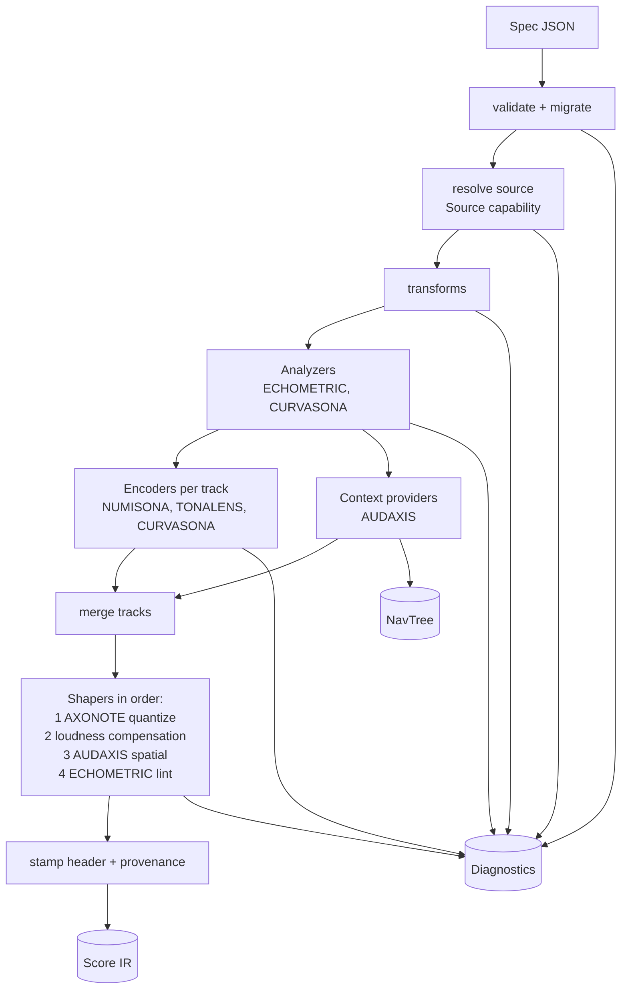

# 05 · Compiler, Engine Registry and Score IR

> **Status:** Baseline v1 (2026-10-18). Skeleton in A03, complete in A06.
> **Decisions:** [ADR-0005](../decisions/0005-declarative-spec-and-score-ir.md), [ADR-0007](../decisions/0007-engines-as-pipeline-capabilities.md), [ADR-0013](../decisions/0013-determinism-and-provenance.md).

## 1. Responsibilities

`sonarithm-compiler` turns **(spec, data) → (Score, NavTree, Diagnostics)**. It:

1. validates and migrates the spec (`sonarithm-spec`);
2. resolves the data source through registered **Sources** and applies transforms (`sonarithm-data`);
3. runs **Analyzers** and collects `Annotations`;
4. runs **Encoders** per track, and **Context** providers;
5. runs **Shapers** in a defined order, including lint;
6. builds the `NavTree` (AUDAXIS);
7. stamps the Score header with provenance (spec hash, data fingerprint, seed, engine versions).

The compiler is **synchronous, deterministic and wasm-compatible**. Parallelism (rayon) is an optional feature used per track and per analyzer. The results are merged in a fixed order, so parallelism never changes the output.

## 2. Pipeline



**Skeleton (A03-T09).** `sonarithm_compiler::Compiler<D>` runs these stages over whatever engines are registered: `sonarithm_spec::prepare` (validate, migrate, defaults, spec hash), then source, analyzers, encoders, context, shapers and the header stamp, checking cancellation between stages and the budget on every track. A capability nobody registered gives `SNR-COMP-010` naming the engine that would provide it; transforms run through `CompilerData::transform`, which the data layer's `DataBundle` implements with `sonarithm_data::apply_all` (A06; a data type without it gives warning `SNR-COMP-022`); a missing context provider gives `SNR-COMP-023`; the budget gives `SNR-COMP-021`; and a Score that breaks an invariant after compilation is reported as an engine bug (`SNR-COMP-020`, and a debug assertion). The compiler's data type implements `CompilerData` (its fingerprint for the header, and transforms). `sonarithm_compiler::Platform` is the platform data engine: it reads `inline` sources, and `file` sources relative to a base directory, into a `DataBundle` (A06).

**Shaper order is fixed and documented.** Quantization runs before loudness compensation, because compensation depends on the final pitch. Spatial placement runs before lint, so lint can see pan. Lint always runs last and never mutates the Score.

## 3. Engine registry and capability traits

Engines register capabilities at startup. The registry is a plain value (`Registry`), not a global, so tests, Python and WASM builds can construct their own.

```rust
// sonarithm-core::engine (sketch — signatures are finalized in A03)
pub trait Engine: Send + Sync + 'static {
    fn manifest(&self) -> &EngineManifest;          // id, display name, version, capabilities, spec keys
    fn register(&self, registry: &mut Registry);    // adds the capability objects below
}

pub trait Source: Send + Sync {
    fn kinds(&self) -> &'static [SourceKind];
    fn ingest(&self, req: &SourceRequest, cx: &mut IngestContext) -> Result<DataBundle, SourceError>;
}

pub trait Analyzer: Send + Sync {
    fn id(&self) -> AnalyzerId;                    // "extrema", "outliers", "critical-points", …
    fn analyze(&self, data: &DataView<'_>, params: &AnalyzerParams, cx: &mut CompileContext)
        -> Result<Vec<Annotation>, CompileError>;
}

pub trait Encoder: Send + Sync {
    fn marks(&self) -> &'static [MarkKind];
    fn encode(&self, track: &TrackSpec, data: &DataView<'_>, ann: &Annotations, cx: &mut CompileContext)
        -> Result<ScoreTrack, CompileError>;
}

pub trait ContextProvider: Send + Sync {
    fn context_tracks(&self, spec: &ContextSpec, score: &Score, data: &DataView<'_>, ann: &Annotations,
        cx: &mut CompileContext) -> Result<Vec<ScoreTrack>, CompileError>;
    fn nav_tree(&self, score: &Score, data: &DataView<'_>, ann: &Annotations) -> NavTree;
}

pub trait Shaper: Send + Sync {
    fn stage(&self) -> ShaperStage;                // Quantize | Loudness | Spatial | Lint
    fn shape(&self, score: &mut Score, cx: &mut CompileContext) -> Result<(), CompileError>;
}

pub trait VoiceProvider: Send + Sync {             // used by the plan builder, never on the audio thread
    fn instruments(&self) -> &[InstrumentDescriptor];
    fn create_voice(&self, inst: &InstrumentRef, cfg: &VoiceConfig) -> Box<dyn Voice>;
}

pub trait Sink: Send + Sync {                      // MIDI file, OSC, …
    fn kind(&self) -> SinkKind;
    fn write(&self, score: &Score, target: &mut dyn SinkTarget) -> Result<(), SinkError>;
}
```

**Implemented in A03** (`sonarithm_core::engine`, A03-T04) with the signatures of [ADR-0014](../decisions/0014-capability-trait-signatures.md): the traits and `Registry<D>` are generic over the compiler's data type `D`, spec input arrives as a `SpecFragment` (compact JSON plus its pointer), analyzer and shaper IDs are given at registration, and `Engine::register` returns a `Result`. `Sink`, `VoiceProvider` and `nav_tree` are added with their first implementations (A05, C04, B03).

**Resolution rules.**

1. A track's `engine` field selects its Encoder. If it is absent, the default is the first Encoder that registered the track's `mark` (NUMISONA for `tone` and `glide`).
2. A spec key owned by an engine that is not registered gives a validation error: `SNR-COMP-010 engine 'resonum' not available in this build`.
3. Two engines may not register the same `SourceKind`, `AnalyzerId`, `MarkKind` default or `ShaperStage` slot. Registration fails fast with `SNR-COMP-011` … `015`. This is how the "nine engines, one compiler" boundary stays clean ([ADR-0007](../decisions/0007-engines-as-pipeline-capabilities.md)). A mark's default is the engine that claims it explicitly, or else the first engine that registered the mark.

**`CompileContext`** provides:
- `rng(track_id)`: a deterministic RNG derived as `seed ⊕ hash(track_id)` (SDR-02);
- a diagnostics sink;
- a cancellation token (the UI cancels stale compiles);
- a budget (max events, max duration), which fails safely with a diagnostic;
- the concept table;
- the user profile overrides (polarity flips, ranges; SDR-15, SDR-38).

**A06:** the concept table and the polarity profile are held by NUMISONA, which owns them (`ConceptTable::builtin`, `Numisona::with_profile`), so `sonarithm-core` carries no engine data; every choice they make is reported as a diagnostic. An encoder's `TrackRequest` carries, besides the track, the spec sections every track's encoding depends on: `substrate` (owned by NUMISONA, RFC-0001 §2), `data.fields`, `data.missing` and the mode. These are additive fields in the spirit of ADR-0014 (spec input as fragments).

## 4. Score IR

The Score is the **canonical artifact** of SONARITHM: tests snapshot it, the renderer consumes it, sinks export it, and navigation indexes it.

```rust
// sonarithm-core::score (sketch)
pub struct Score {
    pub header: ScoreHeader,
    pub tracks: Vec<ScoreTrack>,
    pub markers: Vec<Marker>,            // insights, landmarks, sections, legend boundaries
}

pub struct ScoreHeader {
    pub ir_version: u32,                 // bump on any snapshot-format change
    pub spec_version: SpecVersion,
    pub spec_hash: Sha256,               // RFC 8785 canonical spec, defaults applied
    pub data_fingerprint: Fingerprint,
    pub seed: u64,
    pub mode: Mode,                      // Analysis | Presentation | Monitoring
    pub duration: Seconds,
    pub engines: BTreeMap<EngineId, Version>,
}

pub struct ScoreTrack {
    pub id: TrackId,
    pub role: TrackRole,                 // Data | Context | Earcon | Speech | Monitor
    pub engine: EngineId,
    pub instrument: InstrumentRef,
    pub gain: Db,
    pub pan: Pan,
    pub events: Vec<ScoreEvent>,         // sorted by start time, ties by insertion order
}

pub enum ScoreEvent {
    Note   { t: Seconds, dur: Seconds, pitch: Cents, gain: Db, pan: Pan, timbre: TimbreParams,
             taps: u8, src: Option<RowRef>, conf: Option<f32> },
    Glide  { t0: Seconds, t1: Seconds, curve: Curve, src: Option<RowRange> },   // breakpoints (t, cents, db, pan, brightness)
    Grains { t0: Seconds, t1: Seconds, density: Curve, params: GrainParams, src: Option<RowRange> },
    Audify { t: Seconds, buffer: BufferRef, k: f64, gain: Db, src: Option<RowRange> },
    Earcon { t: Seconds, kind: EarconKind, gain: Db, src: Option<RowRef> },
    Speech { t: Seconds, text: String, priority: Priority, src: Option<RowRef> }, // routed to announcer or sidecar
    Excite { t: Seconds, model: ModelRef, params: ExciteParams },               // RESONUM (Stage D)
}
```

**Implemented in A03** (`sonarithm_core::score`, A03-T03). Differences from the sketch above: events are serialized with a `type` tag (`Earcon` has its own `kind`); `ScoreTrack` records its resolved `pitch_range` (invariant 3, the loudness table and the spoken legend need it) and `ScoreHeader` records the `shapers` that ran (invariant 5); `Note.timbre` is `{ preset, brightness }`. IR version 1 has the `Note`, `Glide`, `Earcon` and `Speech` events; `Audify`, `Grains` and `Excite` are added, additively, when CURVASONA, TONALENS and RESONUM land (C03, D01, D02).

### 4.1 Representation choices

| Choice | Reason |
|---|---|
| Time in **seconds (f64)** in the IR, converted to frames at plan time with a fixed rounding rule (round half to even at the output sample rate) | Sample-rate independence; deterministic conversion |
| Pitch in **cents relative to A4 = 440 Hz (f64)** | Exact for MIDI and microtonal values; Hz conversion happens at plan time |
| `src: RowRef` on every data-derived event | Navigation, value announcements on pause, linked selection, provenance-aware rendering |
| `conf` on events derived from estimated data | Lets the renderer and announcer treat estimates differently (H-06) |
| `Speech` events are **not rendered to audio by default** | The OS or screen-reader TTS cannot be rendered deterministically. Exports include them as a WebVTT sidecar ([06 §7](06-audio-engine.md#7-export)) |
| `BTreeMap` and sorted `Vec`s only | Stable ordering, so snapshots are stable (no `HashMap` iteration in outputs) |

### 4.2 Invariants (property-tested)

1. Events in a track are sorted by start time, and `t ≥ 0`.
2. `t + dur ≤ header.duration` for notes. Glides are monotonic in time.
3. Every pitch lies within the resolved channel range after polarity is applied.
4. Flipping polarity mirrors pitches within the range (`f(lo + hi − x)`), and every other field is unchanged. The mirror is taken in the pitch space's coordinate: in the default log-frequency space it is the cents mirror `low + high − pitch` (`PitchRange::mirror`); in linear-frequency, mel, ERB-rate and Bark spaces it is the mirror in hertz, mel, ERB-number or Bark ([F-080](../research-paper/findings-log.md#f-080--a-polarity-flip-mirrors-pitches-in-the-pitch-spaces-own-coordinate-which-equals-the-cents-mirror-only-in-log-frequency)).
5. `mode = Analysis` ⇒ no quantization shaper ran (SDR-10).
6. The same (spec, data, seed, engine versions) produce a byte-identical **full-precision** serialized Score on every platform (H-08). This requires platform-independent maths (`libm`) for every Score-affecting computation ([ADR-0013](../decisions/0013-determinism-and-provenance.md)).

### 4.3 Snapshot format

Two forms exist. The **canonical form** is a full-precision serialization whose SHA-256 is recorded in each golden test case and in render manifests. This is what "byte-identical" refers to. It is compact JSON: struct fields in declaration order, map keys sorted, integers exact, floats as the shortest decimal that round-trips, finite numbers only; a Score that breaks an invariant has no canonical form (`Score::canonical_json`, `Score::canonical_hash`). The **review form** is a human-readable JSON snapshot through `insta`, with floats rounded to 1 µs for time, 0.01 cents for pitch and 0.01 dB for gain, so diffs stay legible. Large Scores are snapshotted as **summaries** (counts, extents, hashes of event arrays) plus the first and last N events. The golden-file policy is in [testing-strategy.md](../engineering/testing-strategy.md).

## 5. From Score to RenderPlan

The renderer never interprets the Score directly on the audio thread. A **plan builder**, running on a worker thread, converts it:

| Step | Output |
|---|---|
| Resolve instruments → `VoiceProvider::create_voice` | A preallocated voice pool per instrument (polyphony from analysis of overlapping events, plus headroom) |
| Convert times to frames at the device or export sample rate | `Vec<PlannedEvent>` per voice group, sorted |
| Convert curves to per-block breakpoint segments | Automation lanes |
| Load buffers (audify data, samples) into `Arc<[f32]>` | Shared, immutable resources |
| Compute the loudness-compensation table for the pitch range (SDR-24) | Static table |
| Package as `RenderPlan` behind `basedrop::Shared` | Swapped into the audio thread lock-free ([06 §4](06-audio-engine.md#4-real-time-communication)) |

**Implemented in A05** (`sonarithm_render::plan`, A05-T03). Each track gets one voice pool, sized at twice the polyphony of its events, so voices fading out during a seek or loop crossfade never force a steal. A note with `taps > 1` becomes that many tones of equal length. Every tone lasts at least two SDR-22 ramps, so notes shorter than 10 ms are lengthened. Glide breakpoints stay in cents and dB, and the voice interpolates them at a fixed control rate. Unknown instrument names raise `SNR-RENDER-001` and fall back to the default preset.

## 6. Incremental and live compilation

| Situation | Strategy |
|---|---|
| A UI edit to one track's channels | Re-encode only that track (cache key: hash of track spec + data generation + annotations hash), re-run shapers, and diff the plan |
| A UI edit to context or analysis | Re-run the affected analyzers and context providers |
| Streaming data (SONOTRACE) | **Live mode:** encoders implement `encode_incremental(rows_since: Seq)`, emitting events for new rows only. Shapers that need global information (lint, dynamic reference extremes) run on a sliding window. Events are pushed to the audio thread through the live-event queue, not by plan swap |
| A cancelled compile | The cancellation token is checked between stages and every N rows. Partial results are discarded |

## 7. Diagnostics

```rust
pub struct Diagnostic {
    pub severity: Severity,             // Error | Warning | Info
    pub code: &'static str,             // e.g. "SNR-SPEC-012", "SNR-LINT-003"
    pub rules: Vec<RuleId>,             // e.g. [SDR-19]
    pub message: String,                // short, cause + fix, unit-bearing
    pub location: Option<SpecPointer>,  // JSON pointer into the spec
    pub data: Option<RowRange>,
}
```

- **Errors** stop compilation. Warnings and Info do not, unless the CLI is run with `--deny-warnings`.
- Every applied default produces an `Info` with the rule it implements. This is the "explain what you assumed" principle, important for screen-reader users who cannot see the inspector.
- Diagnostics are announced through AUDAXIS when they change, rate-limited.

## 8. NavTree (summary)

The NavTree is built by AUDAXIS from (Score, data, annotations). It is documented in [08-interaction-and-accessibility.md](08-interaction-and-accessibility.md#2-the-navigation-model). The compiler returns it alongside the Score, so the CLI's `inspect` command and the Python API can expose the same structure (for example to generate accessible text reports).
