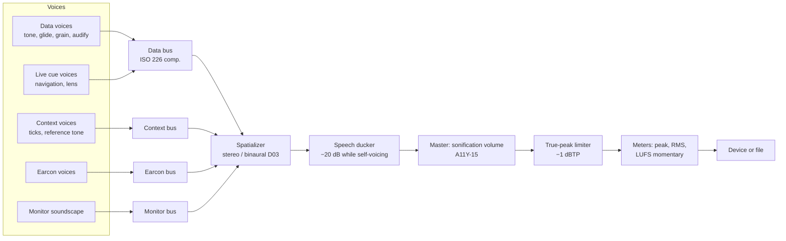

# 06 · Audio Engine: Render Graph, Backends and Export

> **Status:** Baseline v1 (2026-10-18). Built in A05, after the A02 graph decision.
> **Decision:** [ADR-0004 Audio backend and render graph](../decisions/0004-audio-backend-and-render-graph.md). **Rules:** [coding-standards §Real-time audio](../engineering/coding-standards.md).
> **Evidence:** [notes/04-rust-core-stack.md](../research/notes/04-rust-core-stack.md) §§1–4, 13–14.

## 1. Goals

1. **One render path** for real-time playback and offline export ([P4](01-overview.md#2-architectural-principles)).
2. **Glitch-free.** Zero xruns at 128-frame buffers on reference hardware (A05 exit).
3. **Interactive.** A key press reaches the onset of its cue in ≤ 50 ms p95.
4. **Deterministic export.** The same Score gives the same audio within tolerance across platforms (H-08).
5. **Replaceable edges.** cpal and any third-party graph sit behind our traits.

## 2. Threading model

```mermaid
flowchart LR
  subgraph NonRT["Non-real-time threads"]
    UI[Tauri / IPC handlers<br/>tokio]
    CTRL[Control thread<br/>transport, cues, live events]
    PB[Plan builder<br/>worker pool]
    GC[basedrop collector<br/>deferred frees]
    TEL[Telemetry pump<br/>30–60 Hz]
  end
  subgraph RT["Audio thread (device callback)"]
    G[RenderGraph.process(block)]
  end
  UI --> CTRL
  CTRL -- rtrb SPSC: Command --> G
  PB -- basedrop Shared: RenderPlan --> CTRL
  CTRL -- rtrb SPSC: PlanSwap / LiveEvent --> G
  G -- triple_buffer: EngineState --> TEL
  G -- drop old plan --> GC
  TEL -- Tauri Channel: clock anchors, meters --> UI
```

| Thread | May allocate or lock | Responsibilities |
|---|---|---|
| Audio (RT) | **No** | Process blocks, dispatch scheduled events, apply commands, publish state |
| Control | Yes | Owns the transport state machine (authoritative), translates UI intents to `Command`s, feeds live events (cues, lens, streams) |
| Plan builder | Yes | Score → RenderPlan ([05 §5](05-compiler-and-score-ir.md#5-from-score-to-renderplan)) |
| Collector | Yes | Frees retired plans and buffers off the RT thread (basedrop) |
| Telemetry pump | Yes | Reads the triple buffer, sends clock anchors **only on change**, batches meter frames into binary Channel messages |

## 3. Render graph



| Component | Implementation | Notes |
|---|---|---|
| Voices | `trait Voice { fn note_on(..); fn note_off(..); fn set_param(..); fn process(&mut self, out: &mut [f32]) }`, built from fundsp graphs or custom nodes | Preallocated. Polyphony is fixed per plan. Voice stealing takes the oldest or quietest voice and raises a counted diagnostic |
| Envelopes | ADSR with **mandatory ramps ≥ 5 ms** (default about 40 ms onset per SDR-22) | Never zero |
| Oscillators | fundsp PolyBLEP saw/square, sine, triangle; wavetable (custom); FM | The square preset serves BLV chart reading (SDR-29) |
| Granular | Custom node: grain pool, density-driven scheduler, Hann windows | SDR-32; D01 |
| Audifier | Custom node: resampling playback of `Arc<[f32]>` with rubato | SDR-31; C03 |
| Modal | Custom resonator bank (excitation → damped sinusoids) | SDR-33; D02 |
| Loudness compensation | Per-voice gain from an ISO 226:2023-derived table indexed by pitch | SDR-24; precomputed in the plan. A05: ISO 226:2023 Formula (1) with Table 1 at 60 phon (provisional), normalized so the least sensitive pitch of the track's range plays at 0 dB and nothing is boosted; skipped if the Score's header lists a loudness shaper |
| Spatializer | Constant-power pan; ITD/ILD; SOFA HRTF convolution via sofar (D03) | SDR-30 |
| Limiter | Look-ahead true-peak limiter on master | Hearing safety |

### 3.1 Own graph or Firewheel

A02 built both behind the same contract and measured them ([A02 gate report](../sdlc/reviews/A02-prototype-gate.md#spike-2-render-graph-owned-versus-firewheel-a02-t02-t03)). **Decision: the owned graph** ([ADR-0004](../decisions/0004-audio-backend-and-render-graph.md), confirmed at the A02 gate).

Firewheel 0.14 produced bit-identical output at the same CPU cost. It brings no synthesis voices, adds 43 crates, and allocates on the audio thread by default when an event buffer fills (F-035).

The contract has two halves (F-036):

- a control half on a non-real-time thread: `prepare` builds the voice pools and schedule, `update` is the control tick, `seek`. It is not `Send`: it stays on the thread that built it.
- a `GraphProcessor` moved to the audio thread: `process(out)` renders one block, with every event at its exact sample offset, and publishes counters through atomics.

## 4. Real-time communication

| Channel | Direction | Mechanism | Payload |
|---|---|---|---|
| Commands | Control → RT | `rtrb` SPSC ring, fixed capacity (1024) | `Play`, `Pause`, `Seek(frames)`, `SetSpeed(f32)`, `SetLoop`, `SetGain(bus, Db)`, `TriggerCue(CueId, params)`, `StopAll`; `Earcon(EarconSound)` plays an earcon live on the earcon bus (B03-T06) |
| Plan swap | Control → RT | `rtrb` carrying a `basedrop::Shared<RenderPlan>` | A new plan, applied at the next block boundary with crossfade |
| Live events | Control → RT | `rtrb` SPSC, timestamped with a target frame | Stream-derived notes, lens events, excitations |
| Engine state | RT → telemetry | `triple_buffer` | Sample position, host timestamp of the block, playing flag, speed, xrun count, peak/RMS per bus |
| Retired resources | RT → collector | basedrop handles | Old plans, buffers |

**Capacity overflow policy.** If the command ring is full, the control thread coalesces commands (latest seek wins). It never blocks the RT thread. Overflows are counted and logged off-thread.

**Implemented in A05** (`sonarithm_render::rt`, A05-T05). `realtime(graph)` returns the two halves: a `Controller` (control thread) and a `Processor` (audio thread). The audio thread applies at most 64 commands per block. A plan swap travels as a `basedrop::Owned<Graph>`, not a `Shared<RenderPlan>`: the new graph arrives with its voice pools already allocated, adopts the transport and levels of the old one, and the old graph fades out over 20 ms before the audio thread hands it to the collector. Live events and the retired-resource ring are not needed yet; they arrive with the first live sources (B03, B06).

## 5. Scheduler and transport

- **Score time vs device time.** The transport maps score seconds to device frames: `frame = start_frame + (t_score − t0) × sr / speed`. Changing speed changes only the mapping, never the pitch.
- **Sample-accurate dispatch.** Each block dispatches every event whose frame falls in `[block_start, block_end)`, at its sample offset inside the block.
- **Seek and scrub.** On seek, the scheduler binary-searches the next event index per voice group, and voices crossfade out in ≤ 10 ms. Scrub (drag or keyboard) is a stream of seeks plus short **scrub grains** that preview the local value.
- **Loop.** Loop points are wrapped seamlessly with a short crossfade.
- **Transport state machine.** The control thread holds the authoritative state: `Stopped → Playing ⇄ Paused`, `Seeking`, `Exporting`. The UI mirrors it with an XState machine and never assumes a transition succeeded until the authoritative state arrives.

**Implemented in A05** (`sonarithm_render::Graph`, A05-T04). The score position is an anchor plus a count of device frames times the speed, so it never accumulates rounding. A seek, loop wrap or resume restarts the events still sounding at the target part-way through, with a 5 ms fade-in, while the outgoing voices fade out over 10 ms. The search for such events is bounded by the track's longest event and by a cap of 256 events per track. Pause and "stop all audio" fade out over 20 ms (sound-design §5). Glides update pitch, gain, pan and brightness every 32 frames of the voice's own clock, so the output is bit-identical for any block size.

## 6. Backends

```rust
// sonarithm-audio (sketch)
pub trait AudioBackend {
    fn devices(&self) -> Result<Vec<DeviceInfo>, AudioError>;
    fn open(&mut self, cfg: &StreamConfig, graph: RenderGraphHandle) -> Result<StreamHandle, AudioError>;
    fn latency(&self) -> Option<LatencyInfo>;     // reported output latency, used for clock compensation
}
```

| Backend | Phase | Notes |
|---|---|---|
| `CpalBackend` | A05 | cpal 0.18: WASAPI (shared) / ASIO (feature), CoreAudio, PipeWire/PulseAudio/ALSA/JACK (feature). Stream rebuilds after device loss happen on the control thread |
| `OfflineBackend` | A05 | A plain loop at a fixed block size into a sink (file writer, null, analyzer) |
| `WebAudioBackend` | D05 | cpal's WebAudio/AudioWorklet host for `sonarithm-wasm` |
| `WasapiBackend` | A05 (accepted, [ADR-0016](../decisions/0016-windows-low-latency-backend.md)) | Windows: shared mode with the RAW stream option by default (no OEM enhancement APOs), exclusive mode as an opt-in low-latency setting. A02 measured cpal's shared mode at 123 ms p95 key-to-onset on the development laptop, against PB-01's 50 ms ([risk R-03](../planning/risk-register.md)) |
| CoreAudio exclusive (hog mode) | Later | Only if macOS measurements (pending, R-22) miss PB-01 |

**Implemented in A05** (A05-T06, `sonarithm_audio`). The trait differs from the sketch above in three ways. `open` takes the `Processor` half of `realtime(graph)`. `sample_rate(device)` lets the caller plan at the device's rate first. Latency is reported by the open `Stream`, not by the backend. Every backend wraps its callback in the same adapter: stereo is spread over the device's channels, late callbacks (more than 1.5 periods apart, from the device's own timestamps) are counted, and a panic is caught, after which the stream outputs silence and raises a fault flag. `Player` is the control-thread side of 06 §11. It rebuilds the stream on the default device after a loss or a fault, keeps the position, speed, loop and levels, and stays paused (sound-design §12 HS-05). A timer-driven `NullBackend` runs the same callback without hardware, for CI.

`WasapiBackend` (A05-T13, Windows only) opens shared mode with the RAW option by default and reports whether RAW is in effect. It falls back to default processing when the driver refuses RAW. Exclusive mode is opt-in. The device thread runs event-driven at real-time priority and counts underruns from the device clock. A stream on the default device rebuilds when the default changes. `sonarithm_audio::latency` (Windows) measures key-to-onset latency through `Command::Cue`, by loopback or by cable, and reports the calibration offset that `LatencyCalibration` stores per device (§9).

## 7. Export

| Artifact | Writer | Default | Notes |
|---|---|---|---|
| WAV | hound | 48 kHz, 24-bit PCM (or 32-bit float) | |
| FLAC | flacenc | 48 kHz, 24-bit | Pure Rust |
| MIDI (SMF) | midly via the AXONOTE Sink | Type 1, one track per Score track | Notes from `Note` events; glides as pitch-bend (±2 semitones per channel) or as quantized notes, user's choice |
| Render manifest | serde_json | `<name>.render.json` | Required. See below |
| Cue sidecar | WebVTT | `<name>.cues.vtt` | Speech and insight cues with timestamps. Gives Deaf/HoH users and players a text track (A11Y-24) |
| Stems | Per-bus WAV/FLAC | off | Data, context, earcons separately (Presentation workflows) |
| MP3, Opus, Vorbis | Optional features | off | MP3 via LAME is **LGPL** and never on by default |

**Render manifest (`*.render.json`).** Required by [ADR-0013](../decisions/0013-determinism-and-provenance.md):

```json
{
  "sonarithm": { "version": "0.1.0", "git": "<commit>", "engines": { "numisona": "0.1.0" } },
  "spec": { "version": "0.1", "hash": "sha256:…", "embedded": { } },
  "data": { "fingerprint": "sha256:…", "source": { "kind": "file", "name": "temps.csv" }, "provenance": { "exact": 1.0 } },
  "render": { "sampleRate": 48000, "blockSize": 256, "seed": 1729, "mode": "analysis", "durationS": 42.0 },
  "output": { "file": "temps.flac", "sha256": "…", "integratedLufs": -16.1, "truePeakDbtp": -1.2 },
  "platform": { "os": "windows", "arch": "x86_64" }
}
```

Paths are written **relative or redacted**, never as absolute user paths (privacy).

**Cue timing as built (B03-T07).** A cue lasts 3 s, or as long as its text takes to speak at the default rate when that is longer, and ends when the next cue starts, so cues are sequenced like speech and never overlap (A11Y-20; `sonarithm_export::cues::cues_at`). The speech ducker of §3 is `GainTarget::Duck` before the master gain, smoothed like every gain and replayed after a device change; `DUCK_LEVEL` is −20 dB (A11Y-20).

**Manifest as built in A05** (A05-T08, `sonarithm_export::manifest`). The fields above are written in camelCase, with these additions: `manifestVersion` (1); `score` (IR version and canonical Score hash); `render.loudnessCompensationPhon`; and `output.format`, `bitsPerSample`, `channels`, `frames`, `gainDb` (the static normalization gain) and `limitedFrames`. The `cues` object names the sidecar. The schema is generated into `schemas/sonarithm-render-manifest-1.schema.json`. Names keep only their last path component. The git commit, the embedded spec and the data source come from the caller, because the Score does not carry them. Cues last 3 s or until the Score ends (provisional, B03).

**Implemented in A05** (A05-T07). `sonarithm_render::OfflineRender` is the `OfflineBackend`: it plays the plan from its start in fixed blocks (256 frames by default). `sonarithm_export::write_audio` encodes the render block by block, so an export never holds the whole render as PCM. FLAC frames stay in memory, compressed, until the stream is written. Integer samples are scaled by 2^23 − 1, rounded half to even and clamped, without dither.

## 8. Determinism

| Source of variance | Control |
|---|---|
| Random numbers | Seeded per track (SDR-02); no OS entropy in render paths |
| Wall clock | Never read in compile or offline render |
| Sample rate and block size | Fixed per export and recorded in the manifest |
| Floating point and SIMD | Same code path everywhere. Denormals flushed (FTZ/DAZ). Golden comparisons use tolerances: peak null residual ≤ −90 dBFS, ΔLUFS ≤ 0.1 |
| Platform maths libraries | Compile-time and plan-time values (pitch conversion, scales, loudness tables) use pure-Rust `libm`, not the platform's `std` float functions, so the Score is byte-identical ([ADR-0013](../decisions/0013-determinism-and-provenance.md)) |
| Iteration order | No `HashMap` iteration in outputs |
| Threading | The offline renderer is single-threaded per Score (parallel only across independent exports) |

The **Score IR is the strict artifact** (byte-identical). Audio is compared within tolerance ([testing-strategy](../engineering/testing-strategy.md)).

## 9. Latency and clock synchronization

1. Each block records `(sample_position, host_time_at_output)`. The output time is estimated from the backend's timestamp plus a **per-device latency offset from calibration** ([ADR-0016](../decisions/0016-windows-low-latency-backend.md)). The reported device latency is only a fallback: A02 found cpal's prediction about 80 ms early on Windows (F-033).
2. The telemetry pump sends an **anchor** `(sample_position, host_time, speed, playing)` to the UI **only when state changes** (play, pause, seek, speed) and every 2 s as drift correction.
3. The UI extrapolates the playhead each animation frame from the anchor. Rendering cost is constant and IPC jitter is irrelevant.
4. **Interactive cue latency** = input handling + IPC + control enqueue + up to one block + device latency. The budget is ≤ 50 ms p95 at a 256-frame buffer and 48 kHz, measured by the loopback harness in A02 and B03.

## 10. Hearing safety and levels

- **Start-up.** Master gain starts at −20 dB and ramps over 500 ms. There are no full-scale onsets.
- **Limiter.** A look-ahead true-peak limiter at −1 dBTP on the master. Limiter activity is metered and warned about in lint when it is sustained.
- **Independent sonification volume** (A11Y-15), separate from the system volume. A **Stop all audio** command is always available (global shortcut).
- **Session comfort.** An optional reminder after long sessions (SDR-39, experimental).

**Implemented in A05** (A05-T09). `sonarithm_dsp::TruePeakLimiter` is stereo-linked. It estimates inter-sample peaks with a 4× polyphase interpolator and aims 0.2 dB under the ceiling. The required gain is the minimum over a 2 ms window, smoothed by a moving average over the same window, and recovers with a 100 ms release. The look-ahead and release values are provisional. The limiter delays the output by 101 frames at 48 kHz; the offline driver compensates, so frame 0 of an export is score frame 0. The start-up ramp is a property of playback graphs (`GraphConfig::new`). Offline renders (`GraphConfig::offline`) start as the Score does.

## 11. Failure handling

| Failure | Behaviour |
|---|---|
| Device lost or changed | The stream stops. The control thread rebuilds on the new default device and keeps the transport position. The UI announces "Audio device changed to …" |
| xrun | Counted in engine state. Repeated xruns trigger a diagnostic suggesting a larger buffer |
| Panic in RT code | Policy: RT code is panic-free by construction (no indexing without proof, no `unwrap`). The backend callback wrapper catches unwinds, outputs silence, sets a fatal flag, and the control thread tears the stream down and reports it |
| Plan build failure | The previous plan keeps playing; a diagnostic is shown |

## 12. Real-time rules (summary)

The audio thread must never allocate or free memory, take a lock, perform I/O or syscalls (including logging), panic or block on a channel, or run a loop not bounded by the block size and polyphony. Debug builds count the callback's allocations with `allocation-counter` (`assert_no_alloc`'s licence is not allowed, F-038), and CI runs a debug soak test that fails on any allocation. The full rules and review checklist are in [coding-standards.md](../engineering/coding-standards.md).
