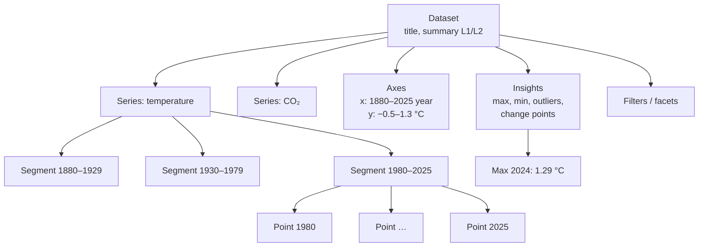
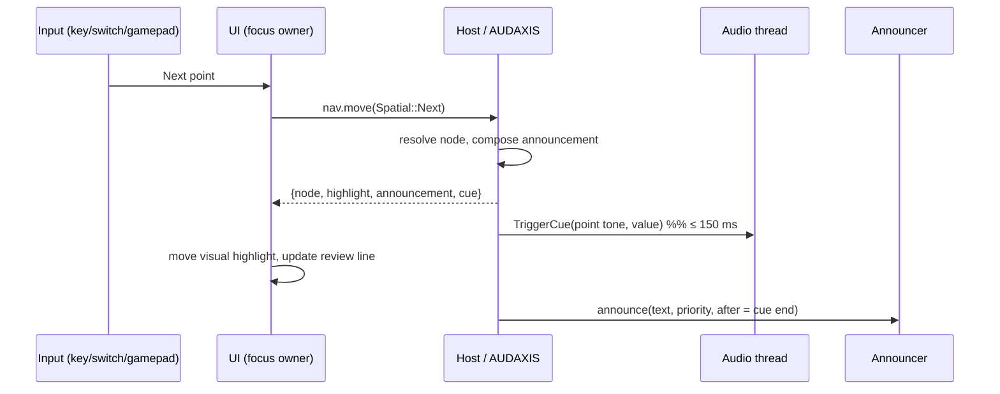
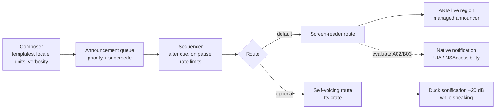

# 08 · Interaction and Accessibility Architecture

> **Status:** Baseline v1 (2026-10-18). Implemented in B03 (AUDAXIS v1), B02 (UI kit) and B07 (conformance).
> **Bindings and wording:** [design/keyboard-and-navigation.md](../design/keyboard-and-navigation.md). **Conformance:** [design/accessibility-conformance-plan.md](../design/accessibility-conformance-plan.md).
> **Requirements:** [A11Y-01..34](../research/design-rules.md#a11y-accessibility-requirements).

## 1. Principles

1. **One cursor, many modalities.** Sound, speech, braille, visual highlight and (later) haptics all render the *same* cursor (A11Y-10). No modality has private state.
2. **Overview first, then control, then the data** (Sharif et al. 2021; MAIDR). The default flow is: summary → play overview → explore → table.
3. **Structure is announced, not inferred.** Users always know where they are, what level they are on and where the boundaries are (Zong et al. 2022; A11Y-04, A11Y-07).
4. **The user's screen reader is the voice.** Speech goes through the user's assistive technology by default, preserving their voice, rate and braille routing (A11Y-19). Self-voicing is optional.
5. **Discrete steps underneath.** Every interaction resolves to a discrete navigation step, so keyboards, switches, gamepads and braille routing keys can all drive it (A11Y-27).
6. **The authoring UI is held to the same bar** as the exploration UI (A11Y-29).

## 2. The navigation model

AUDAXIS builds a **NavTree** for every compiled Score ([05 §8](05-compiler-and-score-ir.md#8-navtree-summary)).

| Node kind | Children | Generated from |
|---|---|---|
| `Dataset` | Series, Axes, Insights, Filters | Score header, data, spec |
| `Series` | Segments (bins) | Data tracks (`TrackRole::Data`) |
| `Axes` | One node per axis, with range, unit and polarity | Channel ranges and legends |
| `Insights` | One node per annotation | ECHOMETRIC and CURVASONA annotations |
| `Segment` | Points | Even bins or semantic segments (trend segments, decades, bars) |
| `Point` | — | A data row (`RowRef`) |
| `Node`, `Edge` (networks, Stage D) | Neighbours, incident edges | Graph data (Data Navigator model; requires H-05 before defaults ship) |

**Movement verbs** (keys in [keyboard-and-navigation](../design/keyboard-and-navigation.md)):

| Verb | Meaning | Example |
|---|---|---|
| Local | Parent / first child | Point → its segment; Series → first segment |
| Lateral | Same position in a sibling structure | Temperature @1980 → CO₂ @1980 |
| Spatial | Step along the ordering axis; jump by 10%; first/last | Next point; jump forward a tenth |
| Targeted | Jump to a landmark or a search result | Next insight; maximum; value nearest 1.0 °C |
| Where am I | Report position, level and neighbours | "Point 47 of 146, segment 1980–2025, series temperature" |

**Invariants** (property-tested): every node is reachable; no verb leaves the cursor undefined; boundary moves produce the boundary earcon and leave the cursor in place (Chart Reader "bonk", A11Y-08).

## 3. What a cursor move produces

| Output | Content | Controlled by |
|---|---|---|
| **Cue** | A short tone (≤ 150 ms) for the point's value, using the track's instrument and mapping. Boundary and invalid moves play earcons instead | Modality toggle "sonification" |
| **Announcement** | Composed text: value + unit, x position, optional series name, provenance qualifier for estimates, rank or insight tags | Verbosity (terse/verbose), part order (A11Y-12), modality "speech" |
| **Visual highlight** | Crosshair and marker on the plot; row selection in the table | Modality "visual" |
| **Braille review line** | A persistent focused text element with the current value. Braille "sparkline" for series overviews (A11Y-21) | Modality "braille" |

## 4. Announcement pipeline

| Concern | Policy |
|---|---|
| **Supersede** | Rapid navigation replaces queued, stale announcements. Only the latest cursor announcement survives (A11Y-17) |
| **Priority** | `polite` for navigation and status; `assertive` only for errors, device loss and true alarms |
| **Sequencing** | During playback, speech is suppressed except for alarms. On pause, the current value is announced (A11Y-09). During exploration, the announcement follows the cue (A11Y-20) |
| **Rate limits** | Streams: at most one announcement per N seconds per stream (configurable), with coalescing (A11Y-16) |
| **Routing (default)** | A single managed ARIA live region pair (polite and assertive) inside the webview. It uses the clear-then-set technique for reliable re-announcement. WebView2, WKWebView and WebKitGTK expose live regions to UIA, NSAccessibility and AT-SPI respectively |
| **Routing (native, to evaluate)** | Where live regions prove unreliable (queueing, double speech), a small Tauri plugin raises native notifications: `UiaRaiseNotificationEvent` on Windows, `announcementRequested` with priority on macOS. Linux stays on live regions/AT-SPI. Decided in the A02 spike and B03 |
| **Self-voicing** | `sonarithm-speech` (tts crate: SAPI/WinRT, AVSpeechSynthesizer, speech-dispatcher). For users without a screen reader or who prefer it. Because SONARITHM controls the timing here, it ducks the sonification bus while speaking |
| **Exports** | Speech never goes into the audio file. A WebVTT cue sidecar is produced instead ([06 §7](06-audio-engine.md#7-export)) |

## 5. Webview accessibility realities

The desktop UI runs in a system webview, so assistive technology treats it as **web content**. That brings the mature ARIA ecosystem, and also browse-mode behaviour that must be designed for:

| Issue | Design response | Verify in |
|---|---|---|
| NVDA and JAWS default to **browse mode** for web content, and capture arrow keys | Every region is a proper composite widget (`tree`, `grid`, `toolbar`, `tablist`), so screen readers switch to focus mode automatically. The chart exploration surface uses `role="application"` **only** inside the chart, with an accessible name, a description and an always-available help command | A02 (5), B03 |
| VoiceOver interaction model (VO keys, rotor) | Landmarks and headings for regions, rotor-friendly labelling, no reliance on VO-key combinations | B03 |
| Orca on WebKitGTK and Wayland is the least mature | It is part of the release matrix (A11Y-32). Known issues are tracked in the ACR. Electron is the fallback if it blocks (ADR-0002) | A02, B07 |
| Canvas and WebGL plots are invisible to assistive technology | The chart's accessible tree comes from the NavTree (DOM nodes generated on demand for the current neighbourhood), never from canvas pixels | B03, B04 |
| Focus visibility | Focus rings of 2 px or more with ≥ 3:1 contrast; nothing ever obscures focus (WCAG 2.4.11) | B02 |
| Shortcut conflicts | Single-key shortcuts are only active while the chart has focus, and can be remapped or disabled (A11Y-06). Default bindings avoid Insert, CapsLock and Ctrl+Option combinations | B03 |

## 6. Modalities, profiles and settings

- **Modalities** (A11Y-10): `sonification`, `speech`, `braille`, `visual`, `haptics` (future). Each toggles independently and persists in the user profile.
- **Profiles** (SDR-38) bundle pitch range, polarity flips per concept, timbre preset, discrete vs continuous mark preference, pace, verbosity, announcement order, modalities and keymap overrides. Presets ship for "BLV chart reading", "Analyst", "Classroom" and "Presentation" ([sound-design](../design/sound-design.md)). Profiles are portable JSON, schema-validated and importable.
- **Precedence:** built-in defaults < user profile < project < spec < explicit UI action. The effective value of any setting is inspectable, and announced on request.

## 7. Non-audio equivalents (Deaf, hard-of-hearing and DeafBlind users)

Every sonified insight has a text, visual or braille equivalent (A11Y-24):
- an insights list and data table (always available);
- a visual highlight of the cursor and insights;
- WebVTT cue sidecars on export;
- earcons with text equivalents in the announcement history panel;
- a braille review line.

## 8. Input methods

| Input | Support |
|---|---|
| Keyboard | Full (A11Y-05); F6 region cycling; command palette for every action |
| Pointer | Hover and scrub on plots, with single-pointer alternatives to dragging (A11Y-26); the minimum target size is met |
| Switch access / scanning | The discrete-step model plus the command palette. A "next action" scanning order is defined for the transport and the cursor |
| Gamepad | D02 maps it for RESONUM excitation; navigation mapping is optional from B03 (DIXTRAL precedent) |
| Braille routing keys | Routing on the review line moves the cursor to the corresponding point (where the screen reader supports it) |
| Voice commands | Out of scope until Stage D; OS-level voice control works through standard accessibility |

## 9. Localization of announcements

Templates are localized with **Fluent** (`fluent-rs` on the Rust side; the same message IDs in the frontend). Numbers, dates and units are formatted with ICU4X per locale. Unit names are spoken in full at verbose and abbreviated at terse ("°C" → "degrees Celsius"). English ships in B03 and a second locale in B07 to prove the pipeline.

## 10. Open questions (tracked in [open-decisions](../planning/open-decisions.md))

| ID | Question | Settled by |
|---|---|---|
| OD-05 | ARIA live regions only, or a native notification plugin, per OS? | A02 spike (5), B03 |
| OD-06 | Default keymap for lateral and local moves | B07 co-design round 1 |
| OD-07 | Is the timbre treatment for low-confidence data helpful or confusing for BLV users? | H-06 / P08 study (D06) |
