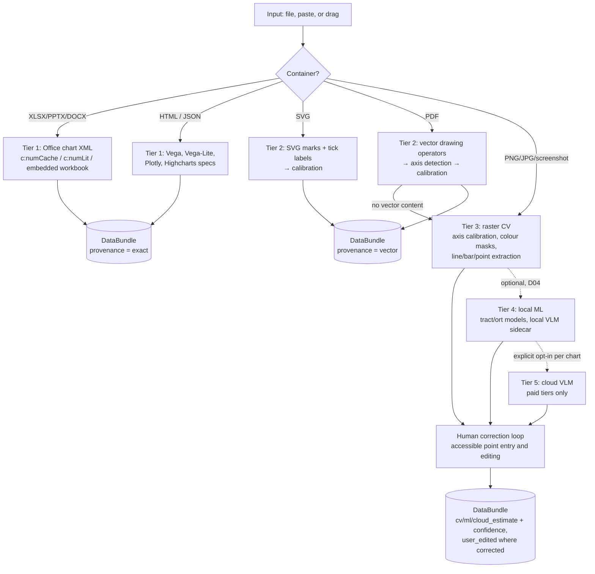

# 10 · Ingestion, Chart Extraction and AI Assistance

> **Status:** Baseline v1 (2026-10-18). File ingestion A04; streams B06; exact chart extraction C01; raster C02; ML and AI D04.
> **Decision:** [ADR-0008 Offline-first extraction and AI](../decisions/0008-offline-first-extraction-and-ai.md). **Evidence:** [notes/06-chart-extraction-ai.md](../research/notes/06-chart-extraction-ai.md).

## 1. Principle: exact before estimated, and label every estimate

Many "chart images" are not really images. Office charts carry their values, web charts carry their data objects, and vector PDFs carry exact geometry. Machine-learning extraction of line charts from raster images is still weak: most models score about 18–39 RMS-F1 on the 2026 WB-ChartExtract preprint. So SONARITHM **tries exact paths first, falls back step by step, and records the provenance class of every value** ([03 §4](03-data-model.md#4-provenance-and-confidence)).

## 2. Source adapters

| Source | Crate / engine | Phase | Notes |
|---|---|---|---|
| CSV, TSV | `sonarithm-data` (csv) | A04 | Delimiter, encoding and header sniffing; locale-aware decimals (opt-in) |
| JSON, NDJSON | `sonarithm-data` | A04 | Records or columns; JSON pointer to the array |
| Parquet, Arrow IPC | `sonarithm-data` (arrow, parquet) | A04 | Preserves `snr.` metadata |
| XLSX, ODS | `sonarithm-data` (calamine) | A04 | Sheet and range selection; formulas take cached values |
| Python objects | `sonarithm-py` | A07 | pyarrow, pandas or polars via the Arrow C Data Interface |
| Functions | CURVASONA | C03 | Expression + domain; adaptive sampling |
| Streams | SONOTRACE / `sonarithm-stream` | B06 | WebSocket, MQTT, serial, OSC-in, file tail |
| Charts | PLOTSONA | C01–C02, D04 | §3 |
| SQL | Later (`sqlx`, feature-gated) | post-1.0 | Read-only queries |

All sources have **size and time budgets** (configurable). They report what they inferred as diagnostics, and run untrusted input through fuzzed parsers.

## 3. The "bring any chart" pipeline (PLOTSONA)

| Tier | Method | Provenance | Expected quality | Phase |
|---|---|---|---|---|
| 1 | Read the data the chart was built from (Office XML caches; chart JSON) | `exact` | Lossless | C01 |
| 2 | Geometry + calibration from vector graphics (SVG, PDF operators). ChartDetective reported 78% lower error than raster digitizing | `vector` | Near-exact | C01 |
| 3 | Classical CV, re-implementing WebPlotDigitizer's *documented* workflow (calibration, colour masks, averaging window, X-step, bar and blob extraction). **WPD code is never copied** (AGPL) | `cv_estimate` + confidence | Good on clean charts; C02 target median ≤ 2% | C02 |
| 4 | Local ML: mark detection + classical calibration (better than end-to-end chart-to-table); self-consistency sampling for confidence (OneChart-style) | `ml_estimate` + confidence | Variable; benchmarked before release | D04 |
| 5 | Cloud VLM, **opt-in per chart**, paid API tiers only (no-training terms) | `cloud_estimate` + confidence | Best models strong but hallucination-prone | D04 |

### 3.1 Calibration and validation checks

- Axis calibration supports linear, log and date scales, plus polar and ternary later. Tick labels are read by OCR (Florence-2 class models in D04, classical OCR before that) **or entered by the user**. The point-entry path is fully keyboard-accessible.
- **Sanity checks** run before acceptance: monotonic tick spacing, label/scale consistency (log vs linear detection), series count against the legend, and points within the plot bounds. Failures become diagnostics, never silent fixes.
- **As built (C01-T04).** `sonarithm_plotsona::calibrate` fits a least-squares line from the scale's transform of the anchor values (identity for linear and date axes, `log10` for log axes) to drawing positions. The residual is the root-mean-square distance of the anchors from that line as a share of their position span; above 0.5 % it is reported (`SNR-ENG-325`), and values read through the axis get a confidence of 1 − 10 × residual (a convention until the C01 corpus checks it). Tick labels become anchors through `calibrate::ticks`: numbers with separators, the Unicode minus, SI suffixes (d3-format's `k`, `M`, `G`, `m`, `µ`…, and `B`), exponents and superscript powers of ten; ISO and month-name dates, and d3 multi-scale ticks where month names continue the last year tick. A label it cannot read is skipped and reported (`SNR-ENG-326`), never guessed. The checks are `check_monotonic` (an error, `SNR-ENG-322`), `check_scale` (a log axis read as linear or the reverse, from three anchors: `SNR-ENG-323`), `Calibration::check_bounds` (`SNR-ENG-324`) and the residual. `fit_auto` picks log over linear only when its residual is ten times smaller. Category axes read the nearest label within half the gap to its neighbours. Codes `SNR-ENG-320` to `326`.
- **As built (C02-T02, the raster core).** `sonarithm_plotsona::raster` decodes PNG and JPEG with the `image` crate's decoders only, after checking the size in the header against a pixel budget (50 megapixels by default) and setting the decoder's allocation limit from it, so a decompression bomb stops before its pixels exist. Transparent pixels are composited onto white. The axes are found as the lowest group of dark rows (luma below 128) whose longest dark run spans half the width, and the leftmost such group of columns; the plot area lies between them. Calibration comes from anchors the user enters in pixels (RFC-0004 §5: y down, a pixel's centre at +0.5), two or more per axis, linear, log or date, fitted by C01-T04's core; a category axis is refused. Each value read at a pixel carries the range of values half a pixel either side (`Estimate`), the uncertainty a raster cannot remove. Nothing is read by OCR (C02-T07 waits on OD-23). The workflow follows WPD's user documentation (register CR-01); the search, thresholds and uncertainty model are SONARITHM's own.
- **As built (C02-T03, lines).** A PNG or JPEG chart is read only with a calibration (`data.source.calibration`; without one, `SNR-ENG-328`); a category x axis is now calibrated from its labels, each an anchor, their indices fitted linearly to their positions. The plot area is the calibration's `plotArea`, else the one the axis lines bound, else the box the anchors span. `raster::colour` filters pixels by colour: foreground (pixels within a distance of the colour; Euclidean in 8-bit RGB, 70 by default) or background (pixels farther than that from it), inside box and pen masks. With no colour given, the series colours are found automatically: colours counted in buckets of 8 levels per channel, greys and paler tints of a colour already chosen skipped, and each series' threshold lowered to half its distance to the nearest grey and to the nearest other series colour (Vega's blue lies 70 from its grey axis line). `raster::lines` has the averaging window (column strips the curve's width wide, split where pixels are more than that apart, each part's closeness-weighted centre) for a continuous x, and X step at given positions (the run nearest the previous point) with natural-cubic-spline interpolation of gaps for a category x, sampled at the labels (custom independents). Each value is `cv_estimate` with a confidence: the mean colour closeness of its pixels times one minus the half-pixel uncertainty as a share of the plot's value span; interpolated values have closeness 0.5. The series' confidence is the median, and every value's goes to `__snr_conf`. Series are named `Series 1`, `Series 2`… (no legend OCR). The documentation names these algorithms and their parameters (register CR-01); how they group, choose and weight pixels is SONARITHM's design, and the spline is the textbook one (CR-07).
- **As built (C02-T04, bars and points).** Each series colour's pixels are grouped into 8-connected components (`raster::components`: two passes with a union-find, register CR-08), and the colour is classified: bars when the bars found in it that stand on (or hang from) the baseline, the row of value 0 clamped into the plot area, cover 80 % of its pixels; points when three or more components are marker-sized (2 pixels to 4 % of the plot's width) and hold half its pixels; otherwise a line (C02-T03). Bars (`raster::marks::bars`) are profiled column by column; a component with holes in its columns (hollow markers) is not a bar; columns split into bars where one is missing or the top or bottom moves by more than 1.5 pixels, so touching histogram bins of different heights separate, while touching bins of equal height stay one. The value is read at the end away from the baseline, at the pixel boundary. Markers (`raster::marks::markers`) are components within the diameter range, at their closeness-weighted centre; a larger blob with 1.5 to 6 times the median marker's area is that many touching markers, separated by k-means (Lloyd, CR-08) and given proportionally lower confidence; pieces under half the median area are fragments of one hollow marker, joined when within a marker's diameter of each other. A category x gives a bar chart, a numeric x a histogram (bin centres) or a scatter plot. CR-01 names the bar extraction with step and value tolerances and the blob detector with minimum and maximum diameters; the profiling, splitting, classification and separation are SONARITHM's design. Only vertical bars are read; horizontal bars need a category y axis.
- **Human in the loop.** Estimated data opens in a correction view: a table of extracted points with confidence, and an overlay on the image. The workflow is usable by keyboard and screen reader (navigate points, hear them, edit values). Corrected values become `user_edited`.

## 4. AI assistance policy

AI features **phrase facts; they do not produce them** ([research report §LLM features](../research/research-report.md#llm-features-should-phrase-facts-not-produce-them)).

| Feature | Design | Guardrails | Phase |
|---|---|---|---|
| Descriptions L1/L2 | Computed deterministically by ECHOMETRIC | No LLM involved | C05 |
| Description L3 (trends) | An optional LLM phrases a **precomputed fact list** | Every number in the output is checked against the fact list. Unverifiable numbers are removed, and the output is labelled "AI-phrased" | D04 |
| Description L4 (interpretation) | Only on explicit request | Labelled as interpretation. Never in default summaries (A11Y-02) | D04 |
| Natural-language Q&A | The model writes a small query (restricted DSL) over the table; ECHOMETRIC executes it | Answers cite the query and the rows used. The model never reads pixels for numbers | D04 |
| Mapping suggestions | A transparent rule engine (design rules + concept table) proposes; an LLM may only rank or explain | Suggestions show the rules they rest on | D04 (rules engine from A06) |
| Chart extraction | Tiers 4–5 above | Provenance and confidence on every value | D04 |

**Runtime and licensing.** Local inference runs through tract (default, wasm-capable) or ort (opt-in, `load-dynamic`). Local VLMs run in a **llama.cpp sidecar** process, isolated from the app. Only models with Apache-2.0 or MIT weights are offered (for example Qwen2.5-VL-7B, Qwen3-VL-8B, Florence-2, DePlot). **No bundling of GPL code (ChartGemma) or BSL weights (Moondream 3).** Models are never bundled in the installer. They are downloaded on explicit request with checksums ([supply-chain policy](../engineering/supply-chain-and-licensing.md)).

**Privacy.** Cloud calls require per-action consent showing the provider, what is sent and its retention terms. The default is local-only. API keys live in the OS keychain, never in project files ([ADR-0012](../decisions/0012-privacy-and-telemetry.md)).

## 5. Accessibility of extraction

Extraction is often needed most by blind users, who received an image without data. So:

1. The extraction result is announced with its provenance mix ("146 points: 0 exact, 146 estimated, median confidence 0.82").
2. Estimated values carry an estimate qualifier in announcements at every verbosity level.
3. The correction workflow is fully keyboard- and screen-reader-operable, though some corrections are realistically easier with sighted assistance. The UI supports collaborative correction (export and import of a correction file).
4. Rendering uncertainty in sound (H-06) is experimental until the P08 study reports.

**As built (C01-T12).** The summary is one catalogue message (`chart-extraction-summary`, or `chart-extraction-summary-confidence` when values have a confidence; `chart.ftl`), so it passes the pseudo-locale check and the UI and Rust say the same words: "36 points: 0 exact, 36 calibrated, 0 estimated, median confidence 0.99". Points are counted as exact (`exact`, `user_edited`), calibrated (`vector`) or estimated (every estimate class); the median confidence is over the points that have one. The facade's `read_chart` gives the report, the sentence (`Chart::summary`) and the spec that plays the chart through its chart-type template (`Chart::spec`). `sonarithm inspect` prints them for a chart file, the Python package has `read_chart`, and the app core's open-dataset path opens chart files, putting the sentence in the reply's diagnostics as `Info` `SNR-ENG-385`. An XLSX opens as data (its cells are the chart's data); a `.json` file opens as a chart when PLOTSONA recognises one, otherwise as data.
