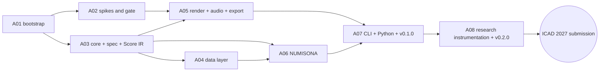
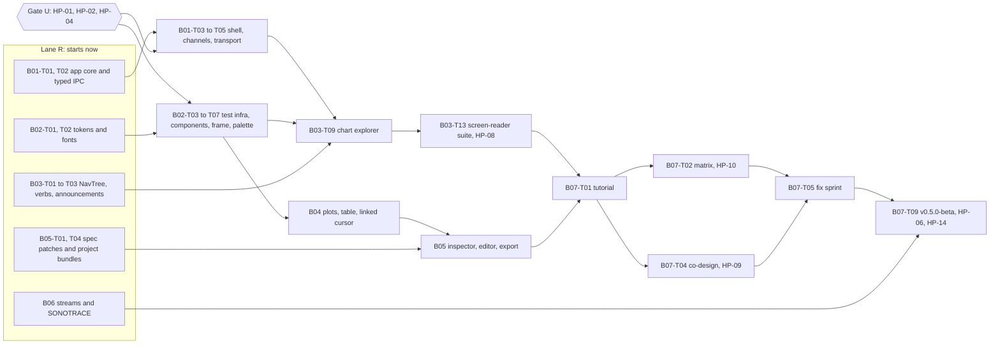

# Implementation Plan

> **Status:** Baseline v1 (2026-10-18); Stage B detailed 2026-10-21. **Owner:** Project lead.
> **Roadmap (stages, phases, exit criteria):** [roadmap.md](roadmap.md). **Live status:** [../sdlc/status.md](../sdlc/status.md). **Risks:** [risk-register.md](risk-register.md). **Open decisions:** [open-decisions.md](open-decisions.md).

This plan breaks the roadmap into **tasks**. It uses **rolling-wave planning**: Stages A and B are detailed to the task level (Stage B on 2026-10-21, §3), and Stages C–D to the epic level. Each stage gate re-plans the next stage in detail.

## 1. How work is executed

### 1.1 Cadence

| Practice | Rule |
|---|---|
| Iterations | 2 weeks. Each iteration has a goal tied to a phase exit criterion |
| WIP limit | At most 2 tasks in progress per person or agent session; finish before starting |
| Task size | **S** ≤ 1 day, **M** 2–3 days, **L** 4–5 days. Anything larger is split. These are the baseline's person-day sizes; for agent sessions they are relative effort, because Stage A ran far faster than planned (§3.1, F-120) |
| Tracking | Each task is a GitHub issue titled `[A03-T06] …`, labelled `stage/a`, `area/*`, `engine/*`, on the project board ([labels](../../.github/labels.yml)) |
| Done | [Definition of Done](../sdlc/definition-of-ready-and-done.md) for every PR; phase exit criteria for phases; gate review for stages |
| Records | Update [status.md](../sdlc/status.md) when a task changes state. Write a [worklog](../sdlc/worklog/README.md) entry per working session. Log [findings](../research-paper/findings-log.md) whenever something is measured or surprising |

### 1.2 Working with AI coding agents

Agents follow [AGENTS.md](../../AGENTS.md). For each task:

1. Read the task row here, the phase in the roadmap, and every document in the "Read" column.
2. Restate the acceptance criteria in the PR description before coding.
3. Keep PRs small (≤ ~400 changed lines excluding generated files and snapshots).
4. Include tests that reference rule IDs when implementing a research default.
5. Update docs, status and findings in the same PR.

### 1.3 Critical path (Stage A)

**Parallel lanes.** After A01, A02 (spikes) and A03 (core types) run in parallel. A04 and A05 can overlap once A03's core types land (A03-T01..T04).

---

## 2. Stage A · Foundation (task level)

Legend: **Read** = documents that must be read before starting.

### A01 · Repository bootstrap and governance

| Task | Description | Acceptance criteria | Size | Deps | Read |
|---|---|---|---|---|---|
| A01-T01 | **Owner decision:** licence (accept or amend ADR-0010) and docs licence (OD-09) | ADR-0010 status `accepted`; OD-01 and OD-09 closed | S | — | ADR-0010 |
| A01-T02 | Initialize the repo with the documentation baseline; default branch `main`; ruleset (PR required, 1 review, required checks, linear history, no force-push) | A direct push to `main` is rejected; the baseline is visible on GitHub | S | — | git-workflow |
| A01-T03 | Cargo workspace skeleton: root `Cargo.toml` with `[workspace.package]` (edition 2024, rust-version 1.88, licence, repository), `[workspace.lints]`, `[workspace.dependencies]`; empty crates `core, spec, data, compiler, dsp, render, audio, export, sonarithm, cli, xtask` with crate-level docs | `cargo build --workspace` and `cargo test --workspace` pass on 3 OSes | M | T01 | 02-repository-and-crate-layout |
| A01-T04 | `rust-toolchain.toml`, `rustfmt.toml`, `clippy.toml`, `.editorconfig` | `cargo fmt --check` and clippy `-D warnings` are clean | S | T03 | coding-standards |
| A01-T05 | `deny.toml` (licence allowlist, advisories, bans, sources) | `cargo deny check` passes; a test PR adding a GPL crate fails | S | T03 | supply-chain-and-licensing |
| A01-T06 | `xtask`: `ci` (all local checks), `check-deps` (enforces 02 §3 rules), `codegen` stub | `cargo xtask check-deps` fails on a deliberate engine→engine dependency | M | T03 | 02 §3 |
| A01-T07 | `ci.yml`: matrix (ubuntu, windows, macos), rust-cache, fmt, clippy, nextest, doc tests, deny, MSRV job, `wasm32-unknown-unknown` check of core crates; `permissions: {}`; SHA-pinned actions | All jobs green on a PR; total wall time ≤ 15 min | M | T04–T06 | ci-cd |
| A01-T08 | PR-title Conventional Commits check, DCO check, OpenSSF Scorecard, CodeQL, Dependabot or Renovate, label sync from `.github/labels.yml` | Each workflow runs once successfully; Scorecard result published | S | T07 | ci-cd |
| A01-T09 | pnpm workspace skeleton: root `package.json`, `pnpm-workspace.yaml`, placeholder `packages/{ui,viz,ipc}`, lint and format config | `pnpm install` and `pnpm -r lint` pass in CI | S | T07 | coding-standards |
| A01-T10 | GitHub Project (Roadmap view; fields Status, Phase, Iteration, Area, Paper), milestones per phase, one issue per Stage A task | Every Stage A task exists as an issue on the board | S | T02 | this document |
| A01-T11 | Enable secret scanning + push protection, private vulnerability reporting, Discussions | Settings verified; SECURITY.md links work | S | T02 | SECURITY.md |
| A01-T12 | Docs CI: markdown lint, link check (lychee), placeholder schema-diff job | The docs workflow is green on the baseline | S | T07 | ci-cd |
| A01-T13 | Add licence files, SPDX/REUSE config, CITATION.cff licence field (after T01) | `reuse lint` passes | S | T01 | supply-chain-and-licensing |

### A02 · Technical spikes and prototype gate

Spikes live in `spikes/<name>/` (excluded from the workspace) and are archived after the gate. Each produces measurements logged as findings (`F-###`).

| Task | Description | Acceptance criteria | Size | Deps | Read |
|---|---|---|---|---|---|
| A02-T01 | cpal output + loopback latency harness (Win WASAPI, macOS CoreAudio, Linux PipeWire) | p50/p95 output latency measured at 128/256/512 frames on each OS | M | A01-T03 | 06 §9 |
| A02-T02 | Minimal own render graph (voice pool, buses, scheduler) behind a draft `RenderGraph` trait | Renders the benchmark Score in real time and offline; CPU per block recorded | M | A01-T03 | 06 §3, ADR-0004 |
| A02-T03 | Firewheel 0.14 behind the same trait; Miri on the integration where feasible | Same benchmark; comparison table (CPU, xruns, code size, Miri, ergonomics) | M | T02 | ADR-0004 |
| A02-T04 | Offline determinism check across 2 OSes | Null residual and ΔLUFS reported against the PB-06 targets | S | T02 | ADR-0013 |
| A02-T05 | Tauri 2.12 spike: Channel throughput; binary `ipc::Response` latency for 1 MB and 10 MB | PB-09 measured on all 3 OSes | M | A01-T09 | 09 §2 |
| A02-T06 | WebGL2 1M-point waveform + spectrogram in WebView2, WKWebView, WebKitGTK (Intel/AMD/NVIDIA if available) | fps and frame-time distributions recorded (PB-08) | M | T05 | notes/05 §6 |
| A02-T07 | React Aria Tree + Slider + Toolbar + live-region announcer in Tauri; walkthroughs with NVDA, VoiceOver and Orca; browse/focus-mode behaviour; native notification prototype on Windows (OD-05) | A pass/fail matrix with notes per AT; OD-05 recommendation | M | T05 | 08 §4–5 |
| A02-T08 | Gate report `docs/sdlc/reviews/A02-prototype-gate.md`; confirm or amend ADR-0002, 0003 and 0004 | Report merged; ADR confirmations recorded; risks R-01..R-05 updated | S | T01–T07 | reviews template |

### A03 · Core types, Spec v0.1 and Score IR

| Task | Description | Acceptance criteria | Size | Deps | Read |
|---|---|---|---|---|---|
| A03-T01 | Units: `Hz`, `Cents`, `Db`, `Seconds`, `Frames`, `Pan` newtypes with conversions | Property tests: Hz↔cents↔MIDI round-trip within 1e-9 | S | A01-T03 | 05 §4.1 |
| A03-T02 | IDs, `RowRef`, `Provenance`, `Diagnostic`, error-code registry, `cargo xtask codes` | Codes doc generated; duplicate codes fail the build | M | T01 | 12 §1 |
| A03-T03 | Score IR types, serde, snapshot serializer (rounding rules), invariant checks | Invariants 1–5 (05 §4.2) checked in debug and covered by proptest | M | T01 | 05 §4 |
| A03-T04 | Capability traits, `Engine`, `Registry`, `EngineManifest`, conflict detection | Duplicate registration fails with `SNR-COMP-0xx` | M | T03 | 05 §3, ADR-0007 |
| A03-T05 | **RFC-0001: Spec v0.1** from the 04 draft; 7-day comment period; accept | RFC merged as accepted; doc 04 updated to "frozen v0.1" | M | — | 04, rfcs/README |
| A03-T06 | Spec types (serde + schemars), `sonarithm schema`, `schemas/` export, CI staleness check | Schema regenerated in CI; diff fails if stale | M | T05 | 04 |
| A03-T07 | Semantic validation with miette diagnostics and JSON pointers | Every validation rule has a passing and a failing test | M | T06 | 04 §8 |
| A03-T08 | Migration framework; RFC 8785 canonicalization; spec hash | Hash stable across OSes; key-order permutations hash equal | M | T06 | ADR-0013 |
| A03-T09 | Compiler skeleton: stages with no-op engines; `CompileContext` (RNG derivation, diagnostics, cancellation, budgets) | An end-to-end compile of a spec with an inline source to an empty Score | M | T04, T07 | 05 §2–3 |
| A03-T10 | Fuzz target for the spec parser; proptest spec generators | 1 h fuzz without panic (A03 exit) | S | T06 | testing-strategy |
| A03-T11 | Test that validates every JSON example in docs/architecture/04 | Example drift breaks CI | S | T07 | 04 §6 |

### A04 · Data layer

| Task | Description | Acceptance criteria | Size | Deps | Read |
|---|---|---|---|---|---|
| A04-T01 | `DataBundle`/`Table`/`FieldMeta` on Arrow; `snr.*` metadata I/O | Metadata survives Parquet and Arrow IPC round trips | M | A03-T02 | 03 §2–3 |
| A04-T02 | CSV/TSV (sniffing, encodings) and JSON/NDJSON sources | Corpus of 20 messy CSVs ingests with correct types | M | T01 | 10 §2 |
| A04-T03 | Parquet and Arrow IPC sources | Metadata and provenance preserved | S | T01 | — |
| A04-T04 | XLSX/ODS via calamine (sheet/range selection) | Test workbook suite passes | S | T01 | — |
| A04-T05 | Type, role and concept inference with `Info` diagnostics | Precision ≥ 95% on the inference corpus | M | T02 | 03 §3 |
| A04-T06 | Provenance columns and propagation rules | Propagation property tests (weakest class, min confidence) | M | T01 | 03 §4 |
| A04-T07 | Transforms (filter, sort, aggregate, bin, smooth, resample, derive, normalize) with a sandboxed rhai subset | Each transform has unit and property tests; rhai is fuel-limited | L | T06 | 03 §6 |
| A04-T08 | M4 and LTTB downsampling; tile cache | M4 is pixel-exact against the reference implementation | M | T01 | 03 §7 |
| A04-T09 | Data fingerprinting | Identical across OSes for the corpus | S | T01 | ADR-0013 |
| A04-T10 | Benchmarks (PB-05); fuzzers for CSV and XLSX | PB-05 met; fuzzers in CI (nightly) | M | T02–T04 | testing-strategy |

### A05 · Render engine, audio backend and export

| Task | Description | Acceptance criteria | Size | Deps | Read |
|---|---|---|---|---|---|
| A05-T01 | DSP nodes: sine, triangle, PolyBLEP saw/square, ADSR with minimum ramps, filters, constant-power panner | Spectral tests; no clicks (SDR-22 test) | M | A02-T08 | 06 §3 |
| A05-T02 | ISO 226:2023 compensation table; EBU R128 meter (ebur128) | Table matches the standard within tolerance; LUFS matches ebur128 reference files | M | T01 | SDR-24 |
| A05-T03 | `RenderPlan` and plan builder (Score → plan; voice pools; frame conversion) | Plan snapshot tests; polyphony analysis correct | L | A03-T03 | 05 §5 |
| A05-T04 | Render graph: buses, voice pool, sample-accurate scheduler, transport | Events land at exact sample offsets (unit test); seek/loop crossfades | L | T03 | 06 §3, §5 |
| A05-T05 | RT communication: rtrb commands, triple_buffer state, basedrop plan swap, collector | shuttle tests on the queues; no allocations on the RT path | M | T04 | 06 §4 |
| A05-T06 | `AudioBackend` + `CpalBackend` (enumeration, hot-plug, latency) | Device unplug/replug keeps the transport position (manual test script) | M | T04 | 06 §6 |
| A05-T07 | `OfflineBackend`; WAV (hound) and FLAC (flacenc) writers | Files validate in external tools; bit depth and sample rate correct | M | T04 | 06 §7 |
| A05-T08 | Render manifest + WebVTT cue sidecar | Manifest validates against its schema; no absolute paths | S | T07 | ADR-0013 |
| A05-T09 | Master limiter + start-up gain ramp | True peak ≤ −1 dBTP on stress Scores; no full-scale onset (NFR-10) | S | T04 | 06 §10 |
| A05-T10 | Allocation check in debug (`allocation-counter`, replacing `assert_no_alloc`: F-038); 10-min soak test; xrun counting | PB-02 met on reference hardware; CI debug soak (shorter) passes | M | T05, T06 | coding-standards |
| A05-T11 | Golden-audio harness and cross-OS CI job; decide Git LFS (OD-08) | PB-06 met for the golden set | M | T07 | testing-strategy |
| A05-T12 | Benchmarks (PB-03) | PB-03 met | S | T07 | — |
| A05-T13 | `WasapiBackend` (ADR-0016): RAW shared mode by default, exclusive mode opt-in, per-device latency calibration; latency measurement tool | RAW is the Windows default and reported; exclusive opens on request; the tool reports p50/p95 and the calibrated offset. ADR-0016 confirmation by cable is an owner step (script) | M | T06 | ADR-0016, 06 §6, §9 |

### A06 · NUMISONA v1

| Task | Description | Acceptance criteria | Size | Deps | Read |
|---|---|---|---|---|---|
| A06-T01 | Scales: linear, log, symlog, sqrt, pow, quantile, band, ordinal | Monotonicity and range property tests | M | A03-T09 | 04 §5.3 |
| A06-T02 | Pitch spaces: log-frequency, linear, mel, ERB-rate, Bark; range defaults | `sdr_08_*` and `sdr_09_*` tests | M | T01 | SDR-08, SDR-09 |
| A06-T03 | Concept table (`concepts.toml`) + polarity resolution + ambiguity diagnostics | `sdr_12..15_*` tests; every row cites evidence | M | T02 | 03 §3.3 |
| A06-T04 | `tone` and `glide` encoders with `RowRef`; redundant duration and taps; categorical timbre | Snapshots on the example datasets; A11Y-13 test | L | T03, A04-T01 | 07 NUMISONA |
| A06-T05 | Psychophysical scaling | `sdr_11_*` test | S | T01 | SDR-11 |
| A06-T06 | `auto` mark with density switching (experimental flag) | Flagged experimental; `sdr_20_*` test | S | T04 | SDR-20 |
| A06-T07 | Templates: line-overview, bar-discrete, scatter-xy, histogram, box-five-number, heatmap-rowscan | Each template renders each compatible example dataset | M | T04 | SDR-03 |
| A06-T08 | Erie importer (subset) | The Erie gallery subset imports with a report of unmapped constructs | M | A03-T06 | 04 §9 |
| A06-T09 | Rule-conformance suite (one test per owned SDR) and compile benchmarks | PB-04 met; rule coverage report | M | T01–T07 | design-rules |

### A07 · CLI, Python package and v0.1.0-alpha

| Task | Description | Acceptance criteria | Size | Deps | Read |
|---|---|---|---|---|---|
| A07-T01 | Facade crate API + rustdoc examples | Docs build; examples compile | M | A06 | 11 §1 |
| A07-T02 | CLI: render, play, quick, validate, inspect, schema, migrate, devices, lint (stub); `--json`, `--plain` | Snapshot tests (assert_cmd + insta); exit codes per 11 §2 | L | T01 | 11 §2 |
| A07-T03 | Python: PyO3/maturin abi3; Arrow PyCapsule input; notebook audio; `.pyi` stubs | Wheels install and pass pytest on 3 OSes | L | T01 | 11 §3 |
| A07-T04 | Examples gallery: 5 datasets (CC BY 4.0) + specs + a notebook | Rendered in CI; licences recorded in datasets.md | M | T02 | research-paper/datasets |
| A07-T05 | release-plz + git-cliff; wheels workflow; trusted publishing (crates.io, PyPI) | Dry-run release succeeds | M | T02, T03 | release-process |
| A07-T06 | Zenodo integration; CITATION.cff completed (names, ORCID) | DOI minted on release | S | T05 | publication-plan |
| A07-T07 | Quickstart tutorial; 3-person install test | Median time to first FLAC ≤ 5 min | S | T02–T04 | — |
| A07-T08 | **Release v0.1.0-alpha** | Gate checklist for releases complete | S | T05–T07 | release-process |

### A08 · Research instrumentation v0

| Task | Description | Acceptance criteria | Size | Deps | Read |
|---|---|---|---|---|---|
| A08-T01 | Stimulus generators: reversals × density (Nees & Walker 2008), price series (Smith & Walker 2005), SNR transits (Tucker Brown et al. 2022), correlation triplets | Deterministic given a seed; parameters documented | M | A06 | evaluation-plan |
| A08-T02 | Replication gallery v0: Smith & Walker context cues, Nees & Walker density, Erie examples (Dombois audification follows in C03) | Every item renders reproducibly with a manifest | M | T01 | P01 outline |
| A08-T03 | Study runner: `sonarithm study run` (protocol file, trial sequencing, keyboard responses, JSONL logs, pause and resume) | A pilot protocol runs end to end, accessibly | L | T01 | experiments/README |
| A08-T04 | Technical benchmark report (latency, RTF, determinism) for P01 and P07 | Numbers in benchmarks-log with method notes | S | A05, A07 | benchmarks-log |
| A08-T05 | Paper P01 draft and submission | Submitted, or a deferral recorded at Gate A | L | T02, T04, RL-T03 | P01 outline |
| A08-T06 | **Release v0.2.0-alpha** | Release checklist complete | S | T01–T04 | release-process |

### 2.1 Research lane (parallel to Stage A)

Research work with fixed external deadlines runs beside the engineering phases, not inside them.

| Task | Description | Acceptance criteria | Size | Deadline | Read |
|---|---|---|---|---|---|
| RL-T01 | Check RV University's policy on non-research usability sessions with BLV participants (OD-04: the owner works alone, so there is no ethics route). Prepare accessible consent, compensation and data-handling materials for those sessions | Policy confirmed in writing; materials drafted | M | Six weeks before B07-T04 (HP-09); baseline Mar 2027 | evaluation-plan, accessibility-conformance-plan |
| RL-T02 | **Deferred (OD-04).** Ethics application for research studies (perception studies, publishable co-design). Revisit at Gate B or when a collaborator offers an ethics route | Decision recorded at Gate B | S | Gate B | evaluation-plan, EXP-000 |
| RL-T03 | P01 related-work and framing sections drafted from [related-work.md](../research-paper/related-work.md) | Draft sections reviewed | M | Jan 2027 | P01 outline |
| RL-T04 | BLV co-designer outreach (recruiting channels, compensation budget per OD-10) | ≥ 10 prospective participants for B07 | M | Six weeks before B07-T04 (HP-09); baseline Mar 2027 | accessibility-conformance-plan |
| RL-T05 | Monthly re-check of venue deadlines; update the publication plan | Plan current | S | Monthly | publication-plan |

---

## 3. Stage B · Accessible desktop (task level)

Stage B was planned to the task level on 2026-10-21, after Stage A's code was complete. The rows below replace the baseline's lighter task list. Each task is a GitHub issue titled `[B01-T01] …`, labelled `stage/b`, in milestones B01–B07 on the [project board](https://github.com/users/DuhItzAniket/projects/2). The phase estimates are in the [roadmap](roadmap.md#stage-b-re-estimate).

### 3.1 How Stage B runs

| Topic | Rule |
|---|---|
| Lane R (starts now) | Rust crates and framework-agnostic assets: the app core, AUDAXIS, SONOTRACE, stream adapters, project bundles, colour tokens, fonts and message catalogues. 23 tasks; no owner step blocks them |
| Lane U (after Gate U) | Every task that commits to the Tauri shell ([ADR-0002](../decisions/0002-desktop-shell-tauri.md)) or to React Aria ([ADR-0003](../decisions/0003-frontend-react-and-react-aria.md)): 37 tasks. Seven more wait only on owner items: the releases, the Gate B review, the second locale, the JOSS paper and the AXONOTE icon |
| Gate U | The [A02 gate](../sdlc/reviews/A02-prototype-gate.md#decision) conditions for starting B01: the Windows walkthroughs (HP-01) and the Linux session (HP-02), then ADR-0002 and ADR-0003 confirmed or amended (HP-04). Until then both ADRs stay `accepted (provisional)`. [OD-15](open-decisions.md) proposes opening Lane U after HP-01 alone |
| Blocked on | Lists the owner and human-paced items (§3.3) that a task cannot finish without. Their issues carry `status/blocked` until the item is done. A task also waits for its Deps; releases and the gate review wait on Lane U tasks through them |
| Sessions | At most two build-heavy agent sessions at once on the 16 GB laptop. Suggested start: one session on AUDAXIS and the message catalogues (B02-T08; B03-T01 to T03, T05, T06, T11), one on the app core and SONOTRACE (B01-T01, T02, T06; B03-T07, T08 once B01-T01 lands; B04-T03; B05-T01, T04; B06 except T06). B02-T01 and T02 need no Rust build |
| Sizes | S, M and L keep their relative meaning (§1.1). Stage A's agent sessions closed a phase of 9–13 tasks in one to two calendar days ([F-120](../research-paper/findings-log.md#implementation-findings)) |
| Rules and budgets | The A11Y and SDR rules a task must satisfy, plus the FR, NFR and PB IDs it serves and the design-language (DL) and keymap (KB) rules. Tests that implement a rule carry its ID in their name (AGENTS.md rule 5) |

### 3.2 Critical path (Stage B)

**Parallel lanes.** Lane R runs now. After Gate U, B01's shell (T03 to T05) and B02's components (T03 to T07) run in parallel; B03's explorer (T09) needs both. B04 and B05 follow B02. B06 has one Lane U task (T06).

### 3.3 Owner and human-paced items

These items run at the owner's pace, or need other people, hardware or calendar time. They are tracked in the owner checklist ([#129](https://github.com/DuhItzAniket/SONARITHM/issues/129)) or the issue named, not as B tasks. Agents prepare the scripts, materials and drafts for each.

| ID | Item | Who | Tracked in | Unblocks | Needed by |
|---|---|---|---|---|---|
| HP-01 | A02 walkthroughs on Windows: NVDA (WALKTHROUGH.md §1) and Narrator (§2), with the OD-05 recommendation from steps 11–15 | Owner | [#32](https://github.com/DuhItzAniket/SONARITHM/issues/32), [#129](https://github.com/DuhItzAniket/SONARITHM/issues/129) | Gate U; B03-T04 | Before Lane U starts (A02 gate condition) |
| HP-02 | Ubuntu live-USB session on HW-01: WebKitGTK IPC and WebGL2 on both GPUs, and the Orca walkthrough (§3) | Owner | [#31](https://github.com/DuhItzAniket/SONARITHM/issues/31), [#32](https://github.com/DuhItzAniket/SONARITHM/issues/32), [#129](https://github.com/DuhItzAniket/SONARITHM/issues/129) | Gate U (ADR-0002's Linux trigger); B04-T08 | Before Lane U starts (A02 gate condition; OD-15 proposes before B03's exit) |
| HP-03 | macOS session on a lab or volunteer Mac: WKWebView IPC, App Nap, WebGL2 and VoiceOver (§4) | Owner arranges access | [#30](https://github.com/DuhItzAniket/SONARITHM/issues/30), [#31](https://github.com/DuhItzAniket/SONARITHM/issues/31), [#32](https://github.com/DuhItzAniket/SONARITHM/issues/32), [#129](https://github.com/DuhItzAniket/SONARITHM/issues/129); R-22 | B01-T07 (App Nap), B02-T10 and B03-T04 (macOS parts), B03-T13, B04-T08 | By B03 (A02 gate condition) |
| HP-04 | Gate U decision: ADR-0002 and ADR-0003 confirmed or amended from HP-01 and HP-02 (A02-T08) | Coordinator under the owner's delegation; the owner signs the A02 gate | [#33](https://github.com/DuhItzAniket/SONARITHM/issues/33), A02 gate report | Gate U | After HP-01 and HP-02 |
| HP-05 | Cable latency test and NVDA coexistence (ADR-0016), and one run on a device with small shared periods | Owner (needs a USB audio interface or cable) | [#123](https://github.com/DuhItzAniket/SONARITHM/issues/123), [#186](https://github.com/DuhItzAniket/SONARITHM/issues/186) | B03-T12 | B03 |
| HP-06 | PB-02 soak at 128-frame buffers on capable hardware | Owner | [#187](https://github.com/DuhItzAniket/SONARITHM/issues/187) | B07-T09 | Before Gate B |
| HP-07 | Manual NVDA and Narrator check of every `@sonarithm/ui` component; VoiceOver with HP-03 | Owner | B02-T10 | B02 exit | B02 exit |
| HP-08 | Scripted task suite T-03 to T-05 with NVDA, JAWS, VoiceOver and Orca | Owner and volunteers; JAWS access TODO(verify) (R-25) | B03-T13 | B03 exit | B03 exit |
| HP-09 | Co-design route: RV University's policy for paid usability sessions confirmed in writing (RL-T01), a compensation budget (OD-10), at least 10 recruited participants (RL-T04) | Owner | [#94](https://github.com/DuhItzAniket/SONARITHM/issues/94), [#92](https://github.com/DuhItzAniket/SONARITHM/issues/92), OD-10 | B07-T04 | Six weeks before B07-T04 (R-10) |
| HP-10 | Full manual matrix M-01 to M-10 with one refreshable braille display | Owner and volunteers; braille display access TODO(verify) (R-25) | B07-T02 | B07-T02 and ACR v0 (B07-T06) | B07 |
| HP-11 | Listening checks of earcons, context sounds and the monitoring soundscape (also A05's deferred limiter and mallet checks) | Owner or co-design partners | B03-T06, B06-T04 | Nothing (recorded, not blocking) | B03, B06 |
| HP-12 | Code-signing route (OD-02, R-14): SignPath Foundation or RV University; the Apple Developer Program | Owner | OD-02 | A signed v0.5.0-beta (optional; signing is a C06 deliverable) | B07 for planning |
| HP-13 | JOSS P02 eligibility and submission: six months of public history and evidence of research use; the owner submits | Owner | B07-T08, OD-17 | B07-T08 | Calendar-gated: the repository was created on 2026-10-18, so not before about 2027-04-18, TODO(verify) |
| HP-14 | Release go and tags for v0.3.0, v0.4.0 and v0.5.0-beta | Owner | B03-T14, B05-T08, B07-T09 | Those releases | Per release |
| HP-15 | Second UI locale chosen with the community (OD-12) | Owner and community | OD-12 | B07-T07 | B05 |
| HP-16 | AXONOTE icon (OD-03) | Owner | OD-03 | B02-T11 | B02 |
| HP-17 | Gate B sign-off, the OD-04 revisit and the RL-T02 decision | Owner | [#95](https://github.com/DuhItzAniket/SONARITHM/issues/95), B07-T10 | Stage C | Gate B |

### 3.4 Carry-over from Stage A

| Issue | What | Stage B task that waits for it |
|---|---|---|
| [#185](https://github.com/DuhItzAniket/SONARITHM/issues/185) | PB-03: SIMD voice batching and a rerun on HW-01e; the owner's waiver covers `v0.1.0-alpha` only. Agent work, build-heavy | B07-T09 (`v0.5.0-beta`, Gate B) |
| [#186](https://github.com/DuhItzAniket/SONARITHM/issues/186) | PB-01: settle key press → cue onset at B03 | B03-T12 |
| [#187](https://github.com/DuhItzAniket/SONARITHM/issues/187) | PB-02: a 10-minute soak at 128-frame buffers on capable hardware (HP-06) | B07-T09 |
| [#123](https://github.com/DuhItzAniket/SONARITHM/issues/123) | A05-T13's cable latency test and NVDA coexistence check (HP-05) | B03-T12, through #186 |
| [#94](https://github.com/DuhItzAniket/SONARITHM/issues/94), [#92](https://github.com/DuhItzAniket/SONARITHM/issues/92) | RL-T01 policy check and RL-T04 outreach (HP-09) | B07-T04 |
| [#95](https://github.com/DuhItzAniket/SONARITHM/issues/95) | RL-T02: the ethics decision at Gate B (HP-17) | B07-T10 |

### B01 · Desktop shell, IPC and app core

| Task | Description | Acceptance criteria | Rules and budgets | Size | Deps | Blocked on | Read |
|---|---|---|---|---|---|---|---|
| B01-T01 | `sonarithm-app` (headless app core, shared by the desktop and the CLI): sessions over the facade (open and close datasets, compile, plan, play through `sonarithm-render`'s player); a command bus with undo tokens; a job queue with progress and cancellation; versioned settings with migrations and atomic, crash-safe writes | Integration scenarios with the null audio backend pass on three OSes: open dataset → compile → play → seek → stop → export (testing-strategy §10); settings migrate from a v0 fixture; an interrupted write leaves the previous settings readable (fault injection); `check-deps` passes | A11Y-15 (playback only on command); FR-050; NFR-11 (settings) | L | A07-T01 | — | 01 §4, 02 §2–§3, 09 §2.1, §5, 12 §3, testing-strategy §10 |
| B01-T02 | ts-rs export of every payload and error type into `packages/ipc/src/generated/` through `cargo xtask codegen`; a protocol version constant shared by host and UI; the `IpcTransport` interface (`invoke`, `subscribe`, `binary`) with a `mockIPC` implementation; typed errors (`code`, `message`, `hint`, `pointer`); the binary view header format | CI regenerates the types and fails on a diff; a version mismatch fails fast with a clear error (test); frontend code uses only generated protocol types; the binary header is documented and generated | AGENTS rule 10 (generated files); ADR-0011 | M | T01 | — | ADR-0011, 09 §2, §2.2, §2.3, 12 §1 |
| B01-T03 | `apps/desktop` with `src-tauri` (crate `sonarithm-desktop`) and a Vite + React 19 UI shell; least-privilege capabilities, no shell plugin; a CSP of `default-src 'self'` that keeps binary IPC; browser accelerator keys disabled; command handlers that validate input and call `sonarithm-app`; the Tauri `IpcTransport`; build and smoke test on the three CI OSes | The app builds and opens an empty workspace on Windows, macOS and Linux runners; a 1 MB view stays binary under the CSP (F-042 test); F5, Ctrl+R, Ctrl+F, F7, F12 and Alt+Left do nothing in the webview (keyboard §12.3); `check-deps` covers `sonarithm-desktop`; no remote URL is loaded | A11Y-05; KB-04; NFR-04 | L | T01, T02 | Gate U | ADR-0002, ADR-0003, 09 §1, §4, keyboard-and-navigation §12.3, A02 gate (F-041, F-042) |
| B01-T04 | Channels for transport clock anchors (on change and every 2 s), meters (binary, batched at 30 Hz), diagnostics, announcements and job progress (JSON, rate-limited); binary `ipc::Response` for views with the generated header; an IPC benchmark in CI | PB-09: ≤ 30 ms p95 for a 1 MB binary view on the three CI OSes and HW-01 (HW-01e rerun if above 50% of the budget), logged in the benchmarks log; no JSON event on a hot path (test); anchors only on change and every 2 s (unit test) | PB-09 | M | T03 | Gate U | 09 §2, 06 §9, A02 gate (spike 3), 12 §8 |
| B01-T05 | The `transport` XState v5 machine mirrors the authoritative Rust `TransportState`; play, pause, stop, seek, speed and loop; the transport toolbar wired to the commands | Model-based tests of the machine; the Rust state wins after a conflicting UI intent (test); playback starts only on a user command (test); toolbar keyboard test (arrows inside, Tab leaves) | A11Y-09, A11Y-15; FR-050 | M | T03, T04 | Gate U | 09 §3, 06 §5, keyboard-and-navigation §5.3 |
| B01-T06 | A harness that fails on any network connection attempt, with the mechanism chosen per OS; it runs the app-core scenarios now and the packaged app from B01-T09 | A deliberate connection attempt fails the test (negative test); every app-core scenario passes with zero connection attempts on three OSes; the per-OS mechanism is documented in testing-strategy §10 | NFR-04; ADR-0012; AGENTS rule 9 | M | T01 | — | ADR-0012, 09 §4, testing-strategy §10 |
| B01-T07 | Start-up per 09 §7: settings and profile load, the audio device opened lazily on first play, no splash screen, focus in the project tree of an empty workspace; a start-up benchmark; App Nap handling for the control and telemetry threads if HP-03 confirms F-041 | PB-07: ≤ 2 s cold start to an interactive workspace on HW-01 (HW-01e rerun if above 50%) and recorded for the CI runners; start-up never waits for an audio driver (test with a slow null backend) | PB-07; DL-X04, DL-X09 | M | T03 | Gate U | 09 §7, 12 §8, design-language §3 |
| B01-T08 | `devices_list` and `device_select`; a sonification volume independent of the system volume; a global "stop all audio" command reachable from every scope and the menu; device-loss and device-change messages in words for the announcement log (HS-05) | Stop all audio silences output within one audio block from every region (null-backend E2E, T-13); the sonification volume never changes the system volume (test); unplugging while playing pauses at the same position and posts a text message (scripted, as A05's hot-plug script) | A11Y-15, A11Y-17, A11Y-24; FR-118 | M | T04, T05 | Gate U | 06 §6, §10, §11, keyboard-and-navigation §5.1, accessibility-conformance-plan §3.2 |
| B01-T09 | `nightly.yml` builds unsigned installers (NSIS or MSI, DMG, AppImage), so the owner and volunteers can run screen-reader checks on a real build; the network-deny harness runs against the packaged app | Nightly artifacts for three OSes, named by commit; an install-and-launch smoke test per runner; the packaged app passes the network-deny test; no updater key or signing secret is used (signing is C06) | A11Y-32 (enables the matrix); NFR-04 | M | T03, T06 | Gate U | ci-cd, release-process (desktop release), 09 §6 |

### B02 · Design system and application frame

| Task | Description | Acceptance criteria | Rules and budgets | Size | Deps | Blocked on | Read |
|---|---|---|---|---|---|---|---|
| B02-T01 | Semantic colour tokens generated in OKLCH for dark, light and high-contrast (dark and light) themes; `forced-colors` and `prefers-contrast` handling; CSS custom properties in cascade layers; spacing, radius and motion tokens | Generated tokens are committed and CI fails on a diff; every pair in design-language §5.3 meets 4.5:1 for text and 3:1 for non-text and focus in every theme (token test); lints catch DL-X01, DL-X02, DL-X03 and DL-X07 | A11Y-25; FR-117; DL-X01–DL-X03, DL-X07 | M | A01-T09 | — | design-language §5, §7, §8, §9 |
| B02-T02 | IBM Plex Sans and Mono bundled locally with their OFL notices; the type scale; tabular numerals for readouts; a font test page for `tnum` and `zero` per weight | No font loads from the network; the notices are in the generated licences data (12 §9); the font test shows `tnum` and `zero` per weight; readouts use the numeric class (DL-X10 lint) | A11Y-25; DL-X10 | S | T01 | — | design-language §7.1, 12 §9 |
| B02-T03 | Storybook 10 with the accessibility and Vitest addons; Vitest browser-mode screenshots on one pinned Linux Chromium image; Playwright with `mockIPC` in Chromium, WebKit and Firefox, with `@axe-core/playwright`; keyboard-only flow helpers; CI jobs | A seeded axe violation fails CI (negative test); a seeded focus trap fails a keyboard-only flow; screenshot baselines are stable across two CI runs | A11Y-05, A11Y-31 (automated checks) | M | A01-T09 | Gate U | testing-strategy §12, §13.1, coding-standards §12 |
| B02-T04 | Button, IconButton, ToggleButton and its group, Toolbar, Menu, Dialog and Modal, Tabs, Tooltip and Disclosure on React Aria Components, each with stories in every state and theme. IconButton requires an accessible name and a tooltip; tooltips hold nothing that keyboard and AT cannot reach | Every story (focus, disabled, error; every theme) passes axe with no serious or critical violation; a keyboard test per component; an IconButton without a name fails type checking; every `:hover` style has a `:focus-visible` counterpart (lint) | A11Y-05, A11Y-18, A11Y-25, A11Y-29; DL-X05, DL-X11 | L | T01, T02, T03 | Gate U | design-language §11, ADR-0003, 08 §5 |
| B02-T05 | Tree (project tree), Table with Virtualizer and exposed row and column headers, Slider that announces value, unit and range, NumberField that accepts units, Select and ComboBox, ListBox and GridList with keyboard reordering | As B02-T04, plus: the Slider's `aria-valuetext` carries value and unit; Table headers are in the accessibility tree (snapshot); the three F-045 points (tree row names, `SliderOutput` live region, React Aria's own announcer) are resolved or filed | A11Y-03, A11Y-05, A11Y-12 (reordering), A11Y-18, A11Y-26 | L | T04 | Gate U | design-language §11, A02 gate (F-045), keyboard-and-navigation §5.6–§5.8 |
| B02-T06 | Top bar, project, workspace, inspector and status regions as landmarks; keyboard-resizable splitters (window splitter pattern); F6 and Shift+F6 in a constant order, with collapsed regions kept as Expand stops; the narrow layout; the native or in-window menu bar decision recorded in 09 | Keyboard E2E: the F6 order is the same at every breakpoint, no focus trap, focus always visible and unobscured; splitters resize by keyboard; landmarks are in the accessibility tree | A11Y-05, A11Y-07, A11Y-25, A11Y-26; KB-05; DL-X12 | M | T04 | Gate U | design-language §4, keyboard-and-navigation §3, 09 §3 |
| B02-T07 | Stable command IDs with names, descriptions, scopes and per-platform default bindings (Primary and Jump); scope precedence; the command palette on React Aria with announced results and current bindings; Shift+F1 lists the bindings of the focused scope | A test reaches every registered action from the palette; scope-precedence unit tests; a lint over the default keymap rejects screen-reader modifiers and KB-04 combinations; palette results are announced (accessibility test) | A11Y-05, A11Y-06, A11Y-30; KB-01–KB-09; FR-116 | M | T04, T06 | Gate U | keyboard-and-navigation §1, §2, §5, §12, §13, design-language §11 |
| B02-T08 | Fluent message catalogues whose IDs the UI and the Rust announcement templates share; locale-aware number, date and unit formatting; a pseudo-locale CI check for truncation and concatenated strings | A lint fails on a hard-coded UI string; the pseudo-locale run catches a seeded concatenated string; one message ID renders the same in Rust and TypeScript (contract test) | NFR-09; A11Y-12 | M | B01-T02 | — | 12 §5, 08 §9, coding-standards |
| B02-T09 | Review every component and the frame against design-language §3 and §13; automate the detectable anti-patterns as lints; CVD simulation of every status and series view | A review record with zero DL-X violations is committed; the lints run in CI | DL-X01–DL-X13; A11Y-25 (no colour-only meaning) | S | T04, T05, T06, T07 | Gate U | design-language §3, §13, engine-identity |
| B02-T10 | Per-component scripts in the style of the A02 WALKTHROUGH.md; the owner runs NVDA and Narrator, and VoiceOver on the Mac from HP-03; failures filed with severities | A results table per component and AT with versions; every failure filed with a severity (conformance plan §9); B02 exits with no open critical issue | A11Y-18, A11Y-32 (subset) | M | T05, T06, T07 | Gate U, HP-07 | accessibility-conformance-plan §3, §9, testing-strategy §13.2 |
| B02-T11 | Close OD-03 with the owner, then produce the engine SVG tiles and chips with accessible names and licence notices | OD-03 closed; SVG assets meet engine-identity §9.2; accessible names per §7; the Lucide ISC and Feather MIT notices are present | DL-X13; A11Y-01 | S | T01 | HP-16 | engine-identity, design-language §10 |

### B03 · AUDAXIS v1: navigation, context and speech

| Task | Description | Acceptance criteria | Rules and budgets | Size | Deps | Blocked on | Read |
|---|---|---|---|---|---|---|---|
| B03-T01 | `sonarithm-audaxis` registered through the engine registry; the NavTree from (Score, data, annotations): Dataset, Series, Axes, Insights, Segment and Point nodes with even or semantic segments; the compiler returns it beside the Score so `inspect` and Python can expose it | NavTree snapshots for each of the six NUMISONA templates; property tests: every node reachable, every Point maps to a `RowRef`; `check-deps` passes (no engine-to-engine dependency) | A11Y-01, A11Y-04; FR-042 | L | A06-T07 | — | 08 §2, 05 §8, 07 AUDAXIS, ADR-0007, ADR-0014 |
| B03-T02 | Cursor state with the local, lateral, spatial (step, ±10%, first, last) and targeted (landmark, maximum, minimum, value nearest, go to x) verbs; where am I; boundary moves keep the cursor and return the boundary earcon | Verb-sequence property tests: no dead end, the cursor is never undefined, boundary moves leave it in place; a unit test per verb and level (keyboard §4.3); where am I is defined at every node | A11Y-04, A11Y-07, A11Y-08, A11Y-27; FR-042 | L | T01 | — | 08 §2, keyboard-and-navigation §4, §6 |
| B03-T03 | Fluent templates (English); parts and their order; terse and verbose; units spoken in full at verbose; provenance qualifiers for estimates; queue classes with priority, supersede and sequencing (keyboard §9.1); an announcement history whose entries link to their node | Announcement snapshots at terse and verbose; a property test that only the latest navigation announcement survives; every estimate carries its qualifier (test); errors are never dropped (test) | A11Y-02, A11Y-12, A11Y-17, A11Y-24; FR-044, FR-051; AGENTS rule 7 | L | T02, B02-T08 | — | 08 §4, keyboard-and-navigation §8, §9, 03 §4, 12 §5 |
| B03-T04 | The managed live-region pair (clear-then-set); a Tauri plugin that raises UI Automation notifications on Windows and `announcementRequested` on macOS; live regions on Linux; a route setting; announcing never moves focus. Closes OD-05 from the A02 walkthrough evidence | OD-05 closed with evidence from HP-01; route unit tests; a Windows CI smoke test raises a UIA notification; announcing never changes focus (test); the owner's NVDA and Narrator check passes | A11Y-17, A11Y-19; FR-044 | L | T03, B01-T03 | Gate U, HP-01 | 08 §4, §5, A02 gate (spike 5), open-decisions OD-05 |
| B03-T05 | AUDAXIS context: a tick track at major ticks for discrete marks, off for glides (SDR-16); a dynamic reference tone in a distinct timbre (SDR-17); a spoken legend with title, ranges, units and polarity before playback (SDR-18) | Conformance tests `sdr_16_*`, `sdr_17_*` and `sdr_18_*`; Score snapshots; golden-audio cases; no static first-value reference anywhere (test) | SDR-16, SDR-17, SDR-18, SDR-22; FR-040, FR-041 | M | T01 | — | sound-design §7, 07 AUDAXIS, design-rules §D |
| B03-T06 | The earcon catalogue (E-BOUNDARY, E-INVALID, E-LANDMARK, E-THRESHOLD, E-MODE, E-STREAM; E-ALARM and E-LEVEL off by default), replacing A05's provisional earcons; gap earcons for `missing: "earcon"` (deferred from A06); a text equivalent for each | A test enumerates the catalogue and finds a text equivalent for every earcon; golden-audio cases; E-BOUNDARY is noise-based and distinct from data tones (spectral test); the listening check (HP-11) is recorded | A11Y-08, A11Y-24, SDR-22, SDR-35; FR-043 | M | T01 | — | keyboard-and-navigation §11, sound-design §8, §14, A06 phase review |
| B03-T07 | Cue, then speech, on each step; only cues during key repeat; speech held during playback except alarms; the current value announced on pause; speaking commands pause playback (duck as an option); `sonarithm-speech` self-voicing that ducks sonification by 20 dB while speaking; WebVTT cue timing from AUDAXIS | Conformance tests `a11y_09_*` and `a11y_20_*`; the duck level measured at −20 dB within the test's tolerance; the WebVTT sidecar validates with AUDAXIS cues; `cargo deny` passes for `tts` | A11Y-09, A11Y-19, A11Y-20; FR-049, FR-051, FR-101 | L | T03, B01-T01 | — | 08 §4, keyboard-and-navigation §9.2, 06 §7, risk R-15 |
| B03-T08 | Modality state (sonification, speech, braille, visual) on one cursor; profiles as portable, schema-validated JSON (pitch range, polarity per concept with the one-key flip, timbre preset, mark preference, pace, verbosity, part order, modalities, keymap overrides); the presets BLV chart reading, Analyst, Classroom and Presentation; precedence and the effective-settings view in the app core | Profile schema tests and an import-export round trip; precedence unit tests (defaults < profile < project < spec < UI action); `sdr_15_*` for the persisted flip and `sdr_38_*` for each personalization field | A11Y-10, A11Y-12, SDR-15, SDR-38; FR-032 (UI flip), FR-047, FR-114 | L | T03, B01-T01 | — | 08 §6, sound-design §13, 12 §3 |
| B03-T09 | The chart explorer: one Tab stop with the role, name, description and help command of 08 §5; DOM nodes for the cursor's neighbourhood from the NavTree; keymap v0 with chart-focus scoping; the single-key group switch; the keymap editor, which records combinations, refuses reserved ones and names the screen reader they collide with; the query menu with the B03 subset (summary, minimum, maximum, range, value at x); modality and verbosity toggles | Keyboard E2E for every verb and for T-06, T-07 and T-15; with single keys off, letters do nothing in the explorer; the recorder refuses every reserved combination (unit test); the explorer is named and described (accessibility tree test); toggles persist after a restart | A11Y-01, A11Y-04–A11Y-07, A11Y-10, A11Y-12, A11Y-18, A11Y-22, A11Y-27; KB-01–KB-09; FR-042, FR-047, FR-116 | L | T02, T03, T08, B01-T05, B02-T07 | Gate U | keyboard-and-navigation §2, §5.4, §5.5, §7, §12, §13, 08 §5 |
| B03-T10 | Review-line text sized to the display's cell count; the Shift+B sparkline in an 8-dot encoding; routing keys move the cursor; exposed as a read-only text field in the explorer | Review-line snapshots at several cell counts; sparkline encoding unit tests; routing selects the right point (unit test); a braille display check, in B07's matrix (HP-10) if no display is available earlier | A11Y-21, A11Y-27; FR-045 | M | T03, T09 | Gate U | keyboard-and-navigation §10, §14, accessibility-conformance-plan §5 |
| B03-T11 | Constant-power stereo as the `Spatial` shaper; a guard so that pan, pitch extremes or timbre never carry essential information alone | `a11y_14_*` mono-survival conformance test; golden stereo cases; a warning when pan is the only carrier | A11Y-14, SDR-27, SDR-30; FR-048 (B03 part) | S | T01 | — | 07 AUDAXIS, 06 §3, sound-design §9 |
| B03-T12 | Measure key press → cue onset through the explorer, IPC and engine with the loopback harness; settle PB-01 with the owner per [#186](https://github.com/DuhItzAniket/SONARITHM/issues/186) | Benchmarks-log rows for the full path; [#186](https://github.com/DuhItzAniket/SONARITHM/issues/186) closed with a decision: met, or a per-device-class re-baseline proposed through change control (no waiver without evidence) | PB-01; A11Y-20 (cue before speech); ADR-0016 | M | T09, [#186](https://github.com/DuhItzAniket/SONARITHM/issues/186), [#123](https://github.com/DuhItzAniket/SONARITHM/issues/123) | Gate U, HP-05 | 06 §9, testing-strategy §14, A05 phase review (gate summary), ADR-0016 |
| B03-T13 | Scripts and result templates for T-01 to T-07 and T-13, with T-03, T-04 and T-05 as the exit tasks; an assessment of Guidepup for NVDA and VoiceOver smoke tests; the owner and volunteers run NVDA, JAWS, VoiceOver and Orca | T-03, T-04 and T-05 pass with NVDA, JAWS, VoiceOver and Orca, with AT versions recorded; failures filed with severities; the Guidepup assessment logged as a finding | A11Y-04, A11Y-07, A11Y-22, A11Y-32 (subset) | M | T04, T09, T10, B01-T09 | Gate U, HP-08 | accessibility-conformance-plan §3.2, testing-strategy §13 |
| B03-T14 | **Release v0.3.0 (desktop preview)**. An unsigned desktop preview on the nightly channel (roadmap §6); the release notes list known accessibility issues, since the first ACR comes with v0.5.0-beta | The release checklist is complete; the owner gives the go and tags (HP-14) | A11Y-31 (known issues disclosed) | S | T13 | HP-14 | release-process, roadmap §6 |

### B04 · Visualization and linked cursor

| Task | Description | Acceptance criteria | Rules and budgets | Size | Deps | Blocked on | Read |
|---|---|---|---|---|---|---|---|
| B04-T01 | uPlot for line and time series; the plot is a named, described object that is not itself focusable; CVD-safe categorical palettes per theme and perceptual colormaps | Stories per theme; the palettes pass a CVD simulation check; the plot's name and description come from the summary (test) | A11Y-01, A11Y-25; DL-X08 | M | B02-T01, B02-T03 | Gate U | 09 §3, design-language §6 |
| B04-T02 | A WebGL2 layer for dense, waveform and spectrogram views, with a Canvas2D fallback and a discrete-GPU option (F-044); data is drawn once and the playhead never redraws it | Frame-time traces recorded; the fallback renders when WebGL2 is unavailable (test); script time ≤ 8 ms per frame with 1M points | PB-08; R-21 | L | T01 | Gate U | A02 gate (spike 4, F-043, F-044), risk R-21 |
| B04-T03 | `view_get` builds M4 (and LTTB) tiles in the app core from A04's downsampling and tile cache; `table_page` builds binary columnar pages; both use the generated binary header | Tiles are pixel-exact against the full polyline (A04's property reused); payload tests for tiles and pages; zoom uses the M4 path (F-043) | PB-09 | M | B01-T02 | — | 03 §7, 09 §2.1 |
| B04-T04 | The playhead extrapolated every animation frame from clock anchors, corrected by the per-device latency calibration (ADR-0016), drawn outside React reconciliation | A drift test with simulated anchors stays within one frame; the calibration offset is applied (unit test); no React render per frame (profiling test) | PB-08; F-033 | M | B01-T04, T02 | Gate U | 06 §9, ADR-0016, 09 §3 |
| B04-T05 | The always-available data table: virtualized, row and column headers exposed, sortable, paged through `table_page`, with a provenance column that names estimates | Headers in the accessibility tree (snapshot) and no axe violation; a 1M-row table scrolls virtualized; keyboard navigation per keyboard §5.6; estimates labelled in text | A11Y-03, A11Y-24; FR-046; AGENTS rule 7 | M | B02-T05, T03 | Gate U | keyboard-and-navigation §5.6, 03 §4 |
| B04-T06 | One Rust-owned cursor, shown by the plot (crosshair and marker), the table (row selection), the breadcrumb and the persistent cursor readout | The views stay in sync within one frame (E2E); T-10 passes as a keyboard E2E; selection is linked across modalities (test) | A11Y-10, A11Y-11, A11Y-24 | M | T01, T05, B03-T02 | Gate U | 08 §1, §3, keyboard-and-navigation §6 |
| B04-T07 | Click to move the cursor; keyboard and single-pointer alternatives to drag scrubbing and drag zoom; minimum target sizes | An E2E test per alternative; targets meet WCAG 2.5.8 (test) | A11Y-26; FR-119 | S | T01, T06 | Gate U | 08 §8, keyboard-and-navigation §14 |
| B04-T08 | Performance traces in WebView2 on HW-01 and on CI for WKWebView and WebKitGTK; the owner's runs on real Linux and macOS hardware | 60 fps playhead and ≤ 8 ms script per frame with a 1M-point series in each webview, logged in the benchmarks log (HW-01e rerun if above 50% of the budget) | PB-08 | M | T02, T04 | Gate U, HP-02, HP-03 | 12 §8, testing-strategy §12 |

### B05 · Inspector, spec editor and project files

| Task | Description | Acceptance criteria | Rules and budgets | Size | Deps | Blocked on | Read |
|---|---|---|---|---|---|---|---|
| B05-T01 | `spec_apply(patch)` with validation diagnostics per patch; history with undo tokens on the command bus; `history_undo` and `history_redo` | Property test: apply, then undo, returns the canonical spec bytes; every patch kind is undoable; typed IPC payloads generated | SDR-01, SDR-36; FR-111 | M | B01-T01, B01-T02 | — | 09 §2.1, 04, ADR-0005, RFC-0001 |
| B05-T02 | Inspector sections per engine (Disclosure): channels, scales, ranges, polarity flip, concept selector and mode; every value announced with unit and range | Property test: inspector → spec → inspector without loss; T-08 as a keyboard E2E; every control has an accessible name, value and unit | A11Y-29, SDR-15, SDR-36, SDR-38; FR-113 | L | T01, B02-T05, B03-T08 | Gate U | keyboard-and-navigation §5.8, design-language §11, engine-identity §6 |
| B05-T03 | CodeMirror 6 with the generated JSON Schema, diagnostics from Rust validation (`spec_validate`) and keyboard-accessible completion; diagnostics are reachable and announced | T-12 as a keyboard E2E; an edit in the editor shows in the inspector and the reverse; screen-reader notes in the PR | A11Y-05, A11Y-29; FR-112 | L | T01, B02-T04 | Gate U | keyboard-and-navigation §5.9, 04 §8, 09 §3 |
| B05-T04 | An RFC for project format v1 from 12 §4 (AGENTS rule 11), then the bundle reader and writer: a manifest with SHA-256 per member, embedded or linked data with fingerprints, the format version and migrations, zip-slip protection, no absolute paths or secrets; autosave of the last N snapshots with a recovery offer on start; open, save, save as and recent | The RFC is accepted before code; a saved project reopens bit-identically; a crash-injection test recovers the last snapshot; a fuzz target for the bundle reader; no absolute path is ever written (test) | FR-110, NFR-11; AGENTS rules 9 and 11; ADR-0013 | L | T01 | — | 12 §4, 09 §5, ADR-0013, rfcs/README |
| B05-T05 | The export dialog (WAV, FLAC, manifest, WebVTT) with the XState `export` machine, progress over a channel, and the result announced with duration, sample rate and loudness | Model-based tests of the export machine; T-11 as a keyboard E2E; a snapshot of the result announcement | A11Y-17, A11Y-24, A11Y-29; FR-100, FR-101 | M | B01-T04, B03-T03 | Gate U | 06 §7, 09 §2.1 |
| B05-T06 | The mode switch in the UI, recorded in the spec, with the E-MODE earcon and an announcement | `sdr_36_*` test: the mode round-trips through the spec; the change is announced and logged | SDR-06, SDR-36, A11Y-08 | S | T02, B03-T06 | Gate U | sound-design §2, 04 |
| B05-T07 | A desktop soak with a 1M-row dataset open; WebdriverIO real-app E2E in `nightly.yml` on Windows and Linux, and on macOS once its embedded provider is verified | PB-10 (≤ 500 MB resident) measured and logged; the nightly real-app E2E is green | PB-10 | M | T04, B01-T09 | Gate U | 12 §8, testing-strategy §12 |
| B05-T08 | **Release v0.4.0 (desktop preview)**. An unsigned desktop preview with the inspector, editor and projects (roadmap §6); the release notes list known accessibility issues | The release checklist is complete; the owner gives the go and tags (HP-14) | A11Y-31 (known issues disclosed) | S | T02, T03, T04, T05, T06, T07 | HP-14 | release-process, roadmap §6 |

### B06 · SONOTRACE v1: transport, streams and monitoring

| Task | Description | Acceptance criteria | Rules and budgets | Size | Deps | Blocked on | Read |
|---|---|---|---|---|---|---|---|
| B06-T01 | `StreamTable` in the crate 02 §2 assigns: ring-buffered record batches with sequence numbers, capacity by time window or row count, cheap snapshot views, and backpressure that drops the oldest rows with a diagnostic | Property tests: memory stays bounded, rows are never skipped in the middle, snapshots are consistent; provenance columns survive | PB-11 (bounded memory); AGENTS rule 7 | M | A04-T06 | — | 03 §8, 05 §6, 02 §2 |
| B06-T02 | WebSocket, OSC, serial and MQTT sources (feature-gated per 02 §4) with schema validation, bounded buffers, reconnect and backpressure; a connection opens only on an explicit user action (consent gate) | Adapter tests against local loopback servers; no connection without the consent call (test), and the network-deny test passes with no stream connected; a fuzz target per payload decoder; `cargo deny` passes | A11Y-16; FR-005; NFR-04; AGENTS rule 9 | L | T01 | — | 07 SONOTRACE, 02 §2, §4, 12 §6, ADR-0012 |
| B06-T03 | `live` drives the track encoder's `encode_incremental` over the stream window; `transport` adds scrub grains and long-series windowing | Deterministic replay: recorded input gives an identical event sequence (test); scrub grains land at the cursor (golden case) | SDR-01, SDR-02, A11Y-09; ADR-0013 | M | T01 | — | 07 SONOTRACE, 05 §6, 06 §5 |
| B06-T04 | An ambient soundscape with salience changes on detector events; the alarm tier only for user-configured alarms; the comfort budget (SDR-39) reported as experimental | `sdr_35_*` conformance test; golden cases; no alarm sound unless one is configured (test); SDR-39 behaviour flagged experimental | SDR-35, SDR-39 (INFER, experimental), A11Y-08 | M | T03, B03-T06 | — | sound-design §10, §11 |
| B06-T05 | Stream announcements rate-limited per stream (keyboard §9.1 proposal: one per 5 s, dropped after 10 s) and coalesced into summaries; streams and their announcements can be paused, stopped and hidden through the app core | `a11y_16_*` property tests for the limits and coalescing; errors and configured alarms are never dropped (test) | A11Y-16, A11Y-17; FR-052 | M | T02, B03-T03 | — | keyboard-and-navigation §9.1, 08 §4 |
| B06-T06 | A connect dialog with the per-action consent; stream status in the status region; pause, stop and hide controls; scrubbing with a non-drag alternative | T-14 as a keyboard E2E; the consent prompt appears before any connection; every control has a name and state | A11Y-16, A11Y-26, A11Y-29; FR-005 | M | T05, B02-T06 | Gate U | keyboard-and-navigation §5.10, 09 §2.1 |
| B06-T07 | A 1-hour soak with a 1 kHz synthetic source through the app core; a shorter nightly run | PB-11: 0 xruns and bounded memory for 1 h on HW-01, logged in the benchmarks log; the nightly job is green | PB-11 | M | T02, T03, T05 | — | testing-strategy §9.3, 12 §8 |

### B07 · Accessibility conformance, tutorial and co-design round 1

| Task | Description | Acceptance criteria | Rules and budgets | Size | Deps | Blocked on | Read |
|---|---|---|---|---|---|---|---|
| B07-T01 | An interactive tutorial of about 15 minutes, offered once on first run as a single dismissible prompt; context help on F1 (H in the explorer) in a consistent place | The tutorial completes by keyboard alone (E2E); help opens from every scope (test); the owner times one run | SDR-37, A11Y-30; FR-115 | L | B03-T09, B04-T06, B05-T02 | Gate U | 09 §7, keyboard-and-navigation §1 (KB-09) |
| B07-T02 | M-01 to M-10 with the full task suite, including NVDA ducking and sound split and one braille display; the agent prepares the scripts and triages the results | A matrix report with AT, OS and webview versions; every failure filed with a severity | A11Y-21, A11Y-32 | L | T01, B06-T06 | Gate U, HP-10 | accessibility-conformance-plan §3, §5–§7, testing-strategy §13.2 |
| B07-T03 | Chartability's 14 critical tests on the visual mode; low-vision checks at 200% and 400% with forced colours per webview; the non-audio-equivalents check | Audit sheets committed; every issue filed with a severity | A11Y-24, A11Y-25, A11Y-33 | M | B04-T06, B04-T05 | Gate U | accessibility-conformance-plan §4, §6, §7 |
| B07-T04 | Paid sessions with 10–15 BLV participants on their own AT, run as product usability feedback, not research (OD-04): accessible consent and payment, a session protocol on the task suite, keymap validation (OD-06); findings logged and triaged; Gate B's completion rate recorded internally, with no research data published | Findings logged (F-###) and triaged into issues; task completion recorded for Gate B; consent materials checked with a screen reader and at 200% zoom before use | A11Y-34; OD-06 | L | T01 | Gate U, HP-09 | accessibility-conformance-plan §8, evaluation-plan, open-decisions OD-04, OD-06, OD-10 |
| B07-T05 | Fix the critical and high issues from B07-T02 to T04; keymap and sound changes go through change control (a finding and a change-log row) | No open critical accessibility issue; each open high issue fixed, or waived in writing and disclosed in the ACR | A11Y-31 (release-blocking policy) | L | T02, T03, T04 | Gate U | accessibility-conformance-plan §9, keyboard-and-navigation §13 |
| B07-T06 | ACR v0 from the VPAT INT template: WCAG 2.2 A and AA via WCAG2ICT, EN 301 549 v3.2.1 and v4.1.1, Section 508; remarks cite A11Y IDs; [CHECK] clause numbers verified or left flagged | The ACR is at `docs/accessibility/acr/0.5.0-beta.md` and attached to the release; no criterion is marked Supports without evidence from B07-T02 or T03 | A11Y-31; NFR-02 | M | T02, T03, T05 | Gate U | accessibility-conformance-plan §1, §2 |
| B07-T07 | UI and announcements in the second locale chosen under OD-12, with locale formatting of numbers and units | A locale-switch E2E; announcement snapshots in both locales; units formatted per locale | NFR-09, A11Y-12 | M | B02-T08, B03-T03 | HP-15 | 12 §5, 08 §9, open-decisions OD-12 |
| B07-T08 | `paper/paper.md` and `paper/paper.bib` with the AI-usage disclosure; the JOSS checklist in the P02 outline kept current; submission is the owner's, once JOSS's eligibility rules are met | The draft is merged; the owner submits it, or a deferral is recorded at Gate B (OD-17) | none (publication) | M | — | HP-13 | P02 outline, publication-plan |
| B07-T09 | **Release v0.5.0-beta**. Desktop beta installers (unsigned unless OD-02 is resolved, HP-12), ACR v0 as a release asset, the release checklist; the budget follow-ups [#185](https://github.com/DuhItzAniket/SONARITHM/issues/185) (PB-03) and [#187](https://github.com/DuhItzAniket/SONARITHM/issues/187) (PB-02) closed first | The release checklist is complete; no open critical accessibility issue; the owner gives the go and tags (HP-14) | A11Y-31; NFR-02 | M | T05, T06, [#185](https://github.com/DuhItzAniket/SONARITHM/issues/185), [#187](https://github.com/DuhItzAniket/SONARITHM/issues/187) | HP-06, HP-14 | release-process, roadmap §6, accessibility-conformance-plan §9.1 |
| B07-T10 | The Gate B review from the gate template: exit criteria B01–B07, budgets, the risk review, the OD-04 revisit and the RL-T02 decision, R-09 (external reviewer); Stage C detailed to task level | The Gate B review is in `docs/sdlc/reviews/` and signed by the owner (HP-17); Stage C task rows are in this plan | none (process) | M | T04, T09 | HP-17 | reviews templates, risk-register, open-decisions |

## 4. Stages C and D · Epics (detailed at Gate B and Gate C)

| Epic | Key deliverables | Phase |
|---|---|---|
| C01 Exact chart ingestion | Office XML, chart JSON, SVG and vector-PDF extractors; chart-type templates; Vega-Lite/MAIDR importers; 50-chart corpus | C01 |
| C02 Raster digitizer | Calibration UI (accessible point entry), colour masks, extraction, correction workflow, confidence | C02 |
| C03 CURVASONA | Expression facade, adaptive sampling, critical points, cues, audification + calculator, 40-curve suite, teacher pilot | C03 |
| C04 AXONOTE | Scales and tunings, instrument library and SF2, MIDI/OSC sinks, stems | C04 |
| C05 ECHOMETRIC v1 | Detectors, insights, L1/L2 descriptions, queries, full lint, mapping-suggestion rule engine | C05 |
| C06 GA hardening | Signing (OD-02), updater keys, installers, SBOM + provenance, docs site, ACR v1, security review, co-design round 2, **v1.0.0**, P05 artifact package | C06 |
| P05 CHI 2028 paper | Drafted in C05; submitted at the CHI deadline (est. early–mid Sep 2027) on the C05 release candidate | C05 → C06 |
| D01–D06 | TONALENS, RESONUM, spatial/multichannel, ML extraction + AI assist, plugins + WASM, research studies programme | Stage D |

## 5. Definition of the first week (concrete start)

1. **Owner:** decide the licence (A01-T01) and answer OD-02, OD-04 and OD-10 in [open-decisions.md](open-decisions.md).
2. Push the documentation baseline (A01-T02) and create the board and issues (A01-T10).
3. Scaffold the workspace and CI (A01-T03..T09).
4. Start spikes A02-T01 (cpal latency) and A02-T05 (Tauri IPC) in parallel with A03-T01..T03 (core types).
