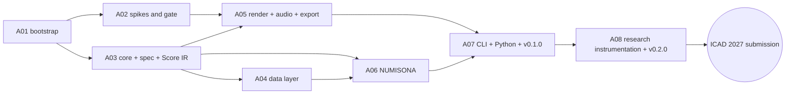

# Implementation Plan

> **Status:** Baseline v1 (2026-10-18). **Owner:** Project lead.
> **Roadmap (stages, phases, exit criteria):** [roadmap.md](roadmap.md). **Live status:** [../sdlc/status.md](../sdlc/status.md). **Risks:** [risk-register.md](risk-register.md). **Open decisions:** [open-decisions.md](open-decisions.md).

This plan breaks the roadmap into **tasks**. It uses **rolling-wave planning**: Stage A is detailed to the task level, Stage B to the task level with lighter acceptance criteria, and Stages C–D to the epic level. Each stage gate re-plans the next stage in detail.

## 1. How work is executed

### 1.1 Cadence

| Practice | Rule |
|---|---|
| Iterations | 2 weeks. Each iteration has a goal tied to a phase exit criterion |
| WIP limit | At most 2 tasks in progress per person or agent session; finish before starting |
| Task size | **S** ≤ 1 day, **M** 2–3 days, **L** 4–5 days. Anything larger is split |
| Tracking | Each task is a GitHub issue titled `[A03-T06] …`, labelled `stage/a`, `area/*`, `engine/*`, on the project board ([labels](../../.github/labels.yml)) |
| Done | [Definition of Done](../sdlc/definition-of-ready-and-done.md) for every PR; phase exit criteria for phases; gate review for stages |
| Records | Update [status.md](../sdlc/status.md) when a task changes state. Write a [worklog](../sdlc/worklog/README.md) entry per working session. Log [findings](../research-paper/findings-log.md) whenever something is measured or surprising |

### 1.2 Working with AI coding agents

Agents follow [AGENTS.md](../../AGENTS.md). For each task:

1. Read the task row here, the phase in the roadmap, and every document in the "Read" column.
2. Restate the acceptance criteria in the PR description before coding.
3. Keep PRs small (≤ ~400 changed lines excluding generated files and snapshots).
4. Include tests that reference rule IDs when implementing a research default.
5. Update docs, status and findings in the same PR.

### 1.3 Critical path (Stage A)

**Parallel lanes.** After A01, A02 (spikes) and A03 (core types) run in parallel. A04 and A05 can overlap once A03's core types land (A03-T01..T04).

---

## 2. Stage A · Foundation (task level)

Legend: **Read** = documents that must be read before starting.

### A01 · Repository bootstrap and governance

| Task | Description | Acceptance criteria | Size | Deps | Read |
|---|---|---|---|---|---|
| A01-T01 | **Owner decision:** licence (accept or amend ADR-0010) and docs licence (OD-09) | ADR-0010 status `accepted`; OD-01 and OD-09 closed | S | — | ADR-0010 |
| A01-T02 | Initialize the repo with the documentation baseline; default branch `main`; ruleset (PR required, 1 review, required checks, linear history, no force-push) | A direct push to `main` is rejected; the baseline is visible on GitHub | S | — | git-workflow |
| A01-T03 | Cargo workspace skeleton: root `Cargo.toml` with `[workspace.package]` (edition 2024, rust-version 1.88, licence, repository), `[workspace.lints]`, `[workspace.dependencies]`; empty crates `core, spec, data, compiler, dsp, render, audio, export, sonarithm, cli, xtask` with crate-level docs | `cargo build --workspace` and `cargo test --workspace` pass on 3 OSes | M | T01 | 02-repository-and-crate-layout |
| A01-T04 | `rust-toolchain.toml`, `rustfmt.toml`, `clippy.toml`, `.editorconfig` | `cargo fmt --check` and clippy `-D warnings` are clean | S | T03 | coding-standards |
| A01-T05 | `deny.toml` (licence allowlist, advisories, bans, sources) | `cargo deny check` passes; a test PR adding a GPL crate fails | S | T03 | supply-chain-and-licensing |
| A01-T06 | `xtask`: `ci` (all local checks), `check-deps` (enforces 02 §3 rules), `codegen` stub | `cargo xtask check-deps` fails on a deliberate engine→engine dependency | M | T03 | 02 §3 |
| A01-T07 | `ci.yml`: matrix (ubuntu, windows, macos), rust-cache, fmt, clippy, nextest, doc tests, deny, MSRV job, `wasm32-unknown-unknown` check of core crates; `permissions: {}`; SHA-pinned actions | All jobs green on a PR; total wall time ≤ 15 min | M | T04–T06 | ci-cd |
| A01-T08 | PR-title Conventional Commits check, DCO check, OpenSSF Scorecard, CodeQL, Dependabot or Renovate, label sync from `.github/labels.yml` | Each workflow runs once successfully; Scorecard result published | S | T07 | ci-cd |
| A01-T09 | pnpm workspace skeleton: root `package.json`, `pnpm-workspace.yaml`, placeholder `packages/{ui,viz,ipc}`, lint and format config | `pnpm install` and `pnpm -r lint` pass in CI | S | T07 | coding-standards |
| A01-T10 | GitHub Project (Roadmap view; fields Status, Phase, Iteration, Area, Paper), milestones per phase, one issue per Stage A task | Every Stage A task exists as an issue on the board | S | T02 | this document |
| A01-T11 | Enable secret scanning + push protection, private vulnerability reporting, Discussions | Settings verified; SECURITY.md links work | S | T02 | SECURITY.md |
| A01-T12 | Docs CI: markdown lint, link check (lychee), placeholder schema-diff job | The docs workflow is green on the baseline | S | T07 | ci-cd |
| A01-T13 | Add licence files, SPDX/REUSE config, CITATION.cff licence field (after T01) | `reuse lint` passes | S | T01 | supply-chain-and-licensing |

### A02 · Technical spikes and prototype gate

Spikes live in `spikes/<name>/` (excluded from the workspace) and are archived after the gate. Each produces measurements logged as findings (`F-###`).

| Task | Description | Acceptance criteria | Size | Deps | Read |
|---|---|---|---|---|---|
| A02-T01 | cpal output + loopback latency harness (Win WASAPI, macOS CoreAudio, Linux PipeWire) | p50/p95 output latency measured at 128/256/512 frames on each OS | M | A01-T03 | 06 §9 |
| A02-T02 | Minimal own render graph (voice pool, buses, scheduler) behind a draft `RenderGraph` trait | Renders the benchmark Score in real time and offline; CPU per block recorded | M | A01-T03 | 06 §3, ADR-0004 |
| A02-T03 | Firewheel 0.14 behind the same trait; Miri on the integration where feasible | Same benchmark; comparison table (CPU, xruns, code size, Miri, ergonomics) | M | T02 | ADR-0004 |
| A02-T04 | Offline determinism check across 2 OSes | Null residual and ΔLUFS reported against the PB-06 targets | S | T02 | ADR-0013 |
| A02-T05 | Tauri 2.12 spike: Channel throughput; binary `ipc::Response` latency for 1 MB and 10 MB | PB-09 measured on all 3 OSes | M | A01-T09 | 09 §2 |
| A02-T06 | WebGL2 1M-point waveform + spectrogram in WebView2, WKWebView, WebKitGTK (Intel/AMD/NVIDIA if available) | fps and frame-time distributions recorded (PB-08) | M | T05 | notes/05 §6 |
| A02-T07 | React Aria Tree + Slider + Toolbar + live-region announcer in Tauri; walkthroughs with NVDA, VoiceOver and Orca; browse/focus-mode behaviour; native notification prototype on Windows (OD-05) | A pass/fail matrix with notes per AT; OD-05 recommendation | M | T05 | 08 §4–5 |
| A02-T08 | Gate report `docs/sdlc/reviews/A02-prototype-gate.md`; confirm or amend ADR-0002, 0003 and 0004 | Report merged; ADR confirmations recorded; risks R-01..R-05 updated | S | T01–T07 | reviews template |

### A03 · Core types, Spec v0.1 and Score IR

| Task | Description | Acceptance criteria | Size | Deps | Read |
|---|---|---|---|---|---|
| A03-T01 | Units: `Hz`, `Cents`, `Db`, `Seconds`, `Frames`, `Pan` newtypes with conversions | Property tests: Hz↔cents↔MIDI round-trip within 1e-9 | S | A01-T03 | 05 §4.1 |
| A03-T02 | IDs, `RowRef`, `Provenance`, `Diagnostic`, error-code registry, `cargo xtask codes` | Codes doc generated; duplicate codes fail the build | M | T01 | 12 §1 |
| A03-T03 | Score IR types, serde, snapshot serializer (rounding rules), invariant checks | Invariants 1–5 (05 §4.2) checked in debug and covered by proptest | M | T01 | 05 §4 |
| A03-T04 | Capability traits, `Engine`, `Registry`, `EngineManifest`, conflict detection | Duplicate registration fails with `SNR-COMP-0xx` | M | T03 | 05 §3, ADR-0007 |
| A03-T05 | **RFC-0001: Spec v0.1** from the 04 draft; 7-day comment period; accept | RFC merged as accepted; doc 04 updated to "frozen v0.1" | M | — | 04, rfcs/README |
| A03-T06 | Spec types (serde + schemars), `sonarithm schema`, `schemas/` export, CI staleness check | Schema regenerated in CI; diff fails if stale | M | T05 | 04 |
| A03-T07 | Semantic validation with miette diagnostics and JSON pointers | Every validation rule has a passing and a failing test | M | T06 | 04 §8 |
| A03-T08 | Migration framework; RFC 8785 canonicalization; spec hash | Hash stable across OSes; key-order permutations hash equal | M | T06 | ADR-0013 |
| A03-T09 | Compiler skeleton: stages with no-op engines; `CompileContext` (RNG derivation, diagnostics, cancellation, budgets) | An end-to-end compile of a spec with an inline source to an empty Score | M | T04, T07 | 05 §2–3 |
| A03-T10 | Fuzz target for the spec parser; proptest spec generators | 1 h fuzz without panic (A03 exit) | S | T06 | testing-strategy |
| A03-T11 | Test that validates every JSON example in docs/architecture/04 | Example drift breaks CI | S | T07 | 04 §6 |

### A04 · Data layer

| Task | Description | Acceptance criteria | Size | Deps | Read |
|---|---|---|---|---|---|
| A04-T01 | `DataBundle`/`Table`/`FieldMeta` on Arrow; `snr.*` metadata I/O | Metadata survives Parquet and Arrow IPC round trips | M | A03-T02 | 03 §2–3 |
| A04-T02 | CSV/TSV (sniffing, encodings) and JSON/NDJSON sources | Corpus of 20 messy CSVs ingests with correct types | M | T01 | 10 §2 |
| A04-T03 | Parquet and Arrow IPC sources | Metadata and provenance preserved | S | T01 | — |
| A04-T04 | XLSX/ODS via calamine (sheet/range selection) | Test workbook suite passes | S | T01 | — |
| A04-T05 | Type, role and concept inference with `Info` diagnostics | Precision ≥ 95% on the inference corpus | M | T02 | 03 §3 |
| A04-T06 | Provenance columns and propagation rules | Propagation property tests (weakest class, min confidence) | M | T01 | 03 §4 |
| A04-T07 | Transforms (filter, sort, aggregate, bin, smooth, resample, derive, normalize) with a sandboxed rhai subset | Each transform has unit and property tests; rhai is fuel-limited | L | T06 | 03 §6 |
| A04-T08 | M4 and LTTB downsampling; tile cache | M4 is pixel-exact against the reference implementation | M | T01 | 03 §7 |
| A04-T09 | Data fingerprinting | Identical across OSes for the corpus | S | T01 | ADR-0013 |
| A04-T10 | Benchmarks (PB-05); fuzzers for CSV and XLSX | PB-05 met; fuzzers in CI (nightly) | M | T02–T04 | testing-strategy |

### A05 · Render engine, audio backend and export

| Task | Description | Acceptance criteria | Size | Deps | Read |
|---|---|---|---|---|---|
| A05-T01 | DSP nodes: sine, triangle, PolyBLEP saw/square, ADSR with minimum ramps, filters, constant-power panner | Spectral tests; no clicks (SDR-22 test) | M | A02-T08 | 06 §3 |
| A05-T02 | ISO 226:2023 compensation table; EBU R128 meter (ebur128) | Table matches the standard within tolerance; LUFS matches ebur128 reference files | M | T01 | SDR-24 |
| A05-T03 | `RenderPlan` and plan builder (Score → plan; voice pools; frame conversion) | Plan snapshot tests; polyphony analysis correct | L | A03-T03 | 05 §5 |
| A05-T04 | Render graph: buses, voice pool, sample-accurate scheduler, transport | Events land at exact sample offsets (unit test); seek/loop crossfades | L | T03 | 06 §3, §5 |
| A05-T05 | RT communication: rtrb commands, triple_buffer state, basedrop plan swap, collector | shuttle tests on the queues; no allocations on the RT path | M | T04 | 06 §4 |
| A05-T06 | `AudioBackend` + `CpalBackend` (enumeration, hot-plug, latency) | Device unplug/replug keeps the transport position (manual test script) | M | T04 | 06 §6 |
| A05-T07 | `OfflineBackend`; WAV (hound) and FLAC (flacenc) writers | Files validate in external tools; bit depth and sample rate correct | M | T04 | 06 §7 |
| A05-T08 | Render manifest + WebVTT cue sidecar | Manifest validates against its schema; no absolute paths | S | T07 | ADR-0013 |
| A05-T09 | Master limiter + start-up gain ramp | True peak ≤ −1 dBTP on stress Scores; no full-scale onset (NFR-10) | S | T04 | 06 §10 |
| A05-T10 | `assert_no_alloc` in debug; 10-min soak test; xrun counting | PB-02 met on reference hardware; CI debug soak (shorter) passes | M | T05, T06 | coding-standards |
| A05-T11 | Golden-audio harness and cross-OS CI job; decide Git LFS (OD-08) | PB-06 met for the golden set | M | T07 | testing-strategy |
| A05-T12 | Benchmarks (PB-03) | PB-03 met | S | T07 | — |
| A05-T13 | `WasapiBackend` (ADR-0016): RAW shared mode by default, exclusive mode opt-in, per-device latency calibration; latency measurement tool | RAW is the Windows default and reported; exclusive opens on request; the tool reports p50/p95 and the calibrated offset. ADR-0016 confirmation by cable is an owner step (script) | M | T06 | ADR-0016, 06 §6, §9 |

### A06 · NUMISONA v1

| Task | Description | Acceptance criteria | Size | Deps | Read |
|---|---|---|---|---|---|
| A06-T01 | Scales: linear, log, symlog, sqrt, pow, quantile, band, ordinal | Monotonicity and range property tests | M | A03-T09 | 04 §5.3 |
| A06-T02 | Pitch spaces: log-frequency, linear, mel, ERB-rate, Bark; range defaults | `sdr_08_*` and `sdr_09_*` tests | M | T01 | SDR-08, SDR-09 |
| A06-T03 | Concept table (`concepts.toml`) + polarity resolution + ambiguity diagnostics | `sdr_12..15_*` tests; every row cites evidence | M | T02 | 03 §3.3 |
| A06-T04 | `tone` and `glide` encoders with `RowRef`; redundant duration and taps; categorical timbre | Snapshots on the example datasets; A11Y-13 test | L | T03, A04-T01 | 07 NUMISONA |
| A06-T05 | Psychophysical scaling | `sdr_11_*` test | S | T01 | SDR-11 |
| A06-T06 | `auto` mark with density switching (experimental flag) | Flagged experimental; `sdr_20_*` test | S | T04 | SDR-20 |
| A06-T07 | Templates: line-overview, bar-discrete, scatter-xy, histogram, box-five-number, heatmap-rowscan | Each template renders each compatible example dataset | M | T04 | SDR-03 |
| A06-T08 | Erie importer (subset) | The Erie gallery subset imports with a report of unmapped constructs | M | A03-T06 | 04 §9 |
| A06-T09 | Rule-conformance suite (one test per owned SDR) and compile benchmarks | PB-04 met; rule coverage report | M | T01–T07 | design-rules |

### A07 · CLI, Python package and v0.1.0-alpha

| Task | Description | Acceptance criteria | Size | Deps | Read |
|---|---|---|---|---|---|
| A07-T01 | Facade crate API + rustdoc examples | Docs build; examples compile | M | A06 | 11 §1 |
| A07-T02 | CLI: render, play, quick, validate, inspect, schema, migrate, devices, lint (stub); `--json`, `--plain` | Snapshot tests (assert_cmd + insta); exit codes per 11 §2 | L | T01 | 11 §2 |
| A07-T03 | Python: PyO3/maturin abi3; Arrow PyCapsule input; notebook audio; `.pyi` stubs | Wheels install and pass pytest on 3 OSes | L | T01 | 11 §3 |
| A07-T04 | Examples gallery: 5 datasets (CC BY 4.0) + specs + a notebook | Rendered in CI; licences recorded in datasets.md | M | T02 | research-paper/datasets |
| A07-T05 | release-plz + git-cliff; wheels workflow; trusted publishing (crates.io, PyPI) | Dry-run release succeeds | M | T02, T03 | release-process |
| A07-T06 | Zenodo integration; CITATION.cff completed (names, ORCID) | DOI minted on release | S | T05 | publication-plan |
| A07-T07 | Quickstart tutorial; 3-person install test | Median time to first FLAC ≤ 5 min | S | T02–T04 | — |
| A07-T08 | **Release v0.1.0-alpha** | Gate checklist for releases complete | S | T05–T07 | release-process |

### A08 · Research instrumentation v0

| Task | Description | Acceptance criteria | Size | Deps | Read |
|---|---|---|---|---|---|
| A08-T01 | Stimulus generators: reversals × density (Nees & Walker 2008), price series (Smith & Walker 2005), SNR transits (Tucker Brown et al. 2022), correlation triplets | Deterministic given a seed; parameters documented | M | A06 | evaluation-plan |
| A08-T02 | Replication gallery v0: Smith & Walker context cues, Nees & Walker density, Erie examples (Dombois audification follows in C03) | Every item renders reproducibly with a manifest | M | T01 | P01 outline |
| A08-T03 | Study runner: `sonarithm study run` (protocol file, trial sequencing, keyboard responses, JSONL logs, pause and resume) | A pilot protocol runs end to end, accessibly | L | T01 | experiments/README |
| A08-T04 | Technical benchmark report (latency, RTF, determinism) for P01 and P07 | Numbers in benchmarks-log with method notes | S | A05, A07 | benchmarks-log |
| A08-T05 | Paper P01 draft and submission | Submitted, or a deferral recorded at Gate A | L | T02, T04, RL-T03 | P01 outline |
| A08-T06 | **Release v0.2.0-alpha** | Release checklist complete | S | T01–T04 | release-process |

### 2.1 Research lane (parallel to Stage A)

Research work with fixed external deadlines runs beside the engineering phases, not inside them.

| Task | Description | Acceptance criteria | Size | Deadline | Read |
|---|---|---|---|---|---|
| RL-T01 | Check RV University's policy on non-research usability sessions with BLV participants (OD-04: the owner works alone, so there is no ethics route). Prepare accessible consent, compensation and data-handling materials for those sessions | Policy confirmed in writing; materials drafted | M | Mar 2027 | evaluation-plan, accessibility-conformance-plan |
| RL-T02 | **Deferred (OD-04).** Ethics application for research studies (perception studies, publishable co-design). Revisit at Gate B or when a collaborator offers an ethics route | Decision recorded at Gate B | S | Gate B | evaluation-plan, EXP-000 |
| RL-T03 | P01 related-work and framing sections drafted from [related-work.md](../research-paper/related-work.md) | Draft sections reviewed | M | Jan 2027 | P01 outline |
| RL-T04 | BLV co-designer outreach (recruiting channels, compensation budget per OD-10) | ≥ 10 prospective participants for B07 | M | Mar 2027 | accessibility-conformance-plan |
| RL-T05 | Monthly re-check of venue deadlines; update the publication plan | Plan current | S | Monthly | publication-plan |

---

## 3. Stage B · Accessible desktop (task level, lighter criteria)

| Phase | Tasks |
|---|---|
| **B01** Shell, IPC, app core | T01 Tauri scaffold, capabilities, CSP · T02 `sonarithm-app` (sessions, command bus with undo tokens, job queue, settings) · T03 ts-rs codegen + `@sonarithm/ipc` typed client + contract tests · T04 Channels for clock anchors and meters; binary view responses · T05 Transport XState mirror · T06 Network-deny integration test · T07 Start-up benchmark (PB-07) · T08 Device selection; sonification volume + global stop (FR-118) |
| **B02** Design system and frame | T01 OKLCH token generator; dark, light and high-contrast themes; forced colors · T02 IBM Plex bundling + type scale · T03 `@sonarithm/ui` components on RAC (Button, ToggleButton, Slider with units, Tree, Table, Toolbar, Menu, Dialog, ComboBox, Tabs) · T04 Fixed regions + splitters + F6 cycling · T05 Command palette · T06 Storybook + a11y addon; Vitest browser screenshots · T07 Design review against the anti-pattern list · T08 Pseudo-locale check · T09 Resolve OD-03 (AXONOTE icon) and produce engine SVG assets |
| **B03** AUDAXIS v1 | T01 NavTree builder · T02 Cursor and verbs; "where am I" · T03 Announcement composer (Fluent) + queue/supersede · T04 Announcer routes (live region; native plugin per OD-05; self-voicing) · T05 Context tracks: ticks, dynamic reference, legends · T06 Earcon set + text equivalents · T07 Braille review line and sparkline · T08 Keymap, remapping, chart-focus scoping · T09 Profiles and presets · T10 Scripted screen-reader task suite (NVDA, JAWS, VoiceOver, Orca) |
| **B04** Visualization and linked cursor | T01 uPlot integration · T02 WebGL2 dense, waveform and spectrogram layer · T03 Rust M4 tiles over binary IPC · T04 Playhead extrapolation + latency compensation · T05 Linked cursor across plot, table and nav · T06 Accessible virtualized table with a provenance column · T07 Non-drag alternatives (FR-119) · T08 PB-08 perf test |
| **B05** Inspector, editor, projects | T01 Engine-grouped inspector panels · T02 CodeMirror 6 spec editor + schema + live diagnostics · T03 Spec patch model + undo/redo · T04 `.sonarithm` bundles + autosave + recovery · T05 Export dialog (WAV/FLAC/manifest/VTT) · T06 Mode switch · T07 Memory soak (PB-10) |
| **B06** SONOTRACE v1 | T01 `sonarithm-stream` adapters (WebSocket, OSC, serial, MQTT) · T02 `StreamTable` · T03 Incremental encoding · T04 Monitoring soundscape · T05 Rate limiting, pause/stop/hide · T06 Stream soak (PB-11) |
| **B07** Conformance, tutorial, co-design | T01 Tutorial (≈15 min) + context help · T02 ACR v0 · T03 Screen-reader matrix run · T04 Chartability audit · T05 Co-design round 1 (ethics approved) · T06 Fix sprint · T07 Second locale · T08 JOSS paper P02 · T09 **Release v0.5.0-beta** |

## 4. Stages C and D · Epics (detailed at Gate B and Gate C)

| Epic | Key deliverables | Phase |
|---|---|---|
| C01 Exact chart ingestion | Office XML, chart JSON, SVG and vector-PDF extractors; chart-type templates; Vega-Lite/MAIDR importers; 50-chart corpus | C01 |
| C02 Raster digitizer | Calibration UI (accessible point entry), colour masks, extraction, correction workflow, confidence | C02 |
| C03 CURVASONA | Expression facade, adaptive sampling, critical points, cues, audification + calculator, 40-curve suite, teacher pilot | C03 |
| C04 AXONOTE | Scales and tunings, instrument library and SF2, MIDI/OSC sinks, stems | C04 |
| C05 ECHOMETRIC v1 | Detectors, insights, L1/L2 descriptions, queries, full lint, mapping-suggestion rule engine | C05 |
| C06 GA hardening | Signing (OD-02), updater keys, installers, SBOM + provenance, docs site, ACR v1, security review, co-design round 2, **v1.0.0**, P05 artifact package | C06 |
| P05 CHI 2028 paper | Drafted in C05; submitted at the CHI deadline (est. early–mid Sep 2027) on the C05 release candidate | C05 → C06 |
| D01–D06 | TONALENS, RESONUM, spatial/multichannel, ML extraction + AI assist, plugins + WASM, research studies programme | Stage D |

## 5. Definition of the first week (concrete start)

1. **Owner:** decide the licence (A01-T01) and answer OD-02, OD-04 and OD-10 in [open-decisions.md](open-decisions.md).
2. Push the documentation baseline (A01-T02) and create the board and issues (A01-T10).
3. Scaffold the workspace and CI (A01-T03..T09).
4. Start spikes A02-T01 (cpal latency) and A02-T05 (Tauri IPC) in parallel with A03-T01..T03 (core types).
