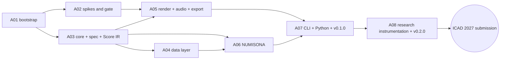
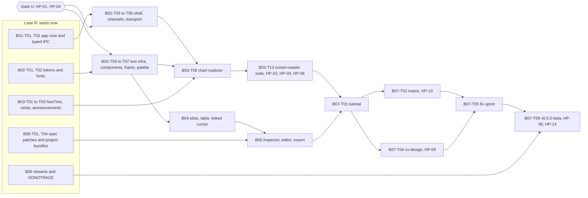
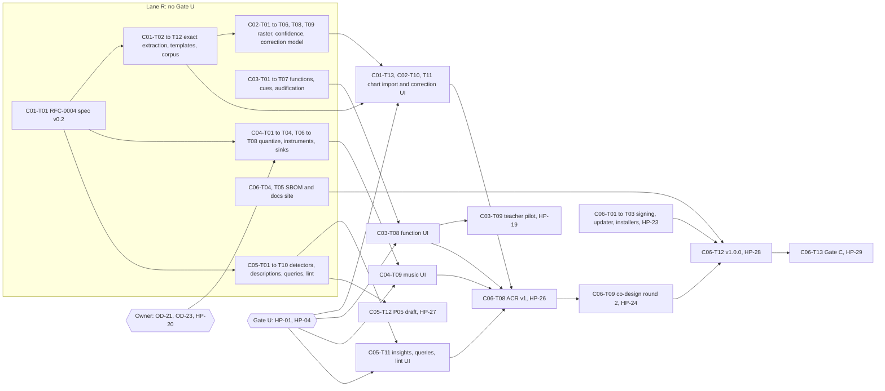

# Implementation Plan

> **Status:** Baseline v1 (2026-10-18); Stage B detailed 2026-10-21; Stage C detailed 2026-10-26. **Owner:** Project lead.
> **Roadmap (stages, phases, exit criteria):** [roadmap.md](roadmap.md). **Live status:** [../sdlc/status.md](../sdlc/status.md). **Risks:** [risk-register.md](risk-register.md). **Open decisions:** [open-decisions.md](open-decisions.md).

This plan breaks the roadmap into **tasks**. It uses **rolling-wave planning**: Stages A, B and C are detailed to the task level (Stage B on 2026-10-21, §3; Stage C on 2026-10-26, §4, ahead of Gate B), and Stage D to the epic level. Each stage gate re-plans the next stage in detail; Gate B reviews the Stage C rows instead of writing them.

## 1. How work is executed

### 1.1 Cadence

| Practice | Rule |
|---|---|
| Iterations | 2 weeks. Each iteration has a goal tied to a phase exit criterion |
| WIP limit | At most 2 tasks in progress per person or agent session; finish before starting |
| Task size | **S** ≤ 1 day, **M** 2–3 days, **L** 4–5 days. Anything larger is split. These are the baseline's person-day sizes; for agent sessions they are relative effort, because Stage A ran far faster than planned (§3.1, F-120) |
| Tracking | Each task is a GitHub issue titled `[A03-T06] …`, labelled `stage/a`, `area/*`, `engine/*`, on the project board ([labels](../../.github/labels.yml)) |
| Done | [Definition of Done](../sdlc/definition-of-ready-and-done.md) for every PR; phase exit criteria for phases; gate review for stages |
| Records | Update [status.md](../sdlc/status.md) when a task changes state. Write a [worklog](../sdlc/worklog/README.md) entry per working session. Log [findings](../research-paper/findings-log.md) whenever something is measured or surprising |

### 1.2 Working with AI coding agents

Agents follow [AGENTS.md](../../AGENTS.md). For each task:

1. Read the task row here, the phase in the roadmap, and every document in the "Read" column.
2. Restate the acceptance criteria in the PR description before coding.
3. Keep PRs small (≤ ~400 changed lines excluding generated files and snapshots).
4. Include tests that reference rule IDs when implementing a research default.
5. Update docs, status and findings in the same PR.

### 1.3 Critical path (Stage A)

**Parallel lanes.** After A01, A02 (spikes) and A03 (core types) run in parallel. A04 and A05 can overlap once A03's core types land (A03-T01..T04).

---

## 2. Stage A · Foundation (task level)

Legend: **Read** = documents that must be read before starting.

### A01 · Repository bootstrap and governance

| Task | Description | Acceptance criteria | Size | Deps | Read |
|---|---|---|---|---|---|
| A01-T01 | **Owner decision:** licence (accept or amend ADR-0010) and docs licence (OD-09) | ADR-0010 status `accepted`; OD-01 and OD-09 closed | S | — | ADR-0010 |
| A01-T02 | Initialize the repo with the documentation baseline; default branch `main`; ruleset (PR required, 1 review, required checks, linear history, no force-push) | A direct push to `main` is rejected; the baseline is visible on GitHub | S | — | git-workflow |
| A01-T03 | Cargo workspace skeleton: root `Cargo.toml` with `[workspace.package]` (edition 2024, rust-version 1.88, licence, repository), `[workspace.lints]`, `[workspace.dependencies]`; empty crates `core, spec, data, compiler, dsp, render, audio, export, sonarithm, cli, xtask` with crate-level docs | `cargo build --workspace` and `cargo test --workspace` pass on 3 OSes | M | T01 | 02-repository-and-crate-layout |
| A01-T04 | `rust-toolchain.toml`, `rustfmt.toml`, `clippy.toml`, `.editorconfig` | `cargo fmt --check` and clippy `-D warnings` are clean | S | T03 | coding-standards |
| A01-T05 | `deny.toml` (licence allowlist, advisories, bans, sources) | `cargo deny check` passes; a test PR adding a GPL crate fails | S | T03 | supply-chain-and-licensing |
| A01-T06 | `xtask`: `ci` (all local checks), `check-deps` (enforces 02 §3 rules), `codegen` stub | `cargo xtask check-deps` fails on a deliberate engine→engine dependency | M | T03 | 02 §3 |
| A01-T07 | `ci.yml`: matrix (ubuntu, windows, macos), rust-cache, fmt, clippy, nextest, doc tests, deny, MSRV job, `wasm32-unknown-unknown` check of core crates; `permissions: {}`; SHA-pinned actions | All jobs green on a PR; total wall time ≤ 15 min | M | T04–T06 | ci-cd |
| A01-T08 | PR-title Conventional Commits check, DCO check, OpenSSF Scorecard, CodeQL, Dependabot or Renovate, label sync from `.github/labels.yml` | Each workflow runs once successfully; Scorecard result published | S | T07 | ci-cd |
| A01-T09 | pnpm workspace skeleton: root `package.json`, `pnpm-workspace.yaml`, placeholder `packages/{ui,viz,ipc}`, lint and format config | `pnpm install` and `pnpm -r lint` pass in CI | S | T07 | coding-standards |
| A01-T10 | GitHub Project (Roadmap view; fields Status, Phase, Iteration, Area, Paper), milestones per phase, one issue per Stage A task | Every Stage A task exists as an issue on the board | S | T02 | this document |
| A01-T11 | Enable secret scanning + push protection, private vulnerability reporting, Discussions | Settings verified; SECURITY.md links work | S | T02 | SECURITY.md |
| A01-T12 | Docs CI: markdown lint, link check (lychee), placeholder schema-diff job | The docs workflow is green on the baseline | S | T07 | ci-cd |
| A01-T13 | Add licence files, SPDX/REUSE config, CITATION.cff licence field (after T01) | `reuse lint` passes | S | T01 | supply-chain-and-licensing |

### A02 · Technical spikes and prototype gate

Spikes live in `spikes/<name>/` (excluded from the workspace) and are archived after the gate. Each produces measurements logged as findings (`F-###`).

| Task | Description | Acceptance criteria | Size | Deps | Read |
|---|---|---|---|---|---|
| A02-T01 | cpal output + loopback latency harness (Win WASAPI, macOS CoreAudio, Linux PipeWire) | p50/p95 output latency measured at 128/256/512 frames on each OS | M | A01-T03 | 06 §9 |
| A02-T02 | Minimal own render graph (voice pool, buses, scheduler) behind a draft `RenderGraph` trait | Renders the benchmark Score in real time and offline; CPU per block recorded | M | A01-T03 | 06 §3, ADR-0004 |
| A02-T03 | Firewheel 0.14 behind the same trait; Miri on the integration where feasible | Same benchmark; comparison table (CPU, xruns, code size, Miri, ergonomics) | M | T02 | ADR-0004 |
| A02-T04 | Offline determinism check across 2 OSes | Null residual and ΔLUFS reported against the PB-06 targets | S | T02 | ADR-0013 |
| A02-T05 | Tauri 2.12 spike: Channel throughput; binary `ipc::Response` latency for 1 MB and 10 MB | PB-09 measured on all 3 OSes | M | A01-T09 | 09 §2 |
| A02-T06 | WebGL2 1M-point waveform + spectrogram in WebView2, WKWebView, WebKitGTK (Intel/AMD/NVIDIA if available) | fps and frame-time distributions recorded (PB-08) | M | T05 | notes/05 §6 |
| A02-T07 | React Aria Tree + Slider + Toolbar + live-region announcer in Tauri; walkthroughs with NVDA, VoiceOver and Orca; browse/focus-mode behaviour; native notification prototype on Windows (OD-05) | A pass/fail matrix with notes per AT; OD-05 recommendation | M | T05 | 08 §4–5 |
| A02-T08 | Gate report `docs/sdlc/reviews/A02-prototype-gate.md`; confirm or amend ADR-0002, 0003 and 0004 | Report merged; ADR confirmations recorded; risks R-01..R-05 updated | S | T01–T07 | reviews template |

### A03 · Core types, Spec v0.1 and Score IR

| Task | Description | Acceptance criteria | Size | Deps | Read |
|---|---|---|---|---|---|
| A03-T01 | Units: `Hz`, `Cents`, `Db`, `Seconds`, `Frames`, `Pan` newtypes with conversions | Property tests: Hz↔cents↔MIDI round-trip within 1e-9 | S | A01-T03 | 05 §4.1 |
| A03-T02 | IDs, `RowRef`, `Provenance`, `Diagnostic`, error-code registry, `cargo xtask codes` | Codes doc generated; duplicate codes fail the build | M | T01 | 12 §1 |
| A03-T03 | Score IR types, serde, snapshot serializer (rounding rules), invariant checks | Invariants 1–5 (05 §4.2) checked in debug and covered by proptest | M | T01 | 05 §4 |
| A03-T04 | Capability traits, `Engine`, `Registry`, `EngineManifest`, conflict detection | Duplicate registration fails with `SNR-COMP-0xx` | M | T03 | 05 §3, ADR-0007 |
| A03-T05 | **RFC-0001: Spec v0.1** from the 04 draft; 7-day comment period; accept | RFC merged as accepted; doc 04 updated to "frozen v0.1" | M | — | 04, rfcs/README |
| A03-T06 | Spec types (serde + schemars), `sonarithm schema`, `schemas/` export, CI staleness check | Schema regenerated in CI; diff fails if stale | M | T05 | 04 |
| A03-T07 | Semantic validation with miette diagnostics and JSON pointers | Every validation rule has a passing and a failing test | M | T06 | 04 §8 |
| A03-T08 | Migration framework; RFC 8785 canonicalization; spec hash | Hash stable across OSes; key-order permutations hash equal | M | T06 | ADR-0013 |
| A03-T09 | Compiler skeleton: stages with no-op engines; `CompileContext` (RNG derivation, diagnostics, cancellation, budgets) | An end-to-end compile of a spec with an inline source to an empty Score | M | T04, T07 | 05 §2–3 |
| A03-T10 | Fuzz target for the spec parser; proptest spec generators | 1 h fuzz without panic (A03 exit) | S | T06 | testing-strategy |
| A03-T11 | Test that validates every JSON example in docs/architecture/04 | Example drift breaks CI | S | T07 | 04 §6 |

### A04 · Data layer

| Task | Description | Acceptance criteria | Size | Deps | Read |
|---|---|---|---|---|---|
| A04-T01 | `DataBundle`/`Table`/`FieldMeta` on Arrow; `snr.*` metadata I/O | Metadata survives Parquet and Arrow IPC round trips | M | A03-T02 | 03 §2–3 |
| A04-T02 | CSV/TSV (sniffing, encodings) and JSON/NDJSON sources | Corpus of 20 messy CSVs ingests with correct types | M | T01 | 10 §2 |
| A04-T03 | Parquet and Arrow IPC sources | Metadata and provenance preserved | S | T01 | — |
| A04-T04 | XLSX/ODS via calamine (sheet/range selection) | Test workbook suite passes | S | T01 | — |
| A04-T05 | Type, role and concept inference with `Info` diagnostics | Precision ≥ 95% on the inference corpus | M | T02 | 03 §3 |
| A04-T06 | Provenance columns and propagation rules | Propagation property tests (weakest class, min confidence) | M | T01 | 03 §4 |
| A04-T07 | Transforms (filter, sort, aggregate, bin, smooth, resample, derive, normalize) with a sandboxed rhai subset | Each transform has unit and property tests; rhai is fuel-limited | L | T06 | 03 §6 |
| A04-T08 | M4 and LTTB downsampling; tile cache | M4 is pixel-exact against the reference implementation | M | T01 | 03 §7 |
| A04-T09 | Data fingerprinting | Identical across OSes for the corpus | S | T01 | ADR-0013 |
| A04-T10 | Benchmarks (PB-05); fuzzers for CSV and XLSX | PB-05 met; fuzzers in CI (nightly) | M | T02–T04 | testing-strategy |

### A05 · Render engine, audio backend and export

| Task | Description | Acceptance criteria | Size | Deps | Read |
|---|---|---|---|---|---|
| A05-T01 | DSP nodes: sine, triangle, PolyBLEP saw/square, ADSR with minimum ramps, filters, constant-power panner | Spectral tests; no clicks (SDR-22 test) | M | A02-T08 | 06 §3 |
| A05-T02 | ISO 226:2023 compensation table; EBU R128 meter (ebur128) | Table matches the standard within tolerance; LUFS matches ebur128 reference files | M | T01 | SDR-24 |
| A05-T03 | `RenderPlan` and plan builder (Score → plan; voice pools; frame conversion) | Plan snapshot tests; polyphony analysis correct | L | A03-T03 | 05 §5 |
| A05-T04 | Render graph: buses, voice pool, sample-accurate scheduler, transport | Events land at exact sample offsets (unit test); seek/loop crossfades | L | T03 | 06 §3, §5 |
| A05-T05 | RT communication: rtrb commands, triple_buffer state, basedrop plan swap, collector | shuttle tests on the queues; no allocations on the RT path | M | T04 | 06 §4 |
| A05-T06 | `AudioBackend` + `CpalBackend` (enumeration, hot-plug, latency) | Device unplug/replug keeps the transport position (manual test script) | M | T04 | 06 §6 |
| A05-T07 | `OfflineBackend`; WAV (hound) and FLAC (flacenc) writers | Files validate in external tools; bit depth and sample rate correct | M | T04 | 06 §7 |
| A05-T08 | Render manifest + WebVTT cue sidecar | Manifest validates against its schema; no absolute paths | S | T07 | ADR-0013 |
| A05-T09 | Master limiter + start-up gain ramp | True peak ≤ −1 dBTP on stress Scores; no full-scale onset (NFR-10) | S | T04 | 06 §10 |
| A05-T10 | Allocation check in debug (`allocation-counter`, replacing `assert_no_alloc`: F-038); 10-min soak test; xrun counting | PB-02 met on reference hardware; CI debug soak (shorter) passes | M | T05, T06 | coding-standards |
| A05-T11 | Golden-audio harness and cross-OS CI job; decide Git LFS (OD-08) | PB-06 met for the golden set | M | T07 | testing-strategy |
| A05-T12 | Benchmarks (PB-03) | PB-03 met | S | T07 | — |
| A05-T13 | `WasapiBackend` (ADR-0016): RAW shared mode by default, exclusive mode opt-in, per-device latency calibration; latency measurement tool | RAW is the Windows default and reported; exclusive opens on request; the tool reports p50/p95 and the calibrated offset. ADR-0016 confirmation by cable is an owner step (script) | M | T06 | ADR-0016, 06 §6, §9 |

### A06 · NUMISONA v1

| Task | Description | Acceptance criteria | Size | Deps | Read |
|---|---|---|---|---|---|
| A06-T01 | Scales: linear, log, symlog, sqrt, pow, quantile, band, ordinal | Monotonicity and range property tests | M | A03-T09 | 04 §5.3 |
| A06-T02 | Pitch spaces: log-frequency, linear, mel, ERB-rate, Bark; range defaults | `sdr_08_*` and `sdr_09_*` tests | M | T01 | SDR-08, SDR-09 |
| A06-T03 | Concept table (`concepts.toml`) + polarity resolution + ambiguity diagnostics | `sdr_12..15_*` tests; every row cites evidence | M | T02 | 03 §3.3 |
| A06-T04 | `tone` and `glide` encoders with `RowRef`; redundant duration and taps; categorical timbre | Snapshots on the example datasets; A11Y-13 test | L | T03, A04-T01 | 07 NUMISONA |
| A06-T05 | Psychophysical scaling | `sdr_11_*` test | S | T01 | SDR-11 |
| A06-T06 | `auto` mark with density switching (experimental flag) | Flagged experimental; `sdr_20_*` test | S | T04 | SDR-20 |
| A06-T07 | Templates: line-overview, bar-discrete, scatter-xy, histogram, box-five-number, heatmap-rowscan | Each template renders each compatible example dataset | M | T04 | SDR-03 |
| A06-T08 | Erie importer (subset) | The Erie gallery subset imports with a report of unmapped constructs | M | A03-T06 | 04 §9 |
| A06-T09 | Rule-conformance suite (one test per owned SDR) and compile benchmarks | PB-04 met; rule coverage report | M | T01–T07 | design-rules |

### A07 · CLI, Python package and v0.1.0-alpha

| Task | Description | Acceptance criteria | Size | Deps | Read |
|---|---|---|---|---|---|
| A07-T01 | Facade crate API + rustdoc examples | Docs build; examples compile | M | A06 | 11 §1 |
| A07-T02 | CLI: render, play, quick, validate, inspect, schema, migrate, devices, lint (stub); `--json`, `--plain` | Snapshot tests (assert_cmd + insta); exit codes per 11 §2 | L | T01 | 11 §2 |
| A07-T03 | Python: PyO3/maturin abi3; Arrow PyCapsule input; notebook audio; `.pyi` stubs | Wheels install and pass pytest on 3 OSes | L | T01 | 11 §3 |
| A07-T04 | Examples gallery: 5 datasets (CC BY 4.0) + specs + a notebook | Rendered in CI; licences recorded in datasets.md | M | T02 | research-paper/datasets |
| A07-T05 | release-plz + git-cliff; wheels workflow; trusted publishing (crates.io, PyPI) | Dry-run release succeeds | M | T02, T03 | release-process |
| A07-T06 | Zenodo integration; CITATION.cff completed (names, ORCID) | DOI minted on release | S | T05 | publication-plan |
| A07-T07 | Quickstart tutorial; 3-person install test | Median time to first FLAC ≤ 5 min | S | T02–T04 | — |
| A07-T08 | **Release v0.1.0-alpha** | Gate checklist for releases complete | S | T05–T07 | release-process |

### A08 · Research instrumentation v0

| Task | Description | Acceptance criteria | Size | Deps | Read |
|---|---|---|---|---|---|
| A08-T01 | Stimulus generators: reversals × density (Nees & Walker 2008), price series (Smith & Walker 2005), SNR transits (Tucker Brown et al. 2022), correlation triplets | Deterministic given a seed; parameters documented | M | A06 | evaluation-plan |
| A08-T02 | Replication gallery v0: Smith & Walker context cues, Nees & Walker density, Erie examples (Dombois audification follows in C03) | Every item renders reproducibly with a manifest | M | T01 | P01 outline |
| A08-T03 | Study runner: `sonarithm study run` (protocol file, trial sequencing, keyboard responses, JSONL logs, pause and resume) | A pilot protocol runs end to end, accessibly | L | T01 | experiments/README |
| A08-T04 | Technical benchmark report (latency, RTF, determinism) for P01 and P07 | Numbers in benchmarks-log with method notes | S | A05, A07 | benchmarks-log |
| A08-T05 | Paper P01 draft and submission | Submitted, or a deferral recorded at Gate A | L | T02, T04, RL-T03 | P01 outline |
| A08-T06 | **Release v0.2.0-alpha** | Release checklist complete | S | T01–T04 | release-process |

### 2.1 Research lane (parallel to Stage A)

Research work with fixed external deadlines runs beside the engineering phases, not inside them.

| Task | Description | Acceptance criteria | Size | Deadline | Read |
|---|---|---|---|---|---|
| RL-T01 | Check RV University's policy on non-research usability sessions with BLV participants (OD-04: the owner works alone, so there is no ethics route). Prepare accessible consent, compensation and data-handling materials for those sessions | Policy confirmed in writing; materials drafted | M | Six weeks before B07-T04 (HP-09); baseline Mar 2027 | evaluation-plan, accessibility-conformance-plan |
| RL-T02 | **Deferred (OD-04).** Ethics application for research studies (perception studies, publishable co-design). Revisit at Gate B or when a collaborator offers an ethics route | Decision recorded at Gate B | S | Gate B | evaluation-plan, EXP-000 |
| RL-T03 | P01 related-work and framing sections drafted from [related-work.md](../research-paper/related-work.md) | Draft sections reviewed | M | Jan 2027 | P01 outline |
| RL-T04 | BLV co-designer outreach (recruiting channels, compensation budget per OD-10) | ≥ 10 prospective participants for B07 | M | Six weeks before B07-T04 (HP-09); baseline Mar 2027 | accessibility-conformance-plan |
| RL-T05 | Monthly re-check of venue deadlines; update the publication plan | Plan current | S | Monthly | publication-plan |

---

## 3. Stage B · Accessible desktop (task level)

Stage B was planned to the task level on 2026-10-21, after Stage A's code was complete. The rows below replace the baseline's lighter task list. Each task is a GitHub issue titled `[B01-T01] …`, labelled `stage/b`, in milestones B01–B07 on the [project board](https://github.com/users/DuhItzAniket/projects/2). The phase estimates are in the [roadmap](roadmap.md#stage-b-re-estimate).

### 3.1 How Stage B runs

| Topic | Rule |
|---|---|
| Lane R (starts now) | Rust crates and framework-agnostic assets: the app core, AUDAXIS, SONOTRACE, stream adapters, project bundles, colour tokens, fonts and message catalogues. 23 tasks; no owner step blocks them |
| Lane U (after Gate U) | Every task that commits to the Tauri shell ([ADR-0002](../decisions/0002-desktop-shell-tauri.md)) or to React Aria ([ADR-0003](../decisions/0003-frontend-react-and-react-aria.md)): 37 tasks. Seven more wait only on owner items: the releases, the Gate B review, the second locale, the JOSS paper and the AXONOTE icon |
| Gate U | Opens after the Windows walkthroughs (HP-01) and ADR-0002 and ADR-0003 confirmed for Windows in the [A02 gate report](../sdlc/reviews/A02-prototype-gate.md#decision) (HP-04), as decided in [OD-15](open-decisions.md#closed-decisions) on 2026-10-21. The Linux session with Orca (HP-02) is a B03 exit criterion, and macOS with VoiceOver (HP-03) stays due by B03. The Tauri host stays a thin adapter over `sonarithm-app` behind the IPC protocol, so a late Linux failure costs only the host (B01-T01 to T03 test this). Lane U issues keep `status/blocked` until HP-01 and HP-04 are done; the coordinator lifts it |
| Blocked on | Lists the owner and human-paced items (§3.3) that a task cannot finish without. Their issues carry `status/blocked` until the item is done. A task also waits for its Deps; releases and the gate review wait on Lane U tasks through them |
| Sessions | At most two build-heavy agent sessions at once on the 16 GB laptop. Suggested start: one session on AUDAXIS and the message catalogues (B02-T08; B03-T01 to T03, T05, T06, T11), one on the app core and SONOTRACE (B01-T01, T02, T06; B03-T07, T08 once B01-T01 lands; B04-T03; B05-T01, T04; B06 except T06). B02-T01 and T02 need no Rust build |
| Sizes | S, M and L keep their relative meaning (§1.1). Stage A's agent sessions closed a phase of 9–13 tasks in one to two calendar days ([F-120](../research-paper/findings-log.md#implementation-findings)) |
| Rules and budgets | The A11Y and SDR rules a task must satisfy, plus the FR, NFR and PB IDs it serves and the design-language (DL) and keymap (KB) rules. Tests that implement a rule carry its ID in their name (AGENTS.md rule 5) |

### 3.2 Critical path (Stage B)

**Parallel lanes.** Lane R runs now. After Gate U, B01's shell (T03 to T05) and B02's components (T03 to T07) run in parallel; B03's explorer (T09) needs both. B04 and B05 follow B02. B06 has one Lane U task (T06).

### 3.3 Owner and human-paced items

These items run at the owner's pace, or need other people, hardware or calendar time. They are tracked in the owner checklist ([#129](https://github.com/DuhItzAniket/SONARITHM/issues/129)) or the issue named, not as B tasks. Agents prepare the scripts, materials and drafts for each.

| ID | Item | Who | Tracked in | Unblocks | Needed by |
|---|---|---|---|---|---|
| HP-01 | A02 walkthroughs on Windows: NVDA (WALKTHROUGH.md §1) and Narrator (§2), with the OD-05 recommendation from steps 11–15 | Owner | [#32](https://github.com/DuhItzAniket/SONARITHM/issues/32), [#129](https://github.com/DuhItzAniket/SONARITHM/issues/129) | Gate U; B03-T04 | Before Lane U starts (A02 gate condition) |
| HP-02 | Ubuntu live-USB session on HW-01: WebKitGTK IPC and WebGL2 on both GPUs, and the Orca walkthrough (§3) | Owner | [#31](https://github.com/DuhItzAniket/SONARITHM/issues/31), [#32](https://github.com/DuhItzAniket/SONARITHM/issues/32), [#129](https://github.com/DuhItzAniket/SONARITHM/issues/129) | B03 exit (B03-T13; ADR-0002's Linux trigger); B04-T08 | By B03's exit (OD-15; was before B01) |
| HP-03 | macOS session on a lab or volunteer Mac: WKWebView IPC, App Nap, WebGL2 and VoiceOver (§4) | Owner arranges access | [#30](https://github.com/DuhItzAniket/SONARITHM/issues/30), [#31](https://github.com/DuhItzAniket/SONARITHM/issues/31), [#32](https://github.com/DuhItzAniket/SONARITHM/issues/32), [#129](https://github.com/DuhItzAniket/SONARITHM/issues/129); R-22 | B01-T07 (App Nap), B02-T10 and B03-T04 (macOS parts), B03-T13 (B03 exit), B04-T08 | By B03 (A02 gate condition) |
| HP-04 | Gate U decision: ADR-0002 and ADR-0003 confirmed for Windows from HP-01 in the A02 gate report (A02-T08); Linux and macOS confirmation follows by B03's exit (OD-15) | Coordinator under the owner's delegation; the owner signs the A02 gate | [#33](https://github.com/DuhItzAniket/SONARITHM/issues/33), A02 gate report | Gate U | After HP-01 |
| HP-05 | Cable latency test and NVDA coexistence (ADR-0016), and one run on a device with small shared periods | Owner (needs a USB audio interface or cable) | [#123](https://github.com/DuhItzAniket/SONARITHM/issues/123), [#186](https://github.com/DuhItzAniket/SONARITHM/issues/186) | B03-T12 | B03 |
| HP-06 | PB-02 soak at 128-frame buffers on capable hardware | Owner | [#187](https://github.com/DuhItzAniket/SONARITHM/issues/187) | B07-T09 | Before Gate B |
| HP-07 | Manual NVDA and Narrator check of every `@sonarithm/ui` component; VoiceOver with HP-03 | Owner | B02-T10 | B02 exit | B02 exit |
| HP-08 | Scripted task suite T-03 to T-05 with NVDA, JAWS, VoiceOver and Orca | Owner and volunteers; JAWS access TODO(verify) (R-25) | B03-T13 | B03 exit | B03 exit |
| HP-09 | Co-design route: RV University's policy for paid usability sessions confirmed in writing (RL-T01), a compensation budget (OD-10), at least 10 recruited participants (RL-T04) | Owner | [#94](https://github.com/DuhItzAniket/SONARITHM/issues/94), [#92](https://github.com/DuhItzAniket/SONARITHM/issues/92), OD-10 | B07-T04 | Six weeks before B07-T04 (R-10) |
| HP-10 | Full manual matrix M-01 to M-10 with one refreshable braille display | Owner and volunteers; braille display access TODO(verify) (R-25) | B07-T02 | B07-T02 and ACR v0 (B07-T06) | B07 |
| HP-11 | Listening checks of earcons, context sounds and the monitoring soundscape (also A05's deferred limiter and mallet checks) | Owner or co-design partners | B03-T06, B06-T04 | Nothing (recorded, not blocking) | B03, B06 |
| HP-12 | Code-signing route (OD-02, R-14): SignPath Foundation or RV University; the Apple Developer Program | Owner | OD-02 | A signed v0.5.0-beta (optional; signing is a C06 deliverable) | B07 for planning |
| HP-13 | JOSS P02 eligibility and submission: six months of public history and evidence of research use; the owner submits | Owner | B07-T08, OD-17 | B07-T08 | Calendar-gated: the repository was created on 2026-10-18, so not before about 2027-04-18, TODO(verify) |
| HP-14 | Release go and tags for v0.3.0, v0.4.0 and v0.5.0-beta | Owner | B03-T14, B05-T08, B07-T09 | Those releases | Per release |
| HP-15 | Second UI locale chosen with the community (OD-12) | Owner and community | OD-12 | B07-T07 | B05 |
| HP-16 | AXONOTE icon (OD-03) | Owner | OD-03 | B02-T11 | B02 |
| HP-17 | Gate B sign-off, the OD-04 revisit and the RL-T02 decision | Owner | [#95](https://github.com/DuhItzAniket/SONARITHM/issues/95), B07-T10 | Stage C | Gate B |

### 3.4 Carry-over from Stage A

| Issue | What | Stage B task that waits for it |
|---|---|---|
| [#185](https://github.com/DuhItzAniket/SONARITHM/issues/185) | PB-03: SIMD voice batching and a rerun on HW-01e; the owner's waiver covers `v0.1.0-alpha` only. Agent work, build-heavy. **Done 2026-10-25:** met on HW-01e (F-134) | B07-T09 (`v0.5.0-beta`, Gate B) |
| [#186](https://github.com/DuhItzAniket/SONARITHM/issues/186) | PB-01: settle key press → cue onset at B03 | B03-T12 |
| [#187](https://github.com/DuhItzAniket/SONARITHM/issues/187) | PB-02: a 10-minute soak at 128-frame buffers on capable hardware (HP-06) | B07-T09 |
| [#123](https://github.com/DuhItzAniket/SONARITHM/issues/123) | A05-T13's cable latency test and NVDA coexistence check (HP-05) | B03-T12, through #186 |
| [#94](https://github.com/DuhItzAniket/SONARITHM/issues/94), [#92](https://github.com/DuhItzAniket/SONARITHM/issues/92) | RL-T01 policy check and RL-T04 outreach (HP-09) | B07-T04 |
| [#95](https://github.com/DuhItzAniket/SONARITHM/issues/95) | RL-T02: the ethics decision at Gate B (HP-17) | B07-T10 |

### B01 · Desktop shell, IPC and app core

| Task | Description | Acceptance criteria | Rules and budgets | Size | Deps | Blocked on | Read |
|---|---|---|---|---|---|---|---|
| B01-T01 | **`sonarithm-app` headless app core: sessions, command bus, job queue, settings.** `sonarithm-app` (headless app core, shared by the desktop and the CLI): sessions over the facade (open and close datasets, compile, plan, play through `sonarithm-render`'s player); a command bus with undo tokens; a job queue with progress and cancellation; versioned settings with migrations and atomic, crash-safe writes | Integration scenarios with the null audio backend pass on three OSes: open dataset → compile → play → seek → stop → export (testing-strategy §10); settings migrate from a v0 fixture; an interrupted write leaves the previous settings readable (fault injection); every session, transport, project and export operation is reachable through the IPC protocol without Tauri, so the scenarios drive it headless (thin host, OD-15); `check-deps` passes | A11Y-15 (playback only on command); FR-050; NFR-11 (settings) | L | A07-T01 | — | 01 §4, 02 §2–§3, 09 §2.1, §5, 12 §3, testing-strategy §10 |
| B01-T02 | **Typed IPC: ts-rs codegen into `@sonarithm/ipc`, protocol version, `IpcTransport`.** ts-rs export of every payload and error type into `packages/ipc/src/generated/` through `cargo xtask codegen`; a protocol version constant shared by host and UI; the `IpcTransport` interface (`invoke`, `subscribe`, `binary`) with a `mockIPC` implementation; typed errors (`code`, `message`, `hint`, `pointer`); the binary view header format | CI regenerates the types and fails on a diff; a version mismatch fails fast with a clear error (test); frontend code uses only generated protocol types; the binary header is documented and generated; `IpcTransport` is the only seam between the UI and the host, so an Electron host would replace only the host, not the React code (09 §2.3, OD-15) | AGENTS rule 10 (generated files); ADR-0011 | M | T01 | — | ADR-0011, 09 §2, §2.2, §2.3, 12 §1 |
| B01-T03 | **Tauri 2 scaffold `apps/desktop`: capabilities, CSP, thin commands, CI on three OSes.** `apps/desktop` with `src-tauri` (crate `sonarithm-desktop`) and a Vite + React 19 UI shell; least-privilege capabilities, no shell plugin; a CSP of `default-src 'self'` that keeps binary IPC; browser accelerator keys disabled; command handlers that validate input and call `sonarithm-app`; the Tauri `IpcTransport`; build and smoke test on the three CI OSes | The app builds and opens an empty workspace on Windows, macOS and Linux runners; a 1 MB view stays binary under the CSP (F-042 test); F5, Ctrl+R, Ctrl+F, F7, F12 and Alt+Left do nothing in the webview (keyboard §12.3); command handlers only validate input and call `sonarithm-app`, and a `check-deps` rule fails if `sonarithm-desktop` depends on anything below `sonarithm-app` except `sonarithm-core` types (thin host, OD-15; 02 §3 rule 6); no remote URL is loaded | A11Y-05; KB-04; NFR-04; OD-15 (thin host) | L | T01, T02 | Gate U | ADR-0002, ADR-0003, 09 §1, §4, keyboard-and-navigation §12.3, A02 gate (F-041, F-042) |
| B01-T04 | **Hot paths: clock anchors, meters and binary views over Channels (PB-09).** Channels for transport clock anchors (on change and every 2 s), meters (binary, batched at 30 Hz), diagnostics, announcements and job progress (JSON, rate-limited); binary `ipc::Response` for views with the generated header; an IPC benchmark in CI | PB-09: ≤ 30 ms p95 for a 1 MB binary view on the three CI OSes and HW-01 (HW-01e rerun if above 50% of the budget), logged in the benchmarks log; no JSON event on a hot path (test); anchors only on change and every 2 s (unit test) | PB-09 | M | T03 | Gate U | 09 §2, 06 §9, A02 gate (spike 3), 12 §8 |
| B01-T05 | **Transport: XState machine mirroring the Rust transport.** The `transport` XState v5 machine mirrors the authoritative Rust `TransportState`; play, pause, stop, seek, speed and loop; the transport toolbar wired to the commands | Model-based tests of the machine; the Rust state wins after a conflicting UI intent (test); playback starts only on a user command (test); toolbar keyboard test (arrows inside, Tab leaves) | A11Y-09, A11Y-15; FR-050 | M | T03, T04 | Gate U | 09 §3, 06 §5, keyboard-and-navigation §5.3 |
| B01-T06 | **Network-deny integration test.** A harness that fails on any network connection attempt, with the mechanism chosen per OS; it runs the app-core scenarios now and the packaged app from B01-T09 | A deliberate connection attempt fails the test (negative test); every app-core scenario passes with zero connection attempts on three OSes; the per-OS mechanism is documented in testing-strategy §10 | NFR-04; ADR-0012; AGENTS rule 9 | M | T01 | — | ADR-0012, 09 §4, testing-strategy §10 |
| B01-T07 | **Start-up path and cold-start benchmark (PB-07).** Start-up per 09 §7: settings and profile load, the audio device opened lazily on first play, no splash screen, focus in the project tree of an empty workspace; a start-up benchmark; App Nap handling for the control and telemetry threads if HP-03 confirms F-041 | PB-07: ≤ 2 s cold start to an interactive workspace on HW-01 (HW-01e rerun if above 50%) and recorded for the CI runners; start-up never waits for an audio driver (test with a slow null backend) | PB-07; DL-X04, DL-X09 | M | T03 | Gate U | 09 §7, 12 §8, design-language §3 |
| B01-T08 | **Devices, sonification volume and a global stop all audio.** `devices_list` and `device_select`; a sonification volume independent of the system volume; a global "stop all audio" command reachable from every scope and the menu; device-loss and device-change messages in words for the announcement log (HS-05) | Stop all audio silences output within one audio block from every region (null-backend E2E, T-13); the sonification volume never changes the system volume (test); unplugging while playing pauses at the same position and posts a text message (scripted, as A05's hot-plug script) | A11Y-15, A11Y-17, A11Y-24; FR-118 | M | T04, T05 | Gate U | 06 §6, §10, §11, keyboard-and-navigation §5.1, accessibility-conformance-plan §3.2 |
| B01-T09 | **Unsigned desktop nightly bundles for testers.** `nightly.yml` builds unsigned installers (NSIS or MSI, DMG, AppImage), so the owner and volunteers can run screen-reader checks on a real build; the network-deny harness runs against the packaged app | Nightly artifacts for three OSes, named by commit; an install-and-launch smoke test per runner; the packaged app passes the network-deny test; no updater key or signing secret is used (signing is C06) | A11Y-32 (enables the matrix); NFR-04 | M | T03, T06 | Gate U | ci-cd, release-process (desktop release), 09 §6 |

### B02 · Design system and application frame

| Task | Description | Acceptance criteria | Rules and budgets | Size | Deps | Blocked on | Read |
|---|---|---|---|---|---|---|---|
| B02-T01 | **OKLCH token generator: dark, light and high-contrast themes, forced colors.** Semantic colour tokens generated in OKLCH for dark, light and high-contrast (dark and light) themes; `forced-colors` and `prefers-contrast` handling; CSS custom properties in cascade layers; spacing, radius and motion tokens | Generated tokens are committed and CI fails on a diff; every pair in design-language §5.3 meets 4.5:1 for text and 3:1 for non-text and focus in every theme (token test); lints catch DL-X01, DL-X02, DL-X03 and DL-X07 | A11Y-25; FR-117; DL-X01–DL-X03, DL-X07 | M | A01-T09 | — | design-language §5, §7, §8, §9 |
| B02-T02 | **IBM Plex fonts, type scale and tabular numerals.** IBM Plex Sans and Mono bundled locally with their OFL notices; the type scale; tabular numerals for readouts; a font test page for `tnum` and `zero` per weight | No font loads from the network; the notices are in the generated licences data (12 §9); the font test shows `tnum` and `zero` per weight; readouts use the numeric class (DL-X10 lint) | A11Y-25; DL-X10 | S | T01 | — | design-language §7.1, 12 §9 |
| B02-T03 | **Frontend test infrastructure: Storybook, axe, Vitest browser mode, Playwright.** Storybook 10 with the accessibility and Vitest addons; Vitest browser-mode screenshots on one pinned Linux Chromium image; Playwright with `mockIPC` in Chromium, WebKit and Firefox, with `@axe-core/playwright`; keyboard-only flow helpers; CI jobs | A seeded axe violation fails CI (negative test); a seeded focus trap fails a keyboard-only flow; screenshot baselines are stable across two CI runs | A11Y-05, A11Y-31 (automated checks) | M | A01-T09 | Gate U | testing-strategy §12, §13.1, coding-standards §12 |
| B02-T04 | **`@sonarithm/ui` core components on React Aria: Button, Toolbar, Menu, Dialog, Tabs and more.** Button, IconButton, ToggleButton and its group, Toolbar, Menu, Dialog and Modal, Tabs, Tooltip and Disclosure on React Aria Components, each with stories in every state and theme. IconButton requires an accessible name and a tooltip; tooltips hold nothing that keyboard and AT cannot reach | Every story (focus, disabled, error; every theme) passes axe with no serious or critical violation; a keyboard test per component; an IconButton without a name fails type checking; every `:hover` style has a `:focus-visible` counterpart (lint) | A11Y-05, A11Y-18, A11Y-25, A11Y-29; DL-X05, DL-X11 | L | T01, T02, T03 | Gate U | design-language §11, ADR-0003, 08 §5 |
| B02-T05 | **Data components on React Aria: Tree, virtualized Table, Slider with units, ComboBox, GridList.** Tree (project tree), Table with Virtualizer and exposed row and column headers, Slider that announces value, unit and range, NumberField that accepts units, Select and ComboBox, ListBox and GridList with keyboard reordering | As B02-T04, plus: the Slider's `aria-valuetext` carries value and unit; Table headers are in the accessibility tree (snapshot); the three F-045 points (tree row names, `SliderOutput` live region, React Aria's own announcer) are resolved or filed | A11Y-03, A11Y-05, A11Y-12 (reordering), A11Y-18, A11Y-26 | L | T04 | Gate U | design-language §11, A02 gate (F-045), keyboard-and-navigation §5.6–§5.8 |
| B02-T06 | **Application frame: fixed regions, splitters, F6 cycling, narrow layout.** Top bar, project, workspace, inspector and status regions as landmarks; keyboard-resizable splitters (window splitter pattern); F6 and Shift+F6 in a constant order, with collapsed regions kept as Expand stops; the narrow layout; the native or in-window menu bar decision recorded in 09 | Keyboard E2E: the F6 order is the same at every breakpoint, no focus trap, focus always visible and unobscured; splitters resize by keyboard; landmarks are in the accessibility tree | A11Y-05, A11Y-07, A11Y-25, A11Y-26; KB-05; DL-X12 | M | T04 | Gate U | design-language §4, keyboard-and-navigation §3, 09 §3 |
| B02-T07 | **Command registry, scopes and command palette.** Stable command IDs with names, descriptions, scopes and per-platform default bindings (Primary and Jump); scope precedence; the command palette on React Aria with announced results and current bindings; Shift+F1 lists the bindings of the focused scope | A test reaches every registered action from the palette; scope-precedence unit tests; a lint over the default keymap rejects screen-reader modifiers and KB-04 combinations; palette results are announced (accessibility test) | A11Y-05, A11Y-06, A11Y-30; KB-01–KB-09; FR-116 | M | T04, T06 | Gate U | keyboard-and-navigation §1, §2, §5, §12, §13, design-language §11 |
| B02-T08 | **Fluent catalogues, locale formatting and the pseudo-locale check.** Fluent message catalogues whose IDs the UI and the Rust announcement templates share; locale-aware number, date and unit formatting; a pseudo-locale CI check for truncation and concatenated strings | A lint fails on a hard-coded UI string; the pseudo-locale run catches a seeded concatenated string; one message ID renders the same in Rust and TypeScript (contract test) | NFR-09; A11Y-12 | M | B01-T02 | — | 12 §5, 08 §9, coding-standards |
| B02-T09 | **Design review against the design-language checklist.** Review every component and the frame against design-language §3 and §13; automate the detectable anti-patterns as lints; CVD simulation of every status and series view | A review record with zero DL-X violations is committed; the lints run in CI | DL-X01–DL-X13; A11Y-25 (no colour-only meaning) | S | T04, T05, T06, T07 | Gate U | design-language §3, §13, engine-identity |
| B02-T10 | **Manual NVDA, Narrator and VoiceOver check of every component (owner).** Per-component scripts in the style of the A02 WALKTHROUGH.md; the owner runs NVDA and Narrator, and VoiceOver on the Mac from HP-03; failures filed with severities | A results table per component and AT with versions; every failure filed with a severity (conformance plan §9); B02 exits with no open critical issue | A11Y-18, A11Y-32 (subset) | M | T05, T06, T07 | Gate U, HP-07 | accessibility-conformance-plan §3, §9, testing-strategy §13.2 |
| B02-T11 | **Engine identity assets and OD-03 (AXONOTE icon).** Close OD-03 with the owner, then produce the engine SVG tiles and chips with accessible names and licence notices | OD-03 closed; SVG assets meet engine-identity §9.2; accessible names per §7; the Lucide ISC and Feather MIT notices are present | DL-X13; A11Y-01 | S | T01 | HP-16 | engine-identity, design-language §10 |

### B03 · AUDAXIS v1: navigation, context and speech

| Task | Description | Acceptance criteria | Rules and budgets | Size | Deps | Blocked on | Read |
|---|---|---|---|---|---|---|---|
| B03-T01 | **`sonarithm-audaxis` crate and NavTree builder.** `sonarithm-audaxis` registered through the engine registry; the NavTree from (Score, data, annotations): Dataset, Series, Axes, Insights, Segment and Point nodes with even or semantic segments; the compiler returns it beside the Score so `inspect` and Python can expose it | NavTree snapshots for each of the six NUMISONA templates; property tests: every node reachable, every Point maps to a `RowRef`; `check-deps` passes (no engine-to-engine dependency) | A11Y-01, A11Y-04; FR-042 | L | A06-T07 | — | 08 §2, 05 §8, 07 AUDAXIS, ADR-0007, ADR-0014 |
| B03-T02 | **Cursor, movement verbs and where am I.** Cursor state with the local, lateral, spatial (step, ±10%, first, last) and targeted (landmark, maximum, minimum, value nearest, go to x) verbs; where am I; boundary moves keep the cursor and return the boundary earcon | Verb-sequence property tests: no dead end, the cursor is never undefined, boundary moves leave it in place; a unit test per verb and level (keyboard §4.3); where am I is defined at every node | A11Y-04, A11Y-07, A11Y-08, A11Y-27; FR-042 | L | T01 | — | 08 §2, keyboard-and-navigation §4, §6 |
| B03-T03 | **Announcement composer and queue.** Fluent templates (English); parts and their order; terse and verbose; units spoken in full at verbose; provenance qualifiers for estimates; queue classes with priority, supersede and sequencing (keyboard §9.1); an announcement history whose entries link to their node | Announcement snapshots at terse and verbose; a property test that only the latest navigation announcement survives; every estimate carries its qualifier (test); errors are never dropped (test) | A11Y-02, A11Y-12, A11Y-17, A11Y-24; FR-044, FR-051; AGENTS rule 7 | L | T02, B02-T08 | — | 08 §4, keyboard-and-navigation §8, §9, 03 §4, 12 §5 |
| B03-T04 | **Announcer routes: live regions and the native notification plugin (OD-05).** The managed live-region pair (clear-then-set); a Tauri plugin that raises UI Automation notifications on Windows and `announcementRequested` on macOS; live regions on Linux; a route setting; announcing never moves focus. Closes OD-05 from the A02 walkthrough evidence | OD-05 closed with evidence from HP-01; route unit tests; a Windows CI smoke test raises a UIA notification; announcing never changes focus (test); the owner's NVDA and Narrator check passes | A11Y-17, A11Y-19; FR-044 | L | T03, B01-T03 | Gate U, HP-01 | 08 §4, §5, A02 gate (spike 5), open-decisions OD-05 |
| B03-T05 | **Context tracks: tick track, dynamic reference tone, spoken legend.** AUDAXIS context: a tick track at major ticks for discrete marks, off for glides (SDR-16); a dynamic reference tone in a distinct timbre (SDR-17); a spoken legend with title, ranges, units and polarity before playback (SDR-18) | Conformance tests `sdr_16_*`, `sdr_17_*` and `sdr_18_*`; Score snapshots; golden-audio cases; no static first-value reference anywhere (test) | SDR-16, SDR-17, SDR-18, SDR-22; FR-040, FR-041 | M | T01 | — | sound-design §7, 07 AUDAXIS, design-rules §D |
| B03-T06 | **Earcon set with text equivalents.** The earcon catalogue (E-BOUNDARY, E-INVALID, E-LANDMARK, E-THRESHOLD, E-MODE, E-STREAM; E-ALARM and E-LEVEL off by default), replacing A05's provisional earcons; gap earcons for `missing: "earcon"` (deferred from A06); a text equivalent for each | A test enumerates the catalogue and finds a text equivalent for every earcon; golden-audio cases; E-BOUNDARY is noise-based and distinct from data tones (spectral test); the listening check (HP-11) is recorded | A11Y-08, A11Y-24, SDR-22, SDR-35; FR-043 | M | T01 | — | keyboard-and-navigation §11, sound-design §8, §14, A06 phase review |
| B03-T07 | **Speech and sonification sequencing; optional self-voicing (`sonarithm-speech`).** Cue, then speech, on each step; only cues during key repeat; speech held during playback except alarms; the current value announced on pause; speaking commands pause playback (duck as an option); `sonarithm-speech` self-voicing that ducks sonification by 20 dB while speaking; WebVTT cue timing from AUDAXIS | Conformance tests `a11y_09_*` and `a11y_20_*`; the duck level measured at −20 dB within the test's tolerance; the WebVTT sidecar validates with AUDAXIS cues; `cargo deny` passes for `tts` | A11Y-09, A11Y-19, A11Y-20; FR-049, FR-051, FR-101 | L | T03, B01-T01 | — | 08 §4, keyboard-and-navigation §9.2, 06 §7, risk R-15 |
| B03-T08 | **Modalities, profiles and presets.** Modality state (sonification, speech, braille, visual) on one cursor; profiles as portable, schema-validated JSON (pitch range, polarity per concept with the one-key flip, timbre preset, mark preference, pace, verbosity, part order, modalities, keymap overrides); the presets BLV chart reading, Analyst, Classroom and Presentation; precedence and the effective-settings view in the app core | Profile schema tests and an import-export round trip; precedence unit tests (defaults < profile < project < spec < UI action); `sdr_15_*` for the persisted flip and `sdr_38_*` for each personalization field | A11Y-10, A11Y-12, SDR-15, SDR-38; FR-032 (UI flip), FR-047, FR-114 | L | T03, B01-T01 | — | 08 §6, sound-design §13, 12 §3 |
| B03-T09 | **Chart explorer, keymap v0 and remapping.** The chart explorer: one Tab stop with the role, name, description and help command of 08 §5; DOM nodes for the cursor's neighbourhood from the NavTree; keymap v0 with chart-focus scoping; the single-key group switch; the keymap editor, which records combinations, refuses reserved ones and names the screen reader they collide with; the query menu with the B03 subset (summary, minimum, maximum, range, value at x); modality and verbosity toggles | Keyboard E2E for every verb and for T-06, T-07 and T-15; with single keys off, letters do nothing in the explorer; the recorder refuses every reserved combination (unit test); the explorer is named and described (accessibility tree test); toggles persist after a restart | A11Y-01, A11Y-04–A11Y-07, A11Y-10, A11Y-12, A11Y-18, A11Y-22, A11Y-27; KB-01–KB-09; FR-042, FR-047, FR-116 | L | T02, T03, T08, B01-T05, B02-T07 | Gate U | keyboard-and-navigation §2, §5.4, §5.5, §7, §12, §13, 08 §5 |
| B03-T10 | **Braille review line and sparkline.** Review-line text sized to the display's cell count; the Shift+B sparkline in an 8-dot encoding; routing keys move the cursor; exposed as a read-only text field in the explorer | Review-line snapshots at several cell counts; sparkline encoding unit tests; routing selects the right point (unit test); a braille display check, in B07's matrix (HP-10) if no display is available earlier | A11Y-21, A11Y-27; FR-045 | M | T03, T09 | Gate U | keyboard-and-navigation §10, §14, accessibility-conformance-plan §5 |
| B03-T11 | **Stereo placement and the never-pan-alone guard.** Constant-power stereo as the `Spatial` shaper; a guard so that pan, pitch extremes or timbre never carry essential information alone | `a11y_14_*` mono-survival conformance test; golden stereo cases; a warning when pan is the only carrier | A11Y-14, SDR-27, SDR-30; FR-048 (B03 part) | S | T01 | — | 07 AUDAXIS, 06 §3, sound-design §9 |
| B03-T12 | **Interactive latency sign-off (PB-01) through the desktop path.** Measure key press → cue onset through the explorer, IPC and engine with the loopback harness; settle PB-01 with the owner per [#186](https://github.com/DuhItzAniket/SONARITHM/issues/186) | Benchmarks-log rows for the full path; [#186](https://github.com/DuhItzAniket/SONARITHM/issues/186) closed with a decision: met, or a per-device-class re-baseline proposed through change control (no waiver without evidence) | PB-01; A11Y-20 (cue before speech); ADR-0016 | M | T09, [#186](https://github.com/DuhItzAniket/SONARITHM/issues/186), [#123](https://github.com/DuhItzAniket/SONARITHM/issues/123) | Gate U, HP-05 | 06 §9, testing-strategy §14, A05 phase review (gate summary), ADR-0016 |
| B03-T13 | **Scripted screen-reader task suite (B03 exit).** Scripts and result templates for T-01 to T-07 and T-13, with T-03, T-04 and T-05 as the exit tasks; an assessment of Guidepup for NVDA and VoiceOver smoke tests; the owner and volunteers run NVDA, JAWS, VoiceOver and Orca | T-03, T-04 and T-05 pass with NVDA, JAWS, VoiceOver and Orca, with AT versions recorded; failures filed with severities; the Guidepup assessment logged as a finding; ADR-0002 and ADR-0003 confirmed on Linux and macOS in the A02 gate report (HP-02, HP-03; OD-15) | A11Y-04, A11Y-07, A11Y-22, A11Y-32 (subset) | M | T04, T09, T10, B01-T09 | Gate U, HP-02, HP-03, HP-08 | accessibility-conformance-plan §3.2, testing-strategy §13 |
| B03-T14 | **Release v0.3.0 (desktop preview).** An unsigned desktop preview on the nightly channel (roadmap §6); the release notes list known accessibility issues, since the first ACR comes with v0.5.0-beta | The release checklist is complete; the owner gives the go and tags (HP-14) | A11Y-31 (known issues disclosed) | S | T13 | HP-14 | release-process, roadmap §6 |

### B04 · Visualization and linked cursor

| Task | Description | Acceptance criteria | Rules and budgets | Size | Deps | Blocked on | Read |
|---|---|---|---|---|---|---|---|
| B04-T01 | **`@sonarithm/viz`: uPlot plots, palettes and the named plot object.** uPlot for line and time series; the plot is a named, described object that is not itself focusable; CVD-safe categorical palettes per theme and perceptual colormaps | Stories per theme; the palettes pass a CVD simulation check; the plot's name and description come from the summary (test) | A11Y-01, A11Y-25; DL-X08 | M | B02-T01, B02-T03 | Gate U | 09 §3, design-language §6 |
| B04-T02 | **WebGL2 dense, waveform and spectrogram layer.** A WebGL2 layer for dense, waveform and spectrogram views, with a Canvas2D fallback and a discrete-GPU option (F-044); data is drawn once and the playhead never redraws it | Frame-time traces recorded; the fallback renders when WebGL2 is unavailable (test); script time ≤ 8 ms per frame with 1M points | PB-08; R-21 | L | T01 | Gate U | A02 gate (spike 4, F-043, F-044), risk R-21 |
| B04-T03 | **M4 and LTTB view tiles and table pages from the app core.** `view_get` builds M4 (and LTTB) tiles in the app core from A04's downsampling and tile cache; `table_page` builds binary columnar pages; both use the generated binary header | Tiles are pixel-exact against the full polyline (A04's property reused); payload tests for tiles and pages; zoom uses the M4 path (F-043) | PB-09 | M | B01-T02 | — | 03 §7, 09 §2.1 |
| B04-T04 | **Playhead from clock anchors with latency compensation.** The playhead extrapolated every animation frame from clock anchors, corrected by the per-device latency calibration (ADR-0016), drawn outside React reconciliation | A drift test with simulated anchors stays within one frame; the calibration offset is applied (unit test); no React render per frame (profiling test) | PB-08; F-033 | M | B01-T04, T02 | Gate U | 06 §9, ADR-0016, 09 §3 |
| B04-T05 | **Accessible data table with a provenance column.** The always-available data table: virtualized, row and column headers exposed, sortable, paged through `table_page`, with a provenance column that names estimates | Headers in the accessibility tree (snapshot) and no axe violation; a 1M-row table scrolls virtualized; keyboard navigation per keyboard §5.6; estimates labelled in text | A11Y-03, A11Y-24; FR-046; AGENTS rule 7 | M | B02-T05, T03 | Gate U | keyboard-and-navigation §5.6, 03 §4 |
| B04-T06 | **Linked cursor across plot, table and navigation.** One Rust-owned cursor, shown by the plot (crosshair and marker), the table (row selection), the breadcrumb and the persistent cursor readout | The views stay in sync within one frame (E2E); T-10 passes as a keyboard E2E; selection is linked across modalities (test) | A11Y-10, A11Y-11, A11Y-24 | M | T01, T05, B03-T02 | Gate U | 08 §1, §3, keyboard-and-navigation §6 |
| B04-T07 | **Non-drag alternatives for scrubbing and zoom.** Click to move the cursor; keyboard and single-pointer alternatives to drag scrubbing and drag zoom; minimum target sizes | An E2E test per alternative; targets meet WCAG 2.5.8 (test) | A11Y-26; FR-119 | S | T01, T06 | Gate U | 08 §8, keyboard-and-navigation §14 |
| B04-T08 | **Frontend performance test (PB-08) in three webviews.** Performance traces in WebView2 on HW-01 and on CI for WKWebView and WebKitGTK; the owner's runs on real Linux and macOS hardware | 60 fps playhead and ≤ 8 ms script per frame with a 1M-point series in each webview, logged in the benchmarks log (HW-01e rerun if above 50% of the budget) | PB-08 | M | T02, T04 | Gate U, HP-02, HP-03 | 12 §8, testing-strategy §12 |

### B05 · Inspector, spec editor and project files

| Task | Description | Acceptance criteria | Rules and budgets | Size | Deps | Blocked on | Read |
|---|---|---|---|---|---|---|---|
| B05-T01 | **Spec patch model with undo and redo in the app core.** `spec_apply(patch)` with validation diagnostics per patch; history with undo tokens on the command bus; `history_undo` and `history_redo` | Property test: apply, then undo, returns the canonical spec bytes; every patch kind is undoable; typed IPC payloads generated | SDR-01, SDR-36; FR-111 | M | B01-T01, B01-T02 | — | 09 §2.1, 04, ADR-0005, RFC-0001 |
| B05-T02 | **Engine-grouped inspector panels.** Inspector sections per engine (Disclosure): channels, scales, ranges, polarity flip, concept selector and mode; every value announced with unit and range | Property test: inspector → spec → inspector without loss; T-08 as a keyboard E2E; every control has an accessible name, value and unit | A11Y-29, SDR-15, SDR-36, SDR-38; FR-113 | L | T01, B02-T05, B03-T08 | Gate U | keyboard-and-navigation §5.8, design-language §11, engine-identity §6 |
| B05-T03 | **CodeMirror 6 spec editor with live diagnostics.** CodeMirror 6 with the generated JSON Schema, diagnostics from Rust validation (`spec_validate`) and keyboard-accessible completion; diagnostics are reachable and announced | T-12 as a keyboard E2E; an edit in the editor shows in the inspector and the reverse; screen-reader notes in the PR | A11Y-05, A11Y-29; FR-112 | L | T01, B02-T04 | Gate U | keyboard-and-navigation §5.9, 04 §8, 09 §3 |
| B05-T04 | **`.sonarithm` project bundles, autosave and crash recovery (RFC first).** An RFC for project format v1 from 12 §4 (AGENTS rule 11), then the bundle reader and writer: a manifest with SHA-256 per member, embedded or linked data with fingerprints, the format version and migrations, zip-slip protection, no absolute paths or secrets; autosave of the last N snapshots with a recovery offer on start; open, save, save as and recent | The RFC is accepted before code; a saved project reopens bit-identically; a crash-injection test recovers the last snapshot; a fuzz target for the bundle reader; no absolute path is ever written (test) | FR-110, NFR-11; AGENTS rules 9 and 11; ADR-0013 | L | T01 | — | 12 §4, 09 §5, ADR-0013, rfcs/README |
| B05-T05 | **Export dialog and export job.** The export dialog (WAV, FLAC, manifest, WebVTT) with the XState `export` machine, progress over a channel, and the result announced with duration, sample rate and loudness | Model-based tests of the export machine; T-11 as a keyboard E2E; a snapshot of the result announcement | A11Y-17, A11Y-24, A11Y-29; FR-100, FR-101 | M | B01-T04, B03-T03 | Gate U | 06 §7, 09 §2.1 |
| B05-T06 | **Analysis, Presentation and Monitoring mode switch.** The mode switch in the UI, recorded in the spec, with the E-MODE earcon and an announcement | `sdr_36_*` test: the mode round-trips through the spec; the change is announced and logged | SDR-06, SDR-36, A11Y-08 | S | T02, B03-T06 | Gate U | sound-design §2, 04 |
| B05-T07 | **Memory soak (PB-10) and real-app E2E.** A desktop soak with a 1M-row dataset open; WebdriverIO real-app E2E in `nightly.yml` on Windows and Linux, and on macOS once its embedded provider is verified | PB-10 (≤ 500 MB resident) measured and logged; the nightly real-app E2E is green | PB-10 | M | T04, B01-T09 | Gate U | 12 §8, testing-strategy §12 |
| B05-T08 | **Release v0.4.0 (desktop preview).** An unsigned desktop preview with the inspector, editor and projects (roadmap §6); the release notes list known accessibility issues | The release checklist is complete; the owner gives the go and tags (HP-14) | A11Y-31 (known issues disclosed) | S | T02, T03, T04, T05, T06, T07 | HP-14 | release-process, roadmap §6 |

### B06 · SONOTRACE v1: transport, streams and monitoring

| Task | Description | Acceptance criteria | Rules and budgets | Size | Deps | Blocked on | Read |
|---|---|---|---|---|---|---|---|
| B06-T01 | **`StreamTable`: bounded, append-only stream storage.** `StreamTable` in the crate 02 §2 assigns: ring-buffered record batches with sequence numbers, capacity by time window or row count, cheap snapshot views, and backpressure that drops the oldest rows with a diagnostic | Property tests: memory stays bounded, rows are never skipped in the middle, snapshots are consistent; provenance columns survive | PB-11 (bounded memory); AGENTS rule 7 | M | A04-T06 | — | 03 §8, 05 §6, 02 §2 |
| B06-T02 | **`sonarithm-stream` adapters with consent and backpressure.** WebSocket, OSC, serial and MQTT sources (feature-gated per 02 §4) with schema validation, bounded buffers, reconnect and backpressure; a connection opens only on an explicit user action (consent gate) | Adapter tests against local loopback servers; no connection without the consent call (test), and the network-deny test passes with no stream connected; a fuzz target per payload decoder; `cargo deny` passes | A11Y-16; FR-005; NFR-04; AGENTS rule 9 | L | T01 | — | 07 SONOTRACE, 02 §2, §4, 12 §6, ADR-0012 |
| B06-T03 | **`sonarithm-sonotrace`: incremental encoding and transport helpers.** `live` drives the track encoder's `encode_incremental` over the stream window; `transport` adds scrub grains and long-series windowing | Deterministic replay: recorded input gives an identical event sequence (test); scrub grains land at the cursor (golden case) | SDR-01, SDR-02, A11Y-09; ADR-0013 | M | T01 | — | 07 SONOTRACE, 05 §6, 06 §5 |
| B06-T04 | **Monitoring soundscape.** An ambient soundscape with salience changes on detector events; the alarm tier only for user-configured alarms; the comfort budget (SDR-39) reported as experimental | `sdr_35_*` conformance test; golden cases; no alarm sound unless one is configured (test); SDR-39 behaviour flagged experimental | SDR-35, SDR-39 (INFER, experimental), A11Y-08 | M | T03, B03-T06 | — | sound-design §10, §11 |
| B06-T05 | **Announcement rate limits, coalescing, pause, stop and hide.** Stream announcements rate-limited per stream (keyboard §9.1 proposal: one per 5 s, dropped after 10 s) and coalesced into summaries; streams and their announcements can be paused, stopped and hidden through the app core | `a11y_16_*` property tests for the limits and coalescing; errors and configured alarms are never dropped (test) | A11Y-16, A11Y-17; FR-052 | M | T02, B03-T03 | — | keyboard-and-navigation §9.1, 08 §4 |
| B06-T06 | **Stream and monitoring UI.** A connect dialog with the per-action consent; stream status in the status region; pause, stop and hide controls; scrubbing with a non-drag alternative | T-14 as a keyboard E2E; the consent prompt appears before any connection; every control has a name and state | A11Y-16, A11Y-26, A11Y-29; FR-005 | M | T05, B02-T06 | Gate U | keyboard-and-navigation §5.10, 09 §2.1 |
| B06-T07 | **Stream soak (PB-11).** A 1-hour soak with a 1 kHz synthetic source through the app core; a shorter nightly run | PB-11: 0 xruns and bounded memory for 1 h on HW-01, logged in the benchmarks log; the nightly job is green | PB-11 | M | T02, T03, T05 | — | testing-strategy §9.3, 12 §8 |

### B07 · Accessibility conformance, tutorial and co-design round 1

| Task | Description | Acceptance criteria | Rules and budgets | Size | Deps | Blocked on | Read |
|---|---|---|---|---|---|---|---|
| B07-T01 | **Built-in tutorial (about 15 minutes) and context help.** An interactive tutorial of about 15 minutes, offered once on first run as a single dismissible prompt; context help on F1 (H in the explorer) in a consistent place | The tutorial completes by keyboard alone (E2E); help opens from every scope (test); the owner times one run | SDR-37, A11Y-30; FR-115 | L | B03-T09, B04-T06, B05-T02 | Gate U | 09 §7, keyboard-and-navigation §1 (KB-09) |
| B07-T02 | **Full manual screen-reader matrix (A11Y-32).** M-01 to M-10 with the full task suite, including NVDA ducking and sound split and one braille display; the agent prepares the scripts and triages the results | A matrix report with AT, OS and webview versions; every failure filed with a severity | A11Y-21, A11Y-32 | L | T01, B06-T06 | Gate U, HP-10 | accessibility-conformance-plan §3, §5–§7, testing-strategy §13.2 |
| B07-T03 | **Chartability audit, low-vision and Deaf or hard-of-hearing checks.** Chartability's 14 critical tests on the visual mode; low-vision checks at 200% and 400% with forced colours per webview; the non-audio-equivalents check | Audit sheets committed; every issue filed with a severity | A11Y-24, A11Y-25, A11Y-33 | M | B04-T06, B04-T05 | Gate U | accessibility-conformance-plan §4, §6, §7 |
| B07-T04 | **Co-design round 1 with BLV participants (usability feedback under OD-04).** Paid sessions with 10–15 BLV participants on their own AT, run as product usability feedback, not research (OD-04): accessible consent and payment, a session protocol on the task suite, keymap validation (OD-06); findings logged and triaged; Gate B's completion rate recorded internally, with no research data published | Findings logged (F-###) and triaged into issues; task completion recorded for Gate B; consent materials checked with a screen reader and at 200% zoom before use | A11Y-34; OD-06 | L | T01 | Gate U, HP-09 | accessibility-conformance-plan §8, evaluation-plan, open-decisions OD-04, OD-06, OD-10 |
| B07-T05 | **Accessibility fix sprint.** Fix the critical and high issues from B07-T02 to T04; keymap and sound changes go through change control (a finding and a change-log row) | No open critical accessibility issue; each open high issue fixed, or waived in writing and disclosed in the ACR | A11Y-31 (release-blocking policy) | L | T02, T03, T04 | Gate U | accessibility-conformance-plan §9, keyboard-and-navigation §13 |
| B07-T06 | **ACR v0 (WCAG 2.2 AA via WCAG2ICT).** ACR v0 from the VPAT INT template: WCAG 2.2 A and AA via WCAG2ICT, EN 301 549 v3.2.1 and v4.1.1, Section 508; remarks cite A11Y IDs; [CHECK] clause numbers verified or left flagged | The ACR is at `docs/accessibility/acr/0.5.0-beta.md` and attached to the release; no criterion is marked Supports without evidence from B07-T02 or T03 | A11Y-31; NFR-02 | M | T02, T03, T05 | Gate U | accessibility-conformance-plan §1, §2 |
| B07-T07 | **Second locale.** UI and announcements in the second locale chosen under OD-12, with locale formatting of numbers and units | A locale-switch E2E; announcement snapshots in both locales; units formatted per locale | NFR-09, A11Y-12 | M | B02-T08, B03-T03 | HP-15 | 12 §5, 08 §9, open-decisions OD-12 |
| B07-T08 | **JOSS paper P02.** `paper/paper.md` and `paper/paper.bib` with the AI-usage disclosure; the JOSS checklist in the P02 outline kept current; submission is the owner's, once JOSS's eligibility rules are met | The draft is merged; the owner submits it, or a deferral is recorded at Gate B (OD-17) | none (publication) | M | — | HP-13 | P02 outline, publication-plan |
| B07-T09 | **Release v0.5.0-beta.** Desktop beta installers (unsigned unless OD-02 is resolved, HP-12), ACR v0 as a release asset, the release checklist; the budget follow-ups [#185](https://github.com/DuhItzAniket/SONARITHM/issues/185) (PB-03) and [#187](https://github.com/DuhItzAniket/SONARITHM/issues/187) (PB-02) closed first | The release checklist is complete; no open critical accessibility issue; the owner gives the go and tags (HP-14) | A11Y-31; NFR-02 | M | T05, T06, [#185](https://github.com/DuhItzAniket/SONARITHM/issues/185), [#187](https://github.com/DuhItzAniket/SONARITHM/issues/187) | HP-06, HP-14 | release-process, roadmap §6, accessibility-conformance-plan §9.1 |
| B07-T10 | **Gate B review and Stage C re-plan.** The Gate B review from the gate template: exit criteria B01–B07, budgets, the risk review, the OD-04 revisit and the RL-T02 decision, R-09 (external reviewer); the Stage C rows (§4, planned 2026-10-26) reviewed and re-baselined | The Gate B review is in `docs/sdlc/reviews/` and signed by the owner (HP-17); the Stage C rows and estimates are re-baselined in this plan and the roadmap | none (process) | M | T04, T09 | HP-17 | reviews templates, risk-register, open-decisions |

## 4. Stage C · Bring any chart (task level)

Stage C was planned to the task level on 2026-10-26, while Stage B's Rust lane was nearly finished and Gate U was still closed. The rows below replace the baseline's epic list. Each task is a GitHub issue titled `[C01-T01] …`, labelled `stage/c`, in milestones C01–C06 on the [project board](https://github.com/users/DuhItzAniket/projects/2). The phase estimates are in the [roadmap](roadmap.md#stage-c-re-estimate).

### 4.1 How Stage C runs

| Topic | Rule |
|---|---|
| Lane R (no Gate U) | Engine crates, the app core, the CLI, Python and docs: PLOTSONA's extractors and raster algorithms, CURVASONA, AXONOTE, ECHOMETRIC v1, the correction model, supply-chain work and the docs site. 46 tasks. None needs the desktop UI or an owner step, though some wait on earlier tasks |
| Lane U (after Gate U) | The Stage C screens in the desktop app and the release work that needs the desktop build: chart import, calibration and correction, function input, music settings, insights and lint panels, the updater, installers, the performance pass, ACR v1 and co-design round 2. 12 tasks. They wait for Gate U (HP-01 and HP-04, [OD-15](open-decisions.md#closed-decisions)) and for the Stage B screens they extend |
| Owner only | Ten tasks wait only on owner items: licence decisions, the DAW check, signing, the external security review, P05, the support policy, the `v1.0.0` go and the Gate C sign-off (§4.3) |
| When Lane R starts | Before Gate B if the coordinator agrees ([OD-20](open-decisions.md)): Lane R needs no Stage B screen. Until then, Stage B's last Lane R tasks (B03-T08, B06-T07) come first |
| Contract changes | RFC-0004 (spec v0.2: the reserved keys `template`, `instruments` and `lint`, and the shapes of `chart.calibration` and chart corrections) is accepted before any code that reads those keys. RFC-0005 (the chart correction file) is accepted before C02-T06's code. AGENTS.md rule 11 |
| Licences | Each phase that adds dependencies starts with a licence check task (C01-T02, C02-T01, C03-T01, C04-T01, C05-T01). A licence outside the allowlist, a model's weights or a bundled asset goes to the owner as an open decision; sessions never add a licence or bundle a model themselves (§4.4) |
| Network and provenance | No Stage C task makes a network call. Remote chart data (`data.url`, web pages) is refused with a diagnostic, never fetched; OSC output opens a socket only after an explicit user action (ADR-0012). Every extracted value carries its provenance class and confidence, and estimates are qualified wherever they are spoken or shown (AGENTS.md rule 7). `ml_estimate` and `cloud_estimate` stay in D04 |
| Sessions | One build-heavy agent session at a time while the owner runs other heavy work on the laptop, two otherwise. Docs-only tasks (C01-T01, C02-T01, C04-T01, C04-T08) and the licence checks can run in a light session beside the builder |
| Blocked on, sizes, rules | As in Stage B (§3.1): "Blocked on" lists owner and human-paced items; S, M and L are relative effort; tests that implement a rule carry its ID in their name (AGENTS.md rule 5) |

### 4.2 Critical path (Stage C)

**Parallel lanes.** Lane R runs before Gate U. C01 comes first because C02 reuses its calibration core and corpus generator, and RFC-0004 is a docs task that can land while C01's crate is built. C03, C04 and C05 are independent of each other and of C01 beyond RFC-0004. Lane U follows Gate U and the Stage B screens it extends. C06's release work needs the desktop build (B01-T09) and the owner's signing route (HP-23).

### 4.3 Owner and human-paced items

Stage B's items (HP-01 to HP-17, §3.3) still apply; Gate U is HP-01 and HP-04. These items are new for Stage C. They are tracked in the owner checklist ([#129](https://github.com/DuhItzAniket/SONARITHM/issues/129)) or the issue named. Agents prepare the scripts, materials and drafts for each.

| ID | Item | Who | Tracked in | Unblocks | Needed by |
|---|---|---|---|---|---|
| HP-18 | Stage C licence decisions: the Standard MIDI File library ([OD-21](open-decisions.md): midly is Unlicense, which the allowlist does not contain), bundled SoundFonts ([OD-22](open-decisions.md)) and an OCR model and runtime for tick labels ([OD-23](open-decisions.md)) | Owner | [#129](https://github.com/DuhItzAniket/SONARITHM/issues/129), OD-21 to OD-23 | C04-T05 (OD-21); C02-T07 (OD-23); a bundled SoundFont in C04-T04 (OD-22, optional) | C04 (OD-21); C02 (OD-23, optional) |
| HP-19 | Blind maths teacher pilot route ([OD-24](open-decisions.md)): usability sessions under OD-04 with compensation (A11Y-34, OD-10) and at least three recruited teachers | Owner | OD-24, OD-10 | C03-T09 (C03 exit) | Six weeks before C03-T09, TODO(verify) |
| HP-20 | DAW round-trip check: import SONARITHM's MIDI files in two DAWs and confirm notes, timing and pitch bends. Which DAWs is TODO(verify); prefer ones that work with a screen reader | Owner | C04-T10 | C04 exit | C04 |
| HP-21 | Listening checks of the Stage C sounds: CURVASONA's cues and audification presets, AXONOTE's presets and SoundFont playback, ECHOMETRIC's insight earcons | Owner or co-design partners | C03-T04, C03-T05, C04-T03, C04-T04, C05-T04 | Nothing (recorded, not blocking) | C03–C05 |
| HP-22 | NVDA and Narrator checks of the Stage C screens: chart import, calibration and point entry, correction view, function input and calculator, music settings, insights, queries, lint and suggestions; VoiceOver with HP-03 | Owner | The Lane U issues | C01-T13, C02-T10, C02-T11, C03-T08, C04-T09, C05-T11 | Per task |
| HP-23 | Code signing and updater keys: OD-02 resolved (SignPath Foundation or RV University; Azure Artifact Signing is not open to the owner), the Apple Developer Program, a GPG key for AppImage, and the updater key custodians ([OD-27](open-decisions.md), R-19) | Owner | OD-02, OD-27, R-14 | C06-T01, C06-T02 | C06 |
| HP-24 | Co-design round 2 route: HP-09's route again (written policy, budget under OD-10, at least ten participants, outreach) on the Stage C features | Owner | OD-04, OD-10, RL-T04 | C06-T09 | Six weeks before C06-T09 (R-10) |
| HP-25 | External security review: who reviews, and how, is TODO(verify) | Owner arranges | C06-T06 | C06-T06 | C06 |
| HP-26 | Full A11Y-32 matrix for `v1.0.0`, including JAWS and one braille display (R-25) | Owner and volunteers | C06-T08 | ACR v1 | C06 |
| HP-27 | P05 (CHI 2028 toolkit paper): the framing decision ([OD-26](open-decisions.md)) and the submission; the deadline (est. early–mid September 2027) is TODO(verify) | Owner | OD-26, C05-T12 | C05-T12, C06-T11 | CHI 2028 deadline |
| HP-28 | `v1.0.0` decisions and settings: the support policy ([OD-28](open-decisions.md)), immutable releases and GitHub Pages switched on in the repository settings, the release go and tag | Owner | OD-28, C06-T10, C06-T12 | C06-T10, C06-T12 | C06 |
| HP-29 | Gate C sign-off, including NFR-14 (bus factor ≥ 2 for the core crates: a co-maintainer, R-09) | Owner | C06-T13 | Stage D | Gate C |

### 4.4 Licence traps and provenance rules

These rows make AGENTS.md rules 7, 8 and 9 concrete for Stage C. The licence check tasks keep them current.

| Item | Licence or risk | Where it could enter | Plan |
|---|---|---|---|
| WebPlotDigitizer | AGPL-3.0 (frontend); closed cloud parts | C02 raster digitizer | Re-implement from its user documentation and published papers only, under the clean-room procedure in C02-T01 (proposed ADR-0022). Never copy, port or translate its source; sessions do not open its repository |
| Engauge Digitizer | GPL | C02 | Reference only, like WPD |
| ChartGemma | Code GPL-3.0; weights under separate terms | Chart understanding (D04) | Not used in Stage C. Never vendored or linked |
| Moondream 3 | BSL 1.1 weights | Local VLM (D04) | Not used in Stage C. Never bundled |
| OCR models (for example ocrs's models) | ocrs and rten are MIT OR Apache-2.0; the models' own licence is not stated, and they are trained on HierText (CC BY-SA 4.0), TODO(verify) | C02 tick-label reading | Owner decision OD-23. Manual tick entry and text ticks from SVG and PDF need no model. Any model is downloaded only on request, checked against its SHA-256, with its licence shown first (supply-chain policy, model weights) |
| midly | Unlicense, not on the allowlist | C04 MIDI export | Owner decision OD-21; MIT alternatives exist |
| SoundFonts | Per file | C04 instruments | Owner decision OD-22; none bundled without a recorded licence |
| Highcharts | The library is not open source | C01 chart JSON | Never used or bundled; fixtures are options JSON written by hand from its documented format |
| evalexpr; anomaly_detection | AGPL-3.0; GPL-3.0 | C03 expressions; C05 detectors | Banned in `deny.toml` (C03-T01, C05-T01); exmex and augurs instead |
| Corpus generators | Tools such as rust_xlsxwriter, python-pptx, python-docx, Plotly with Kaleido, vl-convert, resvg and svg2pdf | C01-T11, C02-T08 | Dev-only, never shipped; licences checked in C01-T02. Generated charts use CC BY 4.0 or CC0 data, recorded in datasets.md |
| `cloud_estimate`, `ml_estimate` | Network and model use | D04 | Out of Stage C. When D04 adds them, each cloud call needs per-action consent naming the provider, what is sent and its retention terms (ADR-0012) |
| Untrusted chart files | Zip bombs, XML entity expansion, PDF recursion, decompression bombs, script content | C01, C02 | Size, time and depth budgets; no DTDs or external entities; no script execution and no remote references (12 §6); a fuzz target per parser (R-29) |

**Provenance by tier** (10 §3, 03 §4): Office chart caches and chart JSON give `exact`; SVG and PDF geometry gives `vector` with the calibration residual recorded; raster extraction gives `cv_estimate` with a confidence; corrected values become `user_edited` with their history kept; function samples are `synthetic`. The `sonarithm-core` doc comment that puts Office chart XML under `Vector` disagrees with 10 §3 and is fixed in C01-T03.

### 4.5 Carry-over into Stage C

| From | What | Stage C task |
|---|---|---|
| [A06 phase review](../sdlc/reviews/A06-phase-review.md) | Move NUMISONA's perceptual warnings (SDR-19, SDR-21, SDR-23, SDR-27, A11Y-14) into ECHOMETRIC's lint, with hysteresis for reversals | C05-T07 |
| [A08 phase review](../sdlc/reviews/A08-phase-review.md) | The Dombois audification gallery item | C03-T06 |
| FR-024 | A broader Erie importer | C05-T10 |
| [#186](https://github.com/DuhItzAniket/SONARITHM/issues/186), [#187](https://github.com/DuhItzAniket/SONARITHM/issues/187) | PB-01 and PB-02 decisions | C06-T07 |
| B03-T09 | The B03 query menu subset, whose backend C05-T06 replaces | C05-T06, C05-T11 |
| B07-T06 | ACR v0, the base for ACR v1 | C06-T08 |

### C01 · PLOTSONA: exact ingestion and chart templates

| Task | Description | Acceptance criteria | Rules and budgets | Size | Deps | Blocked on | Read |
|---|---|---|---|---|---|---|---|
| C01-T01 | **RFC-0004: spec v0.2 for the reserved keys `template`, `instruments` and `lint`.** An RFC for spec v0.2 (a minor version): the reserved keys `template` (PLOTSONA chart templates), `instruments` (AXONOTE presets and SoundFonts) and `lint` (rule selection and suppression); the shapes of `chart.calibration` (axes, kind, anchors) and of a chart's corrections; AXONOTE's scale and tuning vocabularies for `music.quantize`; the 0.1 → 0.2 migration | The RFC is accepted (the coordinator under the owner's delegation) before any code reads the new keys; doc 04 shows v0.2; the generated schema and the migration land with a test that every v0.1 document migrates unchanged except `specVersion`; the doc-example test passes | SDR-01, SDR-03, SDR-10, SDR-36; FR-020, FR-023; AGENTS rule 11 | M | — | — | 04 §5, §7, RFC-0001 (Q12, Q15), rfcs/README, 07, ADR-0015 |
| C01-T02 | **Licence check for C01's parsers and corpus tools.** Check and record the licences of the candidate crates (zip, quick-xml or roxmltree, usvg, lopdf or hayro-syntax) and of the dev-only corpus tools; add the Stage C traps (midly, Highcharts, OCR models) to the supply-chain policy | A table of each candidate with version, licence and decision in the PR; `cargo deny check` passes; any licence outside the allowlist is filed as an open decision for the owner, not added | NFR-07; AGENTS rule 8 | S | — | — | supply-chain-and-licensing, notes/06 §6, §4.4 above |
| C01-T03 | **`sonarithm-plotsona` crate: the `chart` source, container sniffing and input budgets.** The engine crate with the `chart` source; `detect` (XLSX, PPTX, DOCX, SVG, HTML, chart JSON, PDF, PNG and JPEG); an extraction report (per series and per tier, the provenance mix, diagnostics); size, time, depth, entity and compression-ratio budgets; the fuzz harness; the `Vector` doc comment in `sonarithm-core` fixed to match 10 §3 | A sniffing test over one file of each kind picks the right tier and reports unknown input as a diagnostic; zip-bomb, entity-expansion and oversized fixtures fail within budget with registered codes; `check-deps` passes; the crate builds for `wasm32-unknown-unknown` | FR-006, FR-008; NFR-05; AGENTS rule 7; 12 §6 | M | C01-T02, A04-T01 | — | 07 PLOTSONA, 10 §2–§3, 12 §6, 02 §2–§3, ADR-0007, ADR-0008 |
| C01-T04 | **Axis calibration core: linear, log and date fits with sanity checks.** Fit linear, log and date scales from (position, value) anchors and from tick text plus tick-mark positions; residuals; the sanity checks of 10 §3.1 (monotonic tick spacing, log against linear, points within the plot bounds); category axes. Shared by SVG, PDF and raster | Property tests: a fit through exact anchors inverts within 1e-9 relative error; residuals grow with injected jitter; a log axis read as linear (and the reverse) is caught; each check has a passing and a failing test; failed checks are diagnostics, never silent fixes | FR-006, FR-007; 10 §3.1 | M | C01-T03 | — | 10 §3.1, notes/06 §8 |
| C01-T05 | **Office chart XML extractor.** XLSX, PPTX and DOCX chart parts: series names, `c:cat` categories (`c:strCache`, `c:numCache`), values from `c:numCache` or `c:numLit`, the embedded workbook preferred when present (through calamine), chart type and axis titles; provenance `exact` | Charts generated from known workbooks (line, bar, grouped and stacked bar, scatter, pie, area) extract with zero error in XLSX, PPTX and DOCX; a chart without caches gives a diagnostic; no macro or external link is followed; a fuzz target | FR-006, FR-008; AGENTS rule 7 | L | C01-T03 | — | notes/06 §6, 10 §3, 03 §4 |
| C01-T06 | **Chart JSON extractors: Vega, Vega-Lite, Plotly and Highcharts.** Inline datasets and named data in Vega and Vega-Lite specs, Plotly figure traces, Highcharts series options; read statically from JSON files and from `<script>` blocks in local HTML files; provenance `exact`. No script runs and nothing is fetched: remote `data.url` and data built by script are reported as diagnostics (OD-25, proposed ADR-0021) | Each library's example set extracts with zero error; a remote `data.url` gives a diagnostic and no connection (network-deny test); data that needs script execution gives a diagnostic and nothing runs; the Plotly and Highcharts formats are checked against their official documentation (notes/06 §6 lists them as unverified); a fuzz target per format | FR-006, FR-008; NFR-04; ADR-0012; AGENTS rules 7 and 9 | L | C01-T03 | — | notes/06 §6, 10 §3, 12 §6, ADR-0012 |
| C01-T07 | **SVG extractor.** Parse SVG without scripts or external references; find axes from tick text and tick marks; calibrate through C01-T04; classify marks (polylines as line series, rects as bars, repeated glyphs as scatter markers, arcs as pie slices); provenance `vector` with the calibration residual | SVG renders of corpus charts from Vega-Lite, Plotly and D3 extract within 0.5% relative error; the residual is in the report; external references and scripts are refused; a fuzz target | FR-006, FR-008; AGENTS rule 7; 12 §6 | L | C01-T04 | — | notes/06 §6, §8, 10 §3 |
| C01-T08 | **Vector PDF extractor.** Content-stream operators with graphics-state tracking, path grouping and text runs for ticks; chart region by page and bounding box; calibration through C01-T04, following the published ChartDetective approach; provenance `vector`; a PDF with no vector content falls back to the raster tier with a diagnostic | Vector PDFs of the corpus charts extract within 0.5% relative error; encrypted, recursive and oversized PDFs fail within budget; the raster fallback is reported; a fuzz target | FR-006, FR-008; AGENTS rule 7; 12 §6 | L | C01-T04 | — | notes/06 §1 (ChartDetective), §6, 10 §3 |
| C01-T09 | **Chart-type templates through the `template` key.** `chart_type → spec` for line, bar, grouped and stacked bar, scatter, histogram, box, heat map and pie, written as data-agnostic NUMISONA specs under `template` (RFC-0004). Mappings that no design rule covers (pie, stacked bar) are flagged experimental until evidence exists | Each template compiles every compatible corpus chart; Score snapshots; the template round-trips through the spec; the existing NUMISONA conformance tests pass for every template; flagged mappings carry `TODO(verify)` and the experimental flag | SDR-03, SDR-07, SDR-19, SDR-25, A11Y-13; FR-025 | M | C01-T01, C01-T03, A06-T07 | — | 07 PLOTSONA, NUMISONA, sound-design, design-rules §B, §E, §F |
| C01-T10 | **Vega-Lite and MAIDR importers.** Data and encodings to a default spec (x to time, y to pitch, colour to timbre), with a report of unmapped constructs, as the Erie importer does | A Vega-Lite gallery subset and MAIDR examples import with reports; Score snapshots; the MAIDR format version used is recorded (TODO(verify)) | SDR-05, A11Y-13; FR-027 | M | C01-T06, C01-T09 | — | 04 §9, A06 phase review (Erie importer) |
| C01-T11 | **Exact-source corpus of 50 charts and the accuracy harness (C01 exit).** Scripts that generate charts with known data in Office files, Vega and Vega-Lite, Plotly and Highcharts JSON, SVG and vector PDF from CC BY 4.0 or CC0 datasets; ground truth; metrics (relative error, RMS-F1 for table structure, resampled curve error); a CI job | All 50 charts extract within 0.5% relative error with the right provenance class (`exact` or `vector`); the numbers are logged as a finding; every dataset's licence is in datasets.md; no third-party chart file enters without a recorded licence | FR-006; AGENTS rule 7; SDR-42 | M | C01-T05, C01-T06, C01-T07, C01-T08 | — | notes/06 §3, §8, research-paper/datasets, testing-strategy |
| C01-T12 | **Extraction in the CLI, Python and the app core.** `chart` sources through the facade; `sonarithm inspect` prints the extraction report and the summary sentence of 10 §5 ("146 points: 0 exact, 146 estimated, median confidence 0.82") from the shared catalogue; `--json`; Python access to the report; the app core's open-dataset path accepts charts | CLI snapshot tests (plain and JSON); the summary comes from the catalogue and passes the pseudo-locale check; a Python test reads the report; the app-core scenario opens a chart headless | A11Y-01, A11Y-24; FR-006, FR-008; NFR-09; AGENTS rule 7 | M | C01-T05, C01-T06 | — | 10 §5, 11 §2, §3, 09 §2.1 |
| C01-T13 | **Chart import in the desktop app.** Open or drop a chart file; the extraction summary is announced and kept in the announcement history; the data table shows provenance (B04-T05); the chart opens in the explorer with its template | Keyboard E2E: open a chart, hear the summary, reach the table and the explorer, added to the task suite as T-16; axe passes; the owner's NVDA and Narrator check (HP-22) | A11Y-01, A11Y-03, A11Y-17, A11Y-24; FR-006 | M | C01-T12, B03-T09, B04-T05 | Gate U, HP-22 | 10 §5, 09 §3, keyboard-and-navigation |

### C02 · PLOTSONA: raster digitizer with human correction

| Task | Description | Acceptance criteria | Rules and budgets | Size | Deps | Blocked on | Read |
|---|---|---|---|---|---|---|---|
| C02-T01 | **Clean-room procedure and licence check for the raster digitizer.** Write the clean-room procedure (proposed ADR-0022): allowed sources are WebPlotDigitizer's user documentation and published papers; its source and Engauge's are off limits; each C02 PR states the sources it used. Check the licences of the image crates (image, imageproc) | The procedure is in the supply-chain policy and the PR template has a C02 sources line; ADR-0022 is accepted (coordinator) before C02-T03's code; `cargo deny check` passes | AGENTS rule 8; NFR-07 | S | — | — | notes/06 §1, supply-chain-and-licensing (known traps), ADR-0008 |
| C02-T02 | **Raster core: decoding, plot area and anchor calibration.** Image decoding with decompression-bomb limits; plot-area and axis-line detection; calibration from user anchors (two points per axis; linear, log and date) through C01-T04; pixel-to-value mapping with the half-pixel uncertainty carried through the calibration. Manual anchor and tick entry is always possible, with no OCR | A property test: on synthetic rasters with known calibration, values land within the half-pixel bound; bombs fail within budget; every calibration can be entered by hand (test); a fuzz target | FR-007; NFR-05; 12 §6 | M | C02-T01, C01-T04 | — | 10 §3, §3.1, notes/06 §1, §8 |
| C02-T03 | **Colour masks and line extraction.** Foreground colour with a colour-distance threshold; background mode; box and pen masks; the averaging-window and X-step-with-interpolation algorithms, re-implemented from WPD's documentation; per-point confidence from colour distance and pixel quantization; provenance `cv_estimate` | Median relative error ≤ 2% on the clean line-chart part of the raster corpus; a property test: confidence never rises as noise is added; the PR lists its clean-room sources | FR-007, FR-008; AGENTS rules 7 and 8 | L | C02-T02 | — | notes/06 §1 (WPD workflow), 10 §3 |
| C02-T04 | **Bar, histogram and point detection.** Bar and histogram extraction (step and value tolerances); a blob detector with minimum and maximum diameter for scatter markers; provenance `cv_estimate` with confidence | Median relative error ≤ 2% on the clean bar-chart part of the raster corpus; marker counts and positions reported for scatter; the PR lists its clean-room sources | FR-007, FR-008; AGENTS rules 7 and 8 | L | C02-T02 | — | notes/06 §1, 10 §3 |
| C02-T05 | **Sanity checks and the confidence model.** The 10 §3.1 checks on raster results (tick spacing, log against linear, series count against a user-given legend, points within bounds); confidence written to `__snr_conf`; the confidence's meaning documented as uncalibrated (notes/06 §8 gaps) | Each check has a passing and a failing test; no check fixes data silently; provenance and confidence survive transforms (A04's propagation tests extended to `cv_estimate`) | FR-008; AGENTS rule 7 | M | C02-T03, C02-T04 | — | 10 §3.1, 03 §4, notes/06 §8 |
| C02-T06 | **Correction model and the correction file (RFC first).** RFC-0005 for a portable correction file (points added, moved, deleted or retyped; no absolute paths; image pixels only on request), then: corrections as app-core commands with undo (B05-T01's model); corrected values become `user_edited` with their history kept; export and import for collaborative correction (10 §5) | RFC-0005 is accepted before code; export and import round-trip; every correction is undoable; history survives a save and reopen; no absolute path is written (test); a fuzz target for the reader | FR-007, FR-008, FR-111; AGENTS rules 7, 9 and 11 | L | C02-T05, B05-T01 | — | 10 §3.1, §5, 12 §4, rfcs/README |
| C02-T07 | **Optional OCR of tick labels (after OD-23).** If the owner approves a model and runtime (OD-23): OCR of raster tick labels behind a non-default feature, proposing anchors the user confirms. The model is downloaded only on explicit request, checked against its SHA-256, with its licence shown first. If OD-23 defers OCR, the task closes with the decision recorded | OD-23 closed; with OCR on, proposed anchors are always confirmed by the user (test); the network-deny test passes with the feature on and no download consent; the model manifest has name, version, source, licence and SHA-256 | FR-007; NFR-04, NFR-07; ADR-0012; AGENTS rules 8 and 9 | M | C02-T02 | HP-18 (OD-23) | supply-chain-and-licensing (model weights), notes/06 §5, 10 §3.1 |
| C02-T08 | **Raster corpus and accuracy harness (C02 exit).** Clean line and bar charts rendered from C01's generator at several resolutions, with and without anti-aliasing and JPEG artefacts; ground truth; the median-error metric; a CI job | Median relative error ≤ 2% on clean line and bar charts, logged as a finding and in the benchmarks log; licences recorded in datasets.md | FR-007; SDR-42 | M | C02-T03, C02-T04, C01-T11 | — | notes/06 §3, research-paper/datasets |
| C02-T09 | **Estimates in speech, text and descriptions.** The extraction summary with the provenance mix and median confidence; estimate qualifiers at every verbosity for `cv_estimate` (B03-T03's composer); low-confidence regions flagged in speech and text; a timbre flag for low confidence behind the experimental flag, off by default (OD-07, H-06) | Every estimate is labelled in announcements, descriptions and the table (C02 exit); snapshots at terse and verbose; the timbre flag is off by default and labelled experimental | A11Y-02, A11Y-12, A11Y-24; FR-008; AGENTS rule 7; OD-07 | M | C02-T05, B03-T03 | — | 10 §5, 03 §4, keyboard-and-navigation §8, open-decisions OD-07 |
| C02-T10 | **Accessible calibration and point-entry dialog.** A dialog to set axis anchors by keyboard (a crosshair moved by arrow keys with announced pixel and value, or typed coordinates) and to enter tick values; the scale kind; sanity-check results announced | Keyboard E2E of a full calibration; every field has a name, value and unit; axe passes; the owner's NVDA and Narrator check (HP-22) | A11Y-05, A11Y-26, A11Y-29; FR-007 | M | C02-T06, B02-T05 | Gate U, HP-22 | 10 §3.1, §5, keyboard-and-navigation §14 |
| C02-T11 | **Correction view: point table, overlay, hear and edit.** A table of extracted points with confidence and provenance, an overlay on the image, a linked cursor, hear a point, edit, add and delete by keyboard; export and import of the correction file | Keyboard E2E: find a low-confidence point, hear it, correct it, and hear it announced as user-edited (task T-17); the overlay and table stay in sync; axe passes; HP-22 | A11Y-03, A11Y-05, A11Y-10, A11Y-24, A11Y-26, A11Y-29; FR-007 | L | C02-T06, C02-T10, B04-T05, B04-T06 | Gate U, HP-22 | 10 §5, keyboard-and-navigation §5.6, §6 |

### C03 · CURVASONA: functions and audification

| Task | Description | Acceptance criteria | Rules and budgets | Size | Deps | Blocked on | Read |
|---|---|---|---|---|---|---|---|
| C03-T01 | **`sonarithm-curvasona` crate: the `function` source over an exmex facade.** The engine crate; `expr` as a facade over exmex with a sandboxed variable set and budgets (expression length, evaluations); the `function` source producing `x`, `y` and `dy` with provenance `synthetic`; evalexpr banned in `deny.toml`; licence check of exmex and rubato | Function sources compile the 04 §6.3 example; a test PR adding evalexpr fails `cargo deny`; expression fuzz target; `check-deps` passes; the crate builds for `wasm32-unknown-unknown` | A11Y-28; FR-009; AGENTS rule 8 | M | A03-T09 | — | 07 CURVASONA, 04 §6.3, RFC-0001 (Q17), supply-chain-and-licensing |
| C03-T02 | **Adaptive sampling and undefined regions.** Denser sampling near high curvature and discontinuities; undefined regions (NaN, infinities, domain errors); off-screen spans for a y-window; a sample budget | Property tests: on the 40-curve suite no known pole or discontinuity is missed; the budget holds; sampling is deterministic | A11Y-28; FR-009; SDR-01 | M | C03-T01 | — | 07 CURVASONA, 10 §2 |
| C03-T03 | **Symbolic derivatives and critical points.** The `critical-points` analyzer: zeros, extrema, inflections, vertical and horizontal asymptotes, discontinuities and off-screen spans as annotations, which reach AUDAXIS's NavTree insights through core types | The 40-curve suite with analytically known points passes within stated tolerances (C03 exit); annotations appear as NavTree insight nodes (test); no engine-to-engine dependency (`check-deps`) | A11Y-23, A11Y-28; FR-060 | L | C03-T02 | — | 07 CURVASONA, 08 §2, ADR-0007 |
| C03-T04 | **Function cues with text equivalents.** Derivative-sign timbre, zero-crossing earcons, asymptote, undefined and off-screen cues, each with a text equivalent; the sign is never carried by timbre alone | Golden-audio cases; every cue has a text equivalent (test); the `a11y_14_*` guard passes with cues on; ramps on every cue (`sdr_22_*`); the listening check (HP-21) is recorded | A11Y-08, A11Y-14, A11Y-24, A11Y-28, SDR-22; FR-060 | M | C03-T03, B03-T06 | — | 07 CURVASONA, sound-design §8, keyboard-and-navigation §11 |
| C03-T05 | **Audification: the `audify` mark and the audifier voice.** `tracks[].audify` with `k` or `band`; the speed-up calculator (k, duration T/k, audible band) reported as Info diagnostics; resampling, not pitch shifting; a real-time-safe audifier voice in the render engine; the seismic preset (k ≈ 2200, SDR-31). Other presets (EEG) are added only with a documented source, else flagged `TODO(verify)` | `sdr_31_*` conformance tests; a sine in gives the expected tone out; an allocation check under `allocation-counter`; golden-audio cases | SDR-31, SDR-22; FR-061; AGENTS rule 2 | L | C03-T01, A05-T04 | — | 07 CURVASONA, 06 §3, §12, design-rules §G |
| C03-T06 | **Dombois audification gallery item and the curve gallery.** The replication-gallery item deferred from A08, from a seismic dataset with a recorded open licence (TODO(verify)); the 40-curve suite rendered as a documented gallery | Every item renders reproducibly with its manifest; dataset licences in datasets.md | SDR-31, SDR-42; FR-084 | S | C03-T05, A08-T02 | — | A08 phase review, research-paper/datasets |
| C03-T07 | **Functions and audification in the CLI, Python and the app core.** `sonarithm quick` and `inspect` for function sources; the calculator readout and the critical-point list as text; Python access; the app core's open path accepts a function | CLI snapshot tests; the critical-point list is a text equivalent of the cues; a Python test; an app-core scenario compiles a function headless | A11Y-24, A11Y-28, SDR-31; FR-009, FR-061 | M | C03-T03, C03-T05 | — | 11 §2, §3, 09 §2.1 |
| C03-T08 | **Function input and audification calculator in the desktop app.** An expression field with live diagnostics; domain fields with units; the critical-point list navigable as insights; the calculator showing k, duration and band (SDR-31) | Keyboard E2E, including finding a function's zeros and asymptotes (task T-18); every control has a name, value and unit; axe passes; HP-22 | A11Y-05, A11Y-23, A11Y-28, A11Y-29, SDR-31; FR-009, FR-061 | M | C03-T07, B03-T09, B05-T03 | Gate U, HP-22 | 07 CURVASONA, keyboard-and-navigation §5.9 |
| C03-T09 | **Blind maths teacher pilot (C03 exit).** Paid usability sessions with at least three blind maths teachers, run under OD-04 as product feedback, not research: tasks on zeros, extrema and asymptotes; consent materials checked with a screen reader first; findings logged and triaged | At least three teachers complete the tasks; findings logged (F-###) and triaged into issues; no research data published | A11Y-28, A11Y-34 | M | C03-T08 | Gate U, HP-19 | evaluation-plan, accessibility-conformance-plan §8, open-decisions OD-04, OD-24 |

### C04 · AXONOTE: musical mapping and MIDI/OSC

| Task | Description | Acceptance criteria | Rules and budgets | Size | Deps | Blocked on | Read |
|---|---|---|---|---|---|---|---|
| C04-T01 | **Licence check and sink placement.** Record the licences of rustysynth, midir, rosc and the MIDI file candidates (midly is Unlicense: OD-21); decide where the live sinks live so the engine crate still builds for wasm32 (a feature or a leaf crate), recorded in 02 §2 and §4 | The table and the placement are in the PR and in 02; `cargo deny check` passes; OD-21 and OD-22 are filed for the owner | NFR-07; AGENTS rules 4 and 8 | S | — | — | supply-chain-and-licensing, 02 §2–§4, 07 AXONOTE |
| C04-T02 | **`sonarithm-axonote` crate: the `Quantize` shaper and the analysis guard.** Scale and mode tables and tunings (12-TET, just intonation, custom cents) from RFC-0004's vocabulary; snapping with a reported resolution loss; the guard that refuses to run in `analysis` mode with an explicit diagnostic, beside `SNR-SPEC-040` | `sdr_10_*`: a property test over generated specs shows quantization never runs in analysis mode (C04 exit); the resolution loss is reported in cents; `check-deps` passes; the crate builds for `wasm32-unknown-unknown` | SDR-10, SDR-36; FR-070 | M | C04-T01, C01-T01 | — | 07 AXONOTE, RFC-0001 §9, design-rules §B |
| C04-T03 | **Instrument library through the `instruments` key.** Presets mallet, clarinet-like, sine, square-BLV and soft pad as a voice provider over the render engine's instruments; mallet stays the default (SDR-29); new presets' parameters are sound-design proposals until the listening check | `sdr_29_*` conformance tests; golden audio per preset; the listening check (HP-21) recorded; the `instruments` key round-trips | SDR-29, SDR-22, SDR-38; FR-071 | M | C04-T02 | — | 07 AXONOTE, sound-design §3, 06 §3 |
| C04-T04 | **SoundFont playback through rustysynth.** User-supplied SF2 files, preloaded off the audio thread; a real-time-safe voice; deterministic offline renders. No SoundFont is bundled unless OD-22 allows one | An allocation check under `allocation-counter`; a golden case with a self-made or CC0 fixture; a fuzz target for SF2 loading | SDR-29; FR-071; AGENTS rules 2 and 3 | L | C04-T03 | — | 06 §3, §12, supply-chain-and-licensing (assets) |
| C04-T05 | **Standard MIDI File export (after OD-21).** The `midi-file` sink with the library OD-21 chooses: one track per Score track, tempo, a policy for glides (pitch bend or notes); byte-identical output for the same Score | Export, parse and compare round-trip; output is deterministic across OSes; `cargo deny check` passes | FR-072; SDR-01; AGENTS rule 3 | M | C04-T02 | HP-18 (OD-21) | 07 AXONOTE, RFC-0001 (Q15) |
| C04-T06 | **Live MIDI and OSC output.** Live MIDI through midir and OSC through rosc with the address scheme `/sonarithm/<track>/<param>`; both driven from the control thread, never the audio thread; OSC opens a socket only after an explicit user action | An OSC message snapshot; no socket before the consent call (network-deny test); no I/O on the audio thread (review checklist and allocation check); a virtual-port MIDI test where CI allows it, TODO(verify) per OS | FR-072; NFR-04; ADR-0012; AGENTS rules 2 and 9 | M | C04-T02 | — | 07 AXONOTE, 06 §4, 12 §6, ADR-0012 |
| C04-T07 | **Stem export per bus.** Offline render of each bus to WAV or FLAC with manifest entries | Stems sum to the master within the golden tolerance; manifests list every stem; no absolute paths | FR-102; SDR-01; ADR-0013 | M | C04-T01, A05-T07 | — | 06 §7, ADR-0013 |
| C04-T08 | **DAW and VCV Rack recipes.** How-to guides for importing SONARITHM's MIDI files and receiving its OSC in DAWs and VCV Rack, with notes on screen-reader use where known (TODO(verify)) | The guides pass the docs checks; each recipe was followed once and its steps recorded | FR-072 | S | C04-T05, C04-T06 | — | 07 AXONOTE, Diátaxis how-to style |
| C04-T09 | **Presentation-mode music settings in the desktop app.** Scale and tuning pickers that show the resolution trade-off (SDR-10); the instrument picker with a preview played only on command; MIDI and OSC sink settings with the consent prompt | Keyboard E2E; the trade-off is shown in text; the consent prompt comes before any socket; axe passes; HP-22 | SDR-10, A11Y-15, A11Y-29; FR-070, FR-072 | M | C04-T03, C04-T06, B05-T02, B05-T06 | Gate U, HP-22 | keyboard-and-navigation §5.8, sound-design §2 |
| C04-T10 | **DAW round-trip check (C04 exit).** The owner imports exported MIDI files in two DAWs and confirms notes, timing and pitch bends, with a recorded result | Results recorded for two DAWs with versions; failures filed | FR-072 | S | C04-T05 | HP-20 | C04-T08's recipes |

### C05 · ECHOMETRIC v1: analytics, descriptions and lint

| Task | Description | Acceptance criteria | Rules and budgets | Size | Deps | Blocked on | Read |
|---|---|---|---|---|---|---|---|
| C05-T01 | **Detector framework and licence check.** Analyzer registration for ECHOMETRIC's detectors; parameters recorded in annotations; determinism and budgets; licences of augurs' sub-crates and statrs checked; anomaly_detection banned in `deny.toml` | A test PR adding anomaly_detection fails `cargo deny`; annotations carry detector parameters (snapshot); detectors are deterministic across runs | FR-080; SDR-01; AGENTS rule 8 | M | — | — | 07 ECHOMETRIC, supply-chain-and-licensing |
| C05-T02 | **Extrema and outlier detectors.** Global and local extrema; outliers with recorded methods and thresholds | Precision and recall on labelled synthetic sets from A08's generators, reported per detector | FR-080; A11Y-23 | M | C05-T01 | — | 07 ECHOMETRIC, experiments/README |
| C05-T03 | **Change-point, periodicity and trend-segment detectors.** Through augurs and statrs, with recorded parameters; trend reversals counted for SDR-21 | Precision and recall on labelled synthetic sets (C05 exit); reversal counts match the generators' ground truth | FR-080; SDR-21; A11Y-23 | L | C05-T01 | — | 07 ECHOMETRIC, A08 generators |
| C05-T04 | **Navigable insights and insight earcons.** Insight annotations become NavTree insight nodes linked to their rows; insight earcons with text equivalents; audio narratives linked to data ranges | `a11y_23_*`: every insight is reachable and linked to its rows; every insight earcon has a text equivalent; golden cases; the listening check (HP-21) recorded | A11Y-08, A11Y-23, A11Y-24; FR-080 | M | C05-T02, C05-T03, B03-T01, B03-T06 | — | 08 §2, 07 AUDAXIS, keyboard-and-navigation §11 |
| C05-T05 | **Deterministic L1 and L2 descriptions.** L1 encoding facts and L2 statistics and trends from the catalogue; numbers stated plainly only for `exact`, `vector` and `user_edited` values, others qualified; the L3 fact list structure for D04 (no LLM); L4 never | Snapshots per template and dataset; a property test that every number in the text is in the fact list; estimates are qualified (test); the pseudo-locale check passes | A11Y-01, A11Y-02, A11Y-24; FR-081; AGENTS rule 7 | L | C05-T02, C05-T03, B02-T08 | — | 07 ECHOMETRIC, 03 §4, 10 §4, research-report (LLM features) |
| C05-T06 | **Query engine.** min, max, mean, median, mode, SD, sum, range and value at x over the table, answers citing their rows and qualifying estimates; exposed through the app core and the CLI, replacing B03-T09's subset backend | Results match reference computations (property tests); answers cite row references; estimates qualified (test) | A11Y-22, A11Y-24; FR-082; AGENTS rule 7 | M | C05-T01, B01-T01 | — | 07 ECHOMETRIC, keyboard-and-navigation §7 |
| C05-T07 | **Perceptual lint: the `Lint` shaper and the `lint` key.** Rules SDR-14, SDR-17, SDR-19, SDR-21 (with hysteresis), SDR-23, SDR-27 and A11Y-14, moved from NUMISONA's encoder (A06 follow-up); rule selection and suppression through `lint` (RFC-0004); `sonarithm lint` from stub to real | Every rule has a passing and a failing test (C05 exit); diagnostics carry rule IDs; Score snapshots are unchanged after the move, only diagnostics move | SDR-14, SDR-17, SDR-19, SDR-21, SDR-23, SDR-27, A11Y-14; FR-083 | L | C05-T01, C01-T01 | — | 07 ECHOMETRIC, A06 phase review, design-rules |
| C05-T08 | **Experimental lint rules (INFER).** SDR-26 (stream cap), SDR-28 (critical-band spacing) and SDR-39 (comfort budget) as rules flagged experimental, with their INFER status in every message | Passing and failing tests per rule; each message says the rule is experimental; none is on by default unless the rule's strength allows it | SDR-26, SDR-28, SDR-39 (INFER); FR-083 | M | C05-T07 | — | design-rules §F, §H, sound-design §11 |
| C05-T09 | **Rule-based mapping suggester.** A transparent rule engine over the design rules and the concept table that proposes mappings for a dataset; every suggestion cites its rule IDs; nothing changes without a user action; no LLM | Snapshots on the example datasets; every suggestion carries rule IDs (test); applying one is an undoable spec patch | SDR-07, SDR-09, SDR-12–SDR-14, SDR-25, A11Y-13; FR-132 | M | A06-T03 | — | 10 §4, 07 NUMISONA, design-rules |
| C05-T10 | **Broader Erie importer.** Extend A06's subset importer to more of Erie's constructs, with the unmapped report | The wider gallery subset imports; snapshots; the report lists what remains unmapped | SDR-05; FR-024 | M | A06-T08 | — | 04 §9, A06 phase review |
| C05-T11 | **Insights, queries, lint and suggestions in the desktop app.** The full query menu in the explorer; insight jumps; a lint panel in the inspector with links to rule texts; a suggestion panel | Keyboard E2E for T-09 and a lint fix; every result announced; axe passes; HP-22 | A11Y-05, A11Y-22, A11Y-23, A11Y-24, A11Y-29; FR-080, FR-082, FR-083, FR-132 | L | C05-T04, C05-T06, C05-T07, C05-T09, B03-T09, B05-T02 | Gate U, HP-22 | keyboard-and-navigation §7, design-language §11 |
| C05-T12 | **P05 CHI 2028 toolkit paper draft.** Draft P05 on the C05 release candidate in the framing the owner chooses under OD-26 (OD-04 defers its usage-evaluation part); demonstration and technical evaluation from C01–C05; the deadline (est. early–mid September 2027) is TODO(verify) | The draft is merged; the owner submits it, or a deferral is recorded (HP-27) | SDR-42; NFR-13 | M | C05-T05, C01-T11, C02-T08, C03-T03 | HP-27 (OD-26) | publication-plan (P05) |

### C06 · Hardening, release engineering and v1.0 GA

| Task | Description | Acceptance criteria | Rules and budgets | Size | Deps | Blocked on | Read |
|---|---|---|---|---|---|---|---|
| C06-T01 | **Code signing for Windows, macOS and Linux.** Signing through the route OD-02 chooses (SignPath Foundation or RV University; Azure Artifact Signing is not open to the owner), Apple Developer ID with notarization, a GPG signature for AppImage; secrets only in the protected `release` environment | Signed artifacts verify on each OS in CI; no signing secret outside the `release` environment | NFR-05; R-14 | M | B01-T09 | HP-23 | release-process, ci-cd, open-decisions OD-02 |
| C06-T02 | **Tauri updater with two-custodian keys.** The updater with signed updates; the key ceremony, offline backups and rotation runbook (R-19); one anonymous update check with first-run consent, which can be turned off (12 §7) | A signed update applies on three OSes in CI; no update check without consent (network-deny test); the custody record is complete | NFR-04, NFR-05; ADR-0012; R-19 | M | C06-T01 | Gate U, HP-23 | 12 §6, §7, release-process |
| C06-T03 | **Signed installers and PB-12.** NSIS or MSI, DMG and AppImage built and signed in release CI; installer size measured | PB-12: ≤ 40 MB without ML models, logged in the benchmarks log; install-and-launch smoke tests pass on three OSes; the packaged app passes the network-deny test | PB-12; NFR-04, NFR-06 | M | C06-T01, B01-T09 | Gate U | release-process, 12 §8 |
| C06-T04 | **SBOM, auditable binaries and SLSA Build L3.** CycloneDX SBOMs for the Rust and frontend trees; `cargo auditable` checked with tauri-action; release builds moved into a reusable workflow for SLSA Build L3; attestations for every artifact | `gh attestation verify` passes for every released artifact; SBOMs attached to the release; the reusable workflow builds the CLI and wheels (the desktop joins with C06-T03) | NFR-05, NFR-07 | M | — | — | supply-chain-and-licensing (SBOM and provenance), ci-cd |
| C06-T05 | **Documentation site (Diátaxis).** Tutorials, how-tos, reference (the generated spec reference, error codes, CLI) and explanation; the Python API generator per OD-11; GitHub Pages first (OD-13); no third-party trackers or remote fonts | The site builds in CI as an artifact; axe and keyboard checks pass on the site; link check passes; no request leaves the site's origin (test). Publishing needs Pages switched on (HP-28) | A11Y-05, A11Y-25; NFR-08; ADR-0012 | L | — | — | 12 §10, open-decisions OD-11, OD-13 |
| C06-T06 | **Security review.** Re-check the threat model (12 §6) for the chart parsers, the expression engine, project and correction files, IPC and the updater; extended fuzzing runs of every parser; an external review arranged by the owner | A review record in `docs/sdlc/reviews/`; every finding fixed or risk-accepted in writing; OpenSSF Scorecard ≥ 7 (NFR-05) | NFR-05; 12 §6 | M | C01-T11, C02-T06, C03-T01, C04-T04 | HP-25 | 12 §6, SECURITY.md, supply-chain-and-licensing |
| C06-T07 | **Performance pass against every budget.** PB-01 to PB-13 measured on reference-class hardware (HW-01e reruns above 50% of a budget) with the decisions on [#186](https://github.com/DuhItzAniket/SONARITHM/issues/186) and [#187](https://github.com/DuhItzAniket/SONARITHM/issues/187); regressions above 10% block the release | Benchmarks-log rows for every budget; each budget met, or re-baselined through change control with evidence | PB-01–PB-13; NFR-01 | M | B04-T08, B05-T07, B06-T07 | Gate U, HP-05, HP-06 | 12 §8, benchmarks-log |
| C06-T08 | **ACR v1 and the v1.0 conformance checks.** The full A11Y-32 matrix (HP-26), Chartability's 50 heuristics (a major release, A11Y-33), and ACR v1 from ACR v0 | ACR v1 at `docs/accessibility/acr/1.0.0.md`; no criterion marked Supports without evidence; untested configurations marked Not Evaluated | A11Y-31, A11Y-32, A11Y-33; NFR-02 | L | B07-T06, C01-T13, C02-T11, C03-T08, C04-T09, C05-T11 | Gate U, HP-26 | accessibility-conformance-plan |
| C06-T09 | **Co-design round 2 and fix sprint.** Paid sessions with BLV participants on the Stage C features (chart import and correction, functions, insights), run under OD-04; critical and high issues fixed | Findings logged and triaged; no open critical accessibility issue; open high issues fixed or waived in writing and disclosed in ACR v1 | A11Y-34, A11Y-31 | L | C06-T08 | Gate U, HP-24 | accessibility-conformance-plan §8, §9, open-decisions OD-04 |
| C06-T10 | **Support policy and v1.0 stability.** The supported-versions table in SECURITY.md (Gate C) per OD-28; what `v1.0.0` keeps stable (spec, Score IR snapshot format, IPC, project format, Python API) and how it changes (proposed ADR-0024) | SECURITY.md has the policy; the stability ADR is accepted (coordinator; the support window is the owner's, OD-28) | NFR-05, NFR-14 | S | — | HP-28 (OD-28) | SECURITY.md, 04 §7, ADR-0017, ADR-0018 |
| C06-T11 | **P05 artifact package.** The artifact package for P05 (specs, scripts, corpora, a Zenodo record) and any revisions | The package reproduces the paper's figures from a clean checkout | SDR-42; NFR-13 | S | C05-T12 | HP-27 | publication-plan, research-paper/README |
| C06-T12 | **Release v1.0.0.** Signed installers, ACR v1, SBOMs and attestations as release assets; immutable releases switched on; the release checklist | The checklist is complete; no open critical or high bug; the owner gives the go and tags (HP-28) | A11Y-31; NFR-01, NFR-02, NFR-05 | M | C06-T02, C06-T03, C06-T04, C06-T05, C06-T06, C06-T07, C06-T08, C06-T09, C06-T10 | HP-28 | release-process, roadmap §6 |
| C06-T13 | **Gate C review and Stage D re-plan.** The Gate C review: exit criteria C01–C06, all NFR budgets, the risk review, NFR-14 (bus factor), the support policy; Stage D detailed to task level | The Gate C review is in `docs/sdlc/reviews/` and signed by the owner (HP-29); Stage D task rows are in this plan | none (process) | M | C06-T12 | HP-29 | reviews templates, risk-register, open-decisions |

## 5. Stage D · Epics (detailed at Gate C)

| Epic | Key deliverables | Phase |
|---|---|---|
| D01–D06 | TONALENS, RESONUM, spatial/multichannel, ML extraction + AI assist, plugins + WASM, research studies programme | Stage D |

## 6. Definition of the first week (concrete start)

1. **Owner:** decide the licence (A01-T01) and answer OD-02, OD-04 and OD-10 in [open-decisions.md](open-decisions.md).
2. Push the documentation baseline (A01-T02) and create the board and issues (A01-T10).
3. Scaffold the workspace and CI (A01-T03..T09).
4. Start spikes A02-T01 (cpal latency) and A02-T05 (Tauri IPC) in parallel with A03-T01..T03 (core types).
