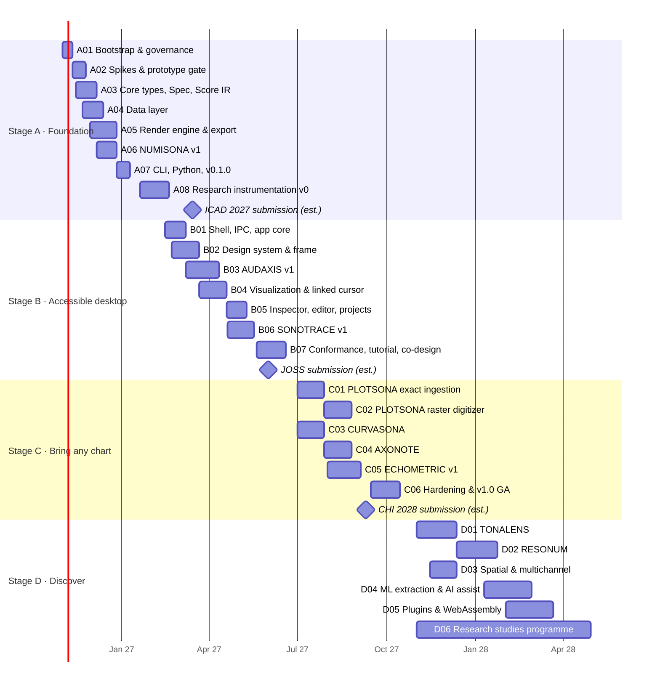

# Roadmap

> **Status:** Baseline v1 (2026-10-18); Stage B re-estimated 2026-10-21; Stage C re-estimated 2026-10-26. **Owner:** Project lead.
> **Live progress:** [docs/sdlc/status.md](../sdlc/status.md). **Task-level plan:** [implementation-plan.md](implementation-plan.md). **Risks:** [risk-register.md](risk-register.md).

## 1. Shape of the plan

The roadmap has **four stages (A–D)**, each made of **numbered phases (A01, A02, …)**. A stage ends at a **gate**: a formal review against exit criteria, recorded in [docs/sdlc/reviews/](../sdlc/reviews/). A phase is done only when its exit criteria are met *and* the [Definition of Done](../sdlc/definition-of-ready-and-done.md) holds for its work.

| Stage | Name | Promise to users | Engines delivered | Release at gate | Indicative window* |
|---|---|---|---|---|---|
| **A** | Foundation | "Hear a CSV": spec → sound from CLI and Python, reproducibly | NUMISONA; ECHOMETRIC harness v0 | `v0.1.0-alpha`, `v0.2.0-alpha` | Nov 2026 – Feb 2027 |
| **B** | Accessible desktop | "Explore by ear": a desktop app a screen-reader user can drive end to end | AUDAXIS, SONOTRACE | `v0.5.0-beta` | Mar – Jun 2027 |
| **C** | Bring any chart | "Any chart, any function, musically": general availability | PLOTSONA, CURVASONA, AXONOTE, ECHOMETRIC v1 | `v1.0.0` | Jul – Oct 2027 |
| **D** | Discover | Research engines, spatial audio, AI assist, plugins, web | TONALENS, RESONUM, PLOTSONA-ML | `v1.x` → `v2.0.0` | Nov 2027 – 2028 |

\* **Planning assumption:** one core developer working with AI coding agents (≈1.5–2 FTE effective), plus paid BLV co-designers from Stage B (A11Y-34; funding is open decision OD-10). Windows are indicative. They are re-baselined at every gate. Publication deadlines are fixed points ([publication plan](../research-paper/publication-plan.md)), so scope moves to fit them, not dates.

The chart is the baseline v1 and is re-baselined at Gate A. Stage A's code was complete on 2026-10-21, months ahead of it; the [Stage B re-estimate](#stage-b-re-estimate) explains what that means for Stage B, whose dates now depend on owner and human-paced items. The [Stage C re-estimate](#stage-c-re-estimate) does the same for Stage C.

---

## 2. Stage A · Foundation ("Hear a CSV")

**Goal.** A reproducible, tested Rust core that compiles a declarative spec into a Score and renders it in real time and to file, from the CLI and Python. Stage A also includes the research instrumentation needed for the first paper.

### A01 · Repository bootstrap and governance

| | |
|---|---|
| **Goal** | A professional, secure, automated repository from day one. |
| **Deliverables** | Cargo workspace skeleton per [02-repository-and-crate-layout.md](../architecture/02-repository-and-crate-layout.md); `rust-toolchain.toml`, `deny.toml`, `rustfmt.toml`, `clippy.toml`, `[workspace.lints]`; pnpm workspace skeleton; CI (`ci.yml`: fmt, clippy `-D warnings`, nextest, deny, MSRV, wasm32 build of core crates, docs lint); PR-title Conventional Commits check and DCO check; Dependabot or Renovate; OpenSSF Scorecard workflow; branch ruleset; secret scanning with push protection; private vulnerability reporting; label sync; GitHub Project board with a Roadmap view; licence files (after ADR-0010 is decided); `cargo xtask check-deps`. |
| **Exit criteria** | A PR to `main` runs all required checks green on Linux, Windows and macOS. Branch protection blocks direct pushes. Scorecard runs. Every root governance file exists. ADR-0010 (licence) is **Accepted**. |
| **Depends on** | — |
| **Research hooks** | Record CI times as a baseline in [benchmarks-log](../research-paper/benchmarks-log.md). |
| **Size** | S (≈1.5 weeks) |

### A02 · Technical spikes and prototype gate

| | |
|---|---|
| **Goal** | Retire the highest technical risks before committing to the stack ([risk register](risk-register.md) R-01..R-05). |
| **Deliverables** | Throwaway spikes in `spikes/` (deleted or archived after the gate): (1) cpal output on all three OSes with a measured loopback latency; (2) an own minimal render graph vs Firewheel 0.14 behind a draft `AudioBackend`/`RenderGraph` trait (UB audit with Miri where feasible); (3) Tauri 2.12 Channel throughput and binary `ipc::Response` latency on Win/macOS/Linux; (4) WebGL2 1M-point waveform and spectrogram fps in WebKitGTK (Intel/AMD/NVIDIA), WebView2 and WKWebView; (5) NVDA, VoiceOver and Orca walkthrough of a React Aria Tree + Slider + Toolbar inside a Tauri window; (6) a determinism check: the same offline render on two OSes compared within tolerance. |
| **Exit criteria** | A gate report in `docs/sdlc/reviews/A02-prototype-gate.md` with measurements. ADR-0002 (shell), ADR-0004 (render graph) and ADR-0003 (frontend) are confirmed or amended. If Linux fails (4) or (5), the Electron fallback is triggered per ADR-0002. |
| **Depends on** | A01 |
| **Research hooks** | Findings F-### for every measurement; latency numbers seed the engine paper (P07). |
| **Size** | M (≈2 weeks) |

### A03 · Core types, Spec v0.1 and Score IR

| | |
|---|---|
| **Goal** | The project's lingua franca: units, IDs, provenance, the spec schema and the canonical Score IR. |
| **Deliverables** | `sonarithm-core` (units as newtypes, `Score`, `ScoreTrack`, `ScoreEvent`, `RowRef`, `Provenance`, `Diagnostic`, capability traits); `sonarithm-spec` (Spec v0.1 per [04-sonification-spec.md](../architecture/04-sonification-spec.md), serde, schemars JSON Schema exported to `schemas/`, semantic validation with `miette` diagnostics, migration framework); `sonarithm-compiler` skeleton with the engine registry; insta snapshot format for Score IR; fuzz target for the spec parser. |
| **Exit criteria** | 100% of the spec examples in the docs validate. The schema in `schemas/` is regenerated and diffed in CI. A fuzz run of ≥1 h finds no panic. Public types are documented (`#![deny(missing_docs)]` on core and spec). |
| **Depends on** | A01 |
| **Research hooks** | Spec vocabulary decisions are logged as findings (Enge et al. alignment, Erie mapping). |
| **Size** | M (≈3 weeks) |

### A04 · Data layer

| | |
|---|---|
| **Goal** | Load real data into a typed, provenance-aware Arrow model, fast. |
| **Deliverables** | `sonarithm-data`: `DataBundle`; sources for CSV, TSV, JSON/NDJSON, Parquet, Arrow IPC, XLSX/ODS; type inference (quantitative, temporal, ordinal, nominal); **concept inference** hints (column-name heuristics → concept table, e.g. `temp*` → temperature); transforms (filter, sort, aggregate, bin, rolling/EMA smoothing, resample, derive via rhai expressions); M4 and LTTB downsampling; data fingerprinting (stable hash of Arrow IPC); provenance columns. |
| **Exit criteria** | Loads a 1M-row CSV in ≤ 1.5 s on reference hardware. Property tests on transforms pass. Downsampling is pixel-exact for M4 against a reference implementation. Fingerprints are stable across OSes. |
| **Depends on** | A03 (core types) |
| **Size** | M (≈3 weeks) |

### A05 · Render engine, audio backend and export

| | |
|---|---|
| **Goal** | Real-time-safe synthesis and deterministic offline rendering through one code path. |
| **Deliverables** | `sonarithm-dsp` (oscillators incl. PolyBLEP, envelopes with mandatory ramps (SDR-22), filters, constant-power panner, ISO 226 loudness compensation (SDR-24), EBU R128 meter); `sonarithm-render` (`RenderGraph`, `RenderPlan`, voice pool, sample-accurate scheduler, transport, `rtrb` command queue, `triple_buffer` telemetry, `basedrop` plan swap); `sonarithm-audio` (`AudioBackend` trait + cpal backend, device hot-plug, latency report); `sonarithm-export` (WAV via hound, FLAC via flacenc, render manifest with spec hash and data fingerprint); an allocation check in debug builds (`allocation-counter`, replacing `assert_no_alloc`: F-038); a 10-minute soak test; golden-audio harness with tolerance comparison. |
| **Exit criteria** | 0 xruns in a 10-min soak at 128-frame buffers on reference hardware. Offline render ≥ 50× real time on the benchmark Score. The null-test residual between OSes is ≤ −90 dBFS for the golden set. No allocations on the audio thread (debug assertion run in CI). |
| **Depends on** | A02 (graph decision), A03 |
| **Research hooks** | Engine benchmark numbers feed P07 (DAFx/JAES engine paper). |
| **Size** | L (≈4 weeks) |

### A06 · NUMISONA v1: parameter mapping

| | |
|---|---|
| **Goal** | Evidence-backed data → sound mapping with the design-rule defaults. |
| **Deliverables** | Channels pitch, loudness, duration, timbre, pan and rate; scales (linear, log, symlog, quantile, band, ordinal); pitch units (Hz, MIDI, cents, mel, ERB, Bark); **concept table** with polarity defaults (SDR-12..14) and one-key flip (SDR-15); psychophysical scaling (SDR-11); redundant duration/tap-count encodings (A11Y-13); mark switching above density thresholds (SDR-20, flagged experimental); default templates for line/bar/scatter; Erie spec importer (subset). |
| **Exit criteria** | Every SDR rule owned by NUMISONA has a unit test referencing its ID. The Erie gallery subset imports and renders. Compile ≤ 200 ms for 100k rows × 4 tracks. |
| **Depends on** | A03, A04 |
| **Size** | M (≈3 weeks) |

### A07 · CLI, Python package and first release

| | |
|---|---|
| **Goal** | Ship something people can use and cite. |
| **Deliverables** | `sonarithm` CLI (`render`, `play`, `validate`, `schema`, `inspect`, `lint` stub); `sonarithm` facade crate; Python package (PyO3/maturin abi3 wheels for Win/macOS/Linux; pandas, polars and pyarrow input via the Arrow C Data Interface; Jupyter audio display); examples gallery (5 datasets, CC BY 4.0); release-plz and wheel workflows; Zenodo integration; `CITATION.cff` completed. **Release `v0.1.0-alpha`.** |
| **Exit criteria** | `pip install sonarithm` works on all three OSes. A Zenodo DOI is minted. Quickstart docs take a new user from install to their first FLAC in ≤ 5 minutes (tested with 3 people). |
| **Depends on** | A05, A06 |
| **Size** | M (≈2 weeks) |

### A08 · Research instrumentation v0 (first paper)

| | |
|---|---|
| **Goal** | Make SONARITHM a research instrument, and submit the toolkit paper to ICAD 2027. |
| **Deliverables** | ECHOMETRIC harness v0: stimulus generators (trend reversals × density per Nees & Walker 2008; Smith & Walker 2005 price series; SNR-controlled transit series per Tucker Brown et al. 2022; correlation triplets); a **replication gallery** that re-creates classic designs from specs (Smith & Walker context cues, Dombois audification, Erie examples); an experiment-runner CLI (`sonarithm study run`) with structured logs; technical benchmarks (latency, real-time factor, determinism). **Release `v0.2.0-alpha`.** Paper P01 drafted and submitted. |
| **Exit criteria** | Every gallery item renders reproducibly from a committed spec with its manifest. P01 is submitted (or consciously deferred at the gate with a recorded reason). |
| **Depends on** | A07 |
| **Research hooks** | Papers P01 (ICAD 2027) and P03 (benchmark). Hypotheses H-01, H-02 prepared. The owner works alone without institutional ethics review (OD-04), so P01 relies on demonstration, the replication gallery and technical benchmarks, with no participant studies. |
| **Size** | M (≈4 weeks, overlaps A07) |

**Gate A (alpha).** CLI and Python are released. Exit criteria A01–A08 are met. The risk register is reviewed. Stage B scope is confirmed.

---

## 3. Stage B · Accessible desktop ("Explore by ear")

**Goal.** A desktop app that a blind screen-reader user can install, open data in, explore, configure and export from, without sighted help. It must also be credible to sighted analysts.

### Stage B re-estimate

> Added 2026-10-21 with the Stage B task rows ([implementation plan §3](implementation-plan.md#3-stage-b--accessible-desktop-task-level)). The estimates are planning figures, not measurements; each phase review re-baselines them.

**Stage A's actual pace.** Agent sessions closed 69 of the 78 Stage A phase tasks in about 55 hours (2026-10-18 19:09 to 2026-10-21 02:11 UTC), against a baseline window of November 2026 to February 2027. Sessions for A03, A04, A05, A06 and A08 all closed tasks on 2026-10-19. The nine open tasks all wait on the owner: walkthroughs on other OSes, the cable test, release go-aheads and the paper submission ([F-120](../research-paper/findings-log.md#implementation-findings)).

**What differs in Stage B.**

- At most two build-heavy agent sessions run at once on the owner's 16 GB laptop.
- Most of Stage B is UI work whose acceptance needs people: screen-reader runs, co-design sessions and listening checks.
- The [A02 gate](../sdlc/reviews/A02-prototype-gate.md#decision) held the shell and UI work (Lane U) until the owner's Windows walkthroughs were done and ADR-0002 and ADR-0003 confirmed for Windows ("Gate U", [OD-15](open-decisions.md#closed-decisions)). On 2026-10-29 the owner opened Gate U provisionally; the walkthroughs follow at a checkpoint (R-33). Linux and macOS confirmation is due by B03's exit. The Rust work (Lane R) started at once.

**Estimate.** Agent-paced work in session-days (one agent session on the phase), from Stage A's one to two days per phase of 9–13 tasks:

| Phase | Tasks | Lane R (starts now) | Agent estimate | Owner and human-paced items |
|---|---|---|---|---|
| B01 | 9 | T01, T02, T06 | ≈ 2 session-days | Gate U; HP-03 (App Nap) |
| B02 | 11 | T01, T02, T08 | ≈ 2–3 | Gate U; HP-01 (Narrator before T10), HP-07 (component checks), HP-16 (OD-03) |
| B03 | 14 | T01–T03, T05–T08, T11 | ≈ 3–4 | Gate U; HP-02 and HP-03 (exit); HP-01 (OD-05), HP-05 ([#123](https://github.com/DuhItzAniket/SONARITHM/issues/123), [#186](https://github.com/DuhItzAniket/SONARITHM/issues/186)), HP-08 (task suite), HP-14 |
| B04 | 8 | T03 | ≈ 2 | Gate U; HP-02, HP-03 (real webviews) |
| B05 | 8 | T01, T04 | ≈ 2–3 | Gate U; HP-14; the project-format RFC |
| B06 | 7 | all but T06 | ≈ 2 | Gate U for T06 only |
| B07 | 10 | none | ≈ 2–3 | HP-06 ([#187](https://github.com/DuhItzAniket/SONARITHM/issues/187)), HP-09 (co-design route), HP-10 (matrix), HP-12 (signing), HP-13 (JOSS), HP-14, HP-15, HP-17 |
| **Total** | **67** | **23** | **≈ 15–19 session-days**, about two calendar weeks with two sessions and the dependency chain | — |

**What sets Gate B's date: the human-paced items, not the engineering.**

- **Gate U:** open provisionally since 2026-10-29 ([OD-15](open-decisions.md#closed-decisions), amended by the owner). HP-01 (NVDA by the coordinator through desktop control, Narrator by the owner before B02-T10) and HP-04 make it final. HP-02, the Linux session with Orca, is a B03 exit criterion.
- **Screen-reader runs:** the B03 task suite (HP-08) and the full matrix (HP-10). Access to JAWS and a braille display is not arranged yet (R-25).
- **Co-design round 1:** it needs RV University's policy confirmed in writing, a compensation budget and recruited participants (HP-09). [OD-16](open-decisions.md) covers the case where it cannot run.
- **JOSS:** P02 eligibility is calendar-gated: six months of public history, about 2027-04-18 at the earliest, TODO(verify) ([OD-17](open-decisions.md)).

Gate B's date stays TODO(verify) until HP-09's lead time is known. The HP items are listed in [implementation plan §3.3](implementation-plan.md#33-owner-and-human-paced-items), with the issue that tracks each.

### B01 · Desktop shell, IPC and app core

| | |
|---|---|
| **Deliverables** | `apps/desktop` (Tauri 2) with `sonarithm-desktop`; `sonarithm-app` (sessions, undo/redo command bus, job queue, settings, profiles); typed IPC (ts-rs → `@sonarithm/ipc`); hot paths over Channels and binary `ipc::Response`; playhead clock anchors; a network-deny integration test; crash-safe autosave. |
| **Exit criteria** | Open → play → stop works on all OSes. Channel throughput meets the A02 budget. Cold start ≤ 2 s. Zero network calls in the network-deny test. |
| **Size** | M (baseline ≈3 weeks). Re-estimate 2026-10-21: ≈ 2 agent session-days. Owner gates: Gate U, HP-03 |

### B02 · Design system and application frame

| | |
|---|---|
| **Deliverables** | `@sonarithm/ui`: OKLCH token generator (dark, light, high-contrast; `forced-colors` honoured), IBM Plex Sans/Mono, React Aria-based components (Button, ToggleButton, Slider with unit announcements, Tree, Table, Toolbar, Menu, Dialog, ComboBox, Tabs); fixed regions with F6 cycling; command palette; Storybook with the a11y addon; Vitest browser-mode visual tests. Follows [design-language.md](../design/design-language.md). |
| **Exit criteria** | Every component passes axe and a manual NVDA/VoiceOver check. A design review against the anti-pattern list has zero violations. High-contrast theme is complete. |
| **Size** | M (baseline ≈4 weeks). Re-estimate 2026-10-21: ≈ 2–3 agent session-days. Owner gates: Gate U, HP-01 (Narrator before T10), HP-07, HP-16 |

### B03 · AUDAXIS v1: navigation, context and speech

| | |
|---|---|
| **Deliverables** | `sonarithm-audaxis`: NavTree builder; discrete-step navigation (local, lateral, spatial, targeted); "where am I"; earcon set; tick track (SDR-16); dynamic reference tone (SDR-17); spoken legends (SDR-18); announcement composer with verbosity and ordering (A11Y-12); speech/sonification sequencing (A11Y-20); screen-reader routing via platform announcements, plus optional self-voicing (`sonarithm-speech`); braille review line (A11Y-21); the keymap in [keyboard-and-navigation.md](../design/keyboard-and-navigation.md). |
| **Exit criteria** | All A11Y requirements owned by AUDAXIS pass their tests. A scripted task suite (find max, compare series, read value at x) completes with NVDA, JAWS, VoiceOver and Orca. ADR-0002 and ADR-0003 are confirmed on Linux and macOS (HP-02, HP-03; OD-15). |
| **Size** | L (baseline ≈5 weeks). Re-estimate 2026-10-21: ≈ 3–4 agent session-days. Owner gates: Gate U, HP-01, HP-02, HP-03, HP-05, HP-08, HP-14 |

### B04 · Visualization and linked cursor

| | |
|---|---|
| **Deliverables** | `@sonarithm/viz`: uPlot for line and time series; a WebGL2 layer for dense, waveform and spectrogram views (WebGPU optional); M4/LTTB tiles from Rust; playhead extrapolated from clock anchors with latency compensation; linked cursor across plot, table and navigation; CVD-safe palettes and perceptual colormaps. |
| **Exit criteria** | 60 fps playhead with 1M-point series on reference hardware in all three webviews. The cursor stays in sync within one frame. |
| **Size** | M (baseline ≈4 weeks). Re-estimate 2026-10-21: ≈ 2 agent session-days. Owner gates: Gate U, HP-02, HP-03 |

### B05 · Inspector, spec editor and project files

| | |
|---|---|
| **Deliverables** | Mapping inspector (channels, scales, polarity flip, ranges, concept selector, mode switch), engine-grouped panels; CodeMirror 6 spec editor with schema validation and diagnostics; `.sonarithm` project bundle (spec + data snapshot + profile + manifests); import/export of specs; Analysis/Presentation/Monitoring modes surfaced (SDR-36). |
| **Exit criteria** | Every inspector edit round-trips to the spec and back without loss. Undo/redo covers all edits. A project reopens bit-identically. |
| **Size** | M (baseline ≈3 weeks). Re-estimate 2026-10-21: ≈ 2–3 agent session-days. Owner gates: Gate U, HP-14 |

### B06 · SONOTRACE v1: transport, streams and monitoring

| | |
|---|---|
| **Deliverables** | `sonarithm-stream` + `sonarithm-sonotrace`: transport state machine (XState on the UI side, Rust authoritative); loop, speed and scrub; WebSocket, OSC, serial and MQTT sources with backpressure; incremental encoding; Monitoring mode with an ambient soundscape (SDR-35); rate-limited announcements and pause/stop/hide (A11Y-16). |
| **Exit criteria** | A 1 kHz input stream sonifies for 1 hour with no xruns and bounded memory. Announcement rate limits are verified. |
| **Size** | M (baseline ≈4 weeks). Re-estimate 2026-10-21: ≈ 2 agent session-days. Owner gates: Gate U (T06 only) |

### B07 · Accessibility conformance, tutorial and co-design round 1

| | |
|---|---|
| **Deliverables** | A built-in 15-minute interactive tutorial (SDR-37, A11Y-30); context help; ACR v0 (WCAG 2.2 AA via WCAG2ICT); the manual screen-reader matrix (A11Y-32); Chartability audit (A11Y-33); co-design round 1 with 10–15 BLV participants (A11Y-34) run as product usability feedback, not as a research study (OD-04), once the co-design route is in place (HP-09); fixes. **Release `v0.5.0-beta`.** JOSS submission (P02). |
| **Exit criteria** | No open "critical" accessibility issues. Co-design findings are logged and triaged. The ACR is published. P02 is submitted, or its deferral is recorded at Gate B (OD-17: JOSS eligibility is calendar-gated). |
| **Size** | M (baseline ≈4 weeks). Re-estimate 2026-10-21: ≈ 2–3 agent session-days; the rest is human-paced. Owner gates: HP-06, HP-09, HP-10, HP-12 to HP-15, HP-17 |

**Gate B (beta).** A BLV user completes the core tasks unaided in ≥ 80% of attempts during co-design round 1. All Stage B exit criteria are met. If round 1 cannot run, OD-16 applies.

---

## 4. Stage C · Bring any chart (general availability)

### Stage C re-estimate

> Added 2026-10-26 with the Stage C task rows ([implementation plan §4](implementation-plan.md#4-stage-c--bring-any-chart-task-level)). The estimates are planning figures, not measurements; each phase review re-baselines them, and Gate B reviews them.

**Actual pace so far.**

- **Stage A:** agent sessions closed 69 of 78 phase tasks in about 55 hours ([F-120](../research-paper/findings-log.md#implementation-findings)); phases of 9–13 tasks took one to two session-days.
- **Stage B's Rust lane:** 21 of its 23 tasks closed on two calendar days, 2026-10-21 and 2026-10-25, with two or three sessions working at once ([F-150](../research-paper/findings-log.md#implementation-findings)). That is about four to five tasks per session-day. The two still open are B03-T08 (profiles) and B06-T07 (a one-hour soak, which waits until the laptop is free).

**What differs in Stage C.**

- PLOTSONA's parsers take untrusted files, so each needs a fuzz target and budgets; C01 and C02 have more L tasks than Stage B's Rust lane had.
- Only one build-heavy session runs while the owner uses the laptop for other heavy work, so session-days add up in sequence.
- Three phases end with people: the teacher pilot (C03), the DAW check (C04) and co-design round 2 (C06). Signing, the external security review and ACR v1 also need the owner or volunteers.

**Estimate.** Agent-paced work in session-days, from the pace above:

| Phase | Tasks | Lane R (no Gate U) | Agent estimate | Owner and human-paced items |
|---|---|---|---|---|
| C01 | 13 | T01–T12 | ≈ 3–4 session-days | Gate U (T13); HP-22; RFC-0004 accepted by the coordinator |
| C02 | 11 | T01–T06, T08, T09 | ≈ 3 | Gate U (T10, T11); HP-18 (OD-23, T07); HP-22; RFC-0005 |
| C03 | 9 | T01–T07 | ≈ 2 | Gate U (T08, T09); HP-19 (teacher pilot, C03 exit); HP-21 |
| C04 | 10 | T01–T04, T06–T08 | ≈ 2 | HP-18 (OD-21, T05; OD-22); HP-20 (DAW check, C04 exit); Gate U (T09); HP-21 |
| C05 | 12 | T01–T10 | ≈ 3 | Gate U (T11); HP-27 (P05, T12) |
| C06 | 13 | T04, T05 | ≈ 3–4 (agent parts of all 13) | Gate U; HP-05, HP-06 (budgets); HP-23 (signing, updater keys); HP-24 (co-design round 2); HP-25 (security review); HP-26 (matrix); HP-28 (`v1.0.0`); HP-29 (Gate C) |
| **Total** | **68** | **46** | **≈ 16–18 session-days**, of which Lane R is about 12–14 | — |

**Calendar.** With one build-heavy session at a time, Lane R is about three weeks of daily sessions, or less once two can run; TODO(verify) against the next phase review. Lane U follows Gate U and the Stage B screens it extends.

**What sets Gate C's date: the human-paced items, not the engineering.** Gate U (open provisionally since 2026-10-29; HP-01 and HP-04 make it final) and Gate B come first. Then the teacher pilot (HP-19), co-design round 2 (HP-24, the same route as HP-09), the signing route (HP-23, OD-02), the external security review (HP-25) and the full matrix with JAWS and braille (HP-26, R-25). The CHI 2028 deadline for P05 (est. early–mid September 2027) is a fixed point if the owner keeps P05 (OD-26). Gate C's date stays TODO(verify).

The baseline Gantt above is unchanged; it is re-baselined at Gate B.

### C01 · PLOTSONA: exact ingestion and chart templates

Extract data **exactly** where possible: Office chart XML (`c:numCache`/`c:numLit` in XLSX/PPTX/DOCX), SVG charts (D3, Vega and Plotly marks), Vega/Vega-Lite/Plotly/Highcharts JSON, and vector PDF drawing operators with auto-calibration (ChartDetective approach). Chart-type templates cover line, bar, grouped/stacked bar, scatter, histogram, box, heat map and pie. **Exit:** a 50-chart exact-source corpus extracts with ≤ 0.5% relative error and the correct provenance class `exact`/`vector`.

**Size.** Re-estimate 2026-10-26: ≈ 3–4 agent session-days. Owner gates: Gate U (T13), HP-22. RFC-0004 (spec v0.2) comes first.

### C02 · PLOTSONA: raster digitizer with human correction

Axis calibration (linear, log, date) with an accessible point-entry alternative; colour-mask curve extraction; bar and point detection; a correction UI; per-point `cv_estimate` provenance with confidence. Low-confidence regions are flagged in speech and text (and optionally in timbre, as an experiment). **Exit:** median relative error ≤ 2% on a raster corpus of clean line and bar charts. Every estimate is labelled in the description and the table.

**Size.** Re-estimate 2026-10-26: ≈ 3 agent session-days. Owner gates: Gate U (T10, T11), HP-18 (OD-23, optional OCR), HP-22.

### C03 · CURVASONA: functions and audification

Expression input (exmex facade), domain sampling, symbolic derivatives, critical-point analysis (zeros, extrema, inflections, asymptotes, undefined regions), derivative/sign timbre cues (A11Y-28), points of interest, and an audification voice with the speed-up calculator (SDR-31) and presets (seismic, EEG). **Exit:** a function test suite of 40 classic curves shows correct critical points. A blind maths teacher pilot (n ≥ 3) completes the tasks.

**Size.** Re-estimate 2026-10-26: ≈ 2 agent session-days. Owner gates: Gate U (T08, T09), HP-19 (OD-24).

### C04 · AXONOTE: musical mapping and MIDI/OSC

Scale and tuning quantization (Presentation mode only, SDR-10), instrument library (synth presets, SF2 via rustysynth), the BLV square-wave preset (SDR-29), Standard MIDI File export, live MIDI (midir) and OSC (rosc) out with DAW/VCV Rack recipes. **Exit:** MIDI export round-trips in two DAWs. Quantization is provably absent in Analysis mode (test).

**Size.** Re-estimate 2026-10-26: ≈ 2 agent session-days. Owner gates: HP-18 (OD-21, OD-22), HP-20, Gate U (T09).

### C05 · ECHOMETRIC v1: analytics, descriptions and lint

Detectors (extrema, outliers, change points, periodicity, trend segments) with augurs and statrs; navigable insights and earcons (A11Y-23); deterministic L1/L2 descriptions and query commands (A11Y-02, A11Y-22); a Score lint with rule-ID diagnostics (SDR-19, -23, -26, -28, -39). **Exit:** each detector is precision/recall-tested on labelled synthetic data. Every lint rule has positive and negative tests.

**Size.** Re-estimate 2026-10-26: ≈ 3 agent session-days. Owner gates: Gate U (T11), HP-27 (P05, OD-26).

### C06 · Hardening, release engineering and v1.0 GA

Code signing (Windows Artifact Signing or alternative; Apple Developer ID + notarization; AppImage GPG), the Tauri updater with two-custodian keys, installers, a CycloneDX SBOM, build-provenance attestations, immutable releases, the documentation site (Diátaxis), ACR v1, a security review, a performance pass against all budgets, co-design round 2. **Release `v1.0.0`.** The CHI 2028 toolkit paper (P05) is drafted during C05 and submitted at the CHI deadline (est. early–mid Sep 2027), using the C05 release candidate. C06 adds its artifact package and any revisions.

**Size.** Re-estimate 2026-10-26: ≈ 3–4 agent session-days; most of C06 is human-paced. Owner gates: Gate U, HP-05, HP-06, HP-23 to HP-26, HP-28, HP-29.

**Gate C (GA).** All NFR budgets are met. ACR v1 is published. No open critical or high bugs. A support policy is published in SECURITY.md.

---

## 5. Stage D · Discover (research engines and reach)

| Phase | Name | Summary | Exit signal |
|---|---|---|---|
| **D01** | TONALENS | Interactive lens over scatter, heat map and table; linked selection across modalities (A11Y-11); multi-stream separation (SDR-26); PCA → partials quick-look (SDR-34); granular density (SDR-32). | H-04 (stream cap) experiment run; lens usable by keyboard and pointer. |
| **D02** | RESONUM | Model-based sonification: data sonogram, crystallization, modal resonator banks; excitation via keyboard, pointer and gamepad (SDR-33). | Two MBS models published as reusable templates; pilot study on cluster detection. |
| **D03** | Spatial and multichannel | Binaural rendering via SOFA HRTFs (sofar); 5.1/7.1 and ambisonic export; a front–back confusion warning (SDR-30). | Spatial renders pass golden tests; user-selectable HRTF. |
| **D04** | ML extraction and AI assist | `sonarithm-plotsona-ml` (tract default, ort opt-in), a local VLM sidecar (llama.cpp, Apache/MIT-licensed models only), self-consistency confidence, uncertainty in sound (H-06), LLM-phrased L3 descriptions with numeric verification, NL Q&A via generated queries, **opt-in** cloud extraction per chart. | Extraction benchmark published; zero unverified numbers in generated descriptions (test). |
| **D05** | Plugins and WebAssembly | WIT world for engine plugins (wasmtime, compile-time only, fuel and epoch limits); `sonarithm-wasm` with the WebAudio host; npm package; MAIDR/Erie interop demos. | A third-party sample plugin builds and runs; the web demo renders identical Score IR. |
| **D06** | Research studies programme | Graph-concept polarity (P04), LLM vs empirical mappings (P06), accessible uncertainty (P08), pacing × range × context factorial (P03 extension). | Each study preregistered, run, and logged in the [findings log](../research-paper/findings-log.md). |

**Gate D.** At least two research engines are released, at least two studies are completed, and the plugin API is stable at v1.

---

## 6. Release and version mapping

| Version | Gate / phase | Channel | Contents |
|---|---|---|---|
| `0.1.0-alpha` | A07 | crates.io, PyPI, GitHub | Core, NUMISONA, CLI, Python |
| `0.2.0-alpha` | A08 | same | + ECHOMETRIC harness v0, replication gallery |
| `0.3.0`–`0.4.0` | B03, B05 | + desktop nightly | Desktop app preview |
| `0.5.0-beta` | Gate B | + desktop beta (signed only if certificates are ready by B07; signing is a C06 deliverable) | AUDAXIS, SONOTRACE, tutorial, ACR v0 |
| `1.0.0` | Gate C | stable | PLOTSONA, CURVASONA, AXONOTE, ECHOMETRIC v1 |
| `1.x` / `2.0.0` | Stage D | stable | Research engines, plugins (2.0 if the plugin API forces breaking changes) |

## 7. How to change this roadmap

1. Propose the change in a PR that edits this file and [status.md](../sdlc/status.md).
2. Scope changes inside a phase are fine through the PR. Moving work **between stages**, or adding or removing a phase, needs a short note in the next gate review.
3. Never renumber phases. A removed phase is struck through with a reason, and new phases get the next free number in their stage.
