# Engine Catalogue

> **Status:** Baseline v1 (2026-10-18). **Owner:** Project lead.
> Related: [architecture/07-engines.md](../architecture/07-engines.md) (technical contracts), [design/engine-identity.md](../design/engine-identity.md) (visual identity), [planning/roadmap.md](../planning/roadmap.md) (delivery).

SONARITHM is **one platform with nine engines**. The platform is the spec compiler, Score IR, render engine, data layer and application shell. The engines are **named capabilities that plug into that one pipeline**; they are not nine separate programs. This was the main architectural lesson of the research: most sonification tools died of feature sprawl and abandonment, and a single shared compiler is the defence ([research report §"Nine engines…"](../research/research-report.md)).

Every engine contributes one or more of these **capability kinds**:

| Kind | What it does | Pipeline stage |
|---|---|---|
| **Source** | Turns an external input (file, chart, function, stream) into a `DataBundle` | Ingest |
| **Analyzer** | Derives annotations (extrema, outliers, change points, critical points) from data | Analyze |
| **Encoder** | Turns data and a track spec into Score events (marks with channel values) | Encode |
| **Context** | Adds auditory context: ticks, reference tones, earcons, speech cues, navigation structure | Encode / Navigate |
| **Shaper** | Transforms a compiled Score: quantize, spatialize, loudness-compensate, lint | Shape |
| **Voice** | Supplies a render-time sound generator: an instrument, a model, an audifier or a grain cloud | Render |
| **Sink** | Sends Score or audio somewhere other than the speakers: MIDI, OSC, files | Output |
| **Interactive** | Responds to live user input with sound: a lens, model excitation or scrubbing | Interact |

---

## The platform

### SONARITHM: the platform and core runtime

| | |
|---|---|
| **Etymology** | SONic + ARITHMetic / algorithm |
| **Icon** | Lucide `audio-lines` |
| **Identity colour** | Teal green (mockup ≈ `#2E7D6B` on `#DDEBE7`) |
| **Owns** | The spec language, compiler, Score IR, render graph, audio backends, data layer, export, project files, desktop app, CLI, Python and WASM bindings, plugin host |
| **Crates** | `sonarithm-core`, `-spec`, `-data`, `-compiler`, `-dsp`, `-render`, `-audio`, `-export`, `-stream`, `-app`, `sonarithm` (facade) |
| **Tagline** | *Hear the patterns.* (Use "Discover what the graphs reveal" only as an aspiration until SONARITHM's own studies support it: [research report, Conclusion](../research/research-report.md#conclusion).) |

---

## The nine engines

The **Phase** column refers to [planning/roadmap.md](../planning/roadmap.md).

| Engine | Icon (Lucide) | One-line role | Capability kinds | First phase |
|---|---|---|---|---|
| **NUMISONA** | `waves` | Maps any numeric field to auditory channels | Encoder | A06 |
| **AUDAXIS** | `move-down-left` | Auditory axes, navigation structure, speech and spatial cues | Context, Interactive, Shaper (spatial) | B03 |
| **SONOTRACE** | `spline` | Time-series transport, live streams and monitoring | Source, Interactive | B06 |
| **PLOTSONA** | `chart-no-axes-combined` | "Bring any chart": chart ingestion and chart-type templates | Source, Encoder (templates) | C01 |
| **CURVASONA** | `square-activity` | Math functions, critical-point cues and audification | Source, Analyzer, Voice | C03 |
| **AXONOTE** | mockup: `audio-lines`-style bars → recommended `audio-waveform` (see note) | Musical mapping, instruments and MIDI/OSC output | Shaper, Voice, Sink | C04 |
| **ECHOMETRIC** | `ear` | Pattern analytics, descriptions, perceptual lint and evaluation harness | Analyzer, Shaper (lint) | A08 (harness), C05 |
| **TONALENS** | `scan-eye` | Multivariate exploration lens with linked selection | Interactive, Encoder, Voice | D01 |
| **RESONUM** | `circle-dot` | Model-based sonification: data as an instrument | Voice, Interactive | D02 |

> **Icon note (open decision OD-03).** In the naming mockup, AXONOTE's glyph is the same "audio bars" shape as the SONARITHM platform icon. Two identical icons with different meanings hurt recognition, and screen-reader users never see icons, so the text labels carry the meaning anyway. We recommend `audio-waveform` for AXONOTE. All other icons match the mockup and have been checked to exist in Lucide.

---

### NUMISONA: parameter mapping

| | |
|---|---|
| **Etymology** | NUMerical + SONic |
| **Purpose** | The core encoder. It turns data fields into auditory channels (pitch, loudness, duration, timbre, pan, rate) with scales, polarity and perceptual units. Every other engine that produces "data sound" goes through NUMISONA's channel model. |
| **Owns** | Channel encodings and scales (linear, log, symlog, quantile, ordinal, band); pitch units (Hz, MIDI, cents, mel, ERB, Bark); polarity presets from the **concept table** (SDR-12..14); psychophysical scaling (SDR-11); redundant encodings (duration and tap count, A11Y-13); mark-switching under density (SDR-20); reusable templates ("sonecules", SDR-03); Erie import. |
| **Does not own** | Musical quantization (AXONOTE), context cues (AUDAXIS), real-time voices (render layer). |
| **Research basis** | Walker 2002/2007; Walker & Kramer 2005; Dubus & Bresin 2013; Fitzpatrick & Neff 2023; Enge et al. 2023; Erie (Kim et al. 2024). |
| **Crate** | `sonarithm-numisona` |
| **Spec surface** | `tracks[].channels`, `tracks[].mark`, `concepts` |
| **Maturity target** | Wave 1 (Stage A) |

### AUDAXIS: auditory axes and navigation

| | |
|---|---|
| **Etymology** | AUDitory + AXIS |
| **Purpose** | Makes a sonification *navigable* and *legible*. It provides the hierarchical navigation tree, keyboard and discrete-step movement, context tracks (tick clicks, dynamic reference tone, earcons), auditory legends, speech cues routed to the user's screen reader, and stereo/binaural placement. |
| **Owns** | `NavTree` construction (dataset → series/axes/insights → segments → points; node → neighbours for networks); cursor semantics; announcement composition and verbosity (A11Y-12); earcon set (A11Y-08); SDR-16/17/18; spatial shaping (stereo, ITD/ILD; SOFA HRTF in D03); "where am I" (A11Y-07). |
| **Does not own** | Platform accessibility plumbing (desktop app a11y bridge), widget-level ARIA (UI kit). |
| **Research basis** | Smith & Walker 2005; Zong et al. 2022 / Olli; Chart Reader (CHI 2023); MAIDR; Data Navigator; Apple Audio Graphs. |
| **Crate** | `sonarithm-audaxis` |
| **Spec surface** | `context`, `navigation`, `speech`, `spatial` |
| **Maturity target** | Wave 1 (Stage B), HRTF in Wave 3 (Stage D) |

### SONOTRACE: time series and live streams

| | |
|---|---|
| **Etymology** | SONic + TRACE |
| **Purpose** | Follows a series through time. It owns the playback transport (play, pause, scrub, loop, speed), long-series windowing, and live sources (WebSocket, MQTT, serial, OSC in, file tail). It also provides **Monitoring mode**: an ambient soundscape with salience changes on events (SDR-35), rate-limited announcements, and pause/stop/hide for streams (A11Y-16). |
| **Owns** | Stream source adapters (Source), the transport state machine, ring-buffered windows, live re-encoding, the monitoring preset. |
| **Does not own** | Anomaly detection (ECHOMETRIC supplies detectors; SONOTRACE runs them incrementally). |
| **Research basis** | Hildebrandt et al. 2016; Debashi & Vickers 2018 (SoNSTAR); MAIDR live mode; Chart2Music monitor mode. |
| **Crate** | `sonarithm-sonotrace` (uses `sonarithm-stream`) |
| **Spec surface** | `data.source.kind = "stream"`, `playback`, `monitor` |
| **Maturity target** | Wave 1–2 (Stage B) |

### PLOTSONA: chart ingestion and chart-type templates

| | |
|---|---|
| **Etymology** | PLOT + SONification |
| **Purpose** | "Bring any chart." It (1) ingests charts and recovers their data, **always preferring exact sources** (Office chart XML caches, SVG and Vega/Plotly/Highcharts JSON, vector PDF) over raster estimation, and (2) supplies chart-type sonification templates (line, bar, scatter, histogram, box, heat map, pie) so a chart sounds right without hand-written specs. |
| **Owns** | Exact extractors; raster digitizer (axis calibration, colour masks, WebPlotDigitizer-style extraction with human correction, re-implemented from documented behaviour); ML-assisted extraction (Stage D); **per-point provenance class and confidence** (exact, vector, cv_estimate, ml_estimate, cloud_estimate, user_edited); chart-type templates. |
| **Does not own** | Natural-language description (ECHOMETRIC), cloud opt-in policy (platform privacy layer). |
| **Research basis** | ChartDetective (78% lower error on vector PDFs); WebPlotDigitizer docs; WB-ChartExtract and EpiCurveBench 2026 (ML line-chart extraction is still weak); OneChart self-consistency. |
| **Crates** | `sonarithm-plotsona`; `sonarithm-plotsona-ml` (optional, Stage D) |
| **Spec surface** | `data.source.kind = "chart"`, `template` |
| **Maturity target** | Wave 2 (Stage C), ML in Wave 3 (Stage D) |

### CURVASONA: functions, signals and audification

| | |
|---|---|
| **Etymology** | CURVE + SONic |
| **Purpose** | Makes the *shape* of a curve audible. It handles math expressions (explicit, parametric), derivative-driven timbre, sign, zero-crossing, extremum, inflection, asymptote and undefined/off-screen cues (A11Y-28), points of interest, and **audification** of dense signals with an explicit speed-up calculator (SDR-31). |
| **Owns** | Expression parsing and evaluation (exmex behind a facade), symbolic derivatives, critical-point analysis, the audification voice, spectral views (FFT) for signals. |
| **Does not own** | Generic time-series transport (SONOTRACE). |
| **Research basis** | SonicFunction (Bielefeld); AudioFunctions 1/2; Desmos Audio Trace; Dombois 2001 (seismic audification, k ≈ 2200). |
| **Crate** | `sonarithm-curvasona` |
| **Spec surface** | `data.source.kind = "function"`, `tracks[].mark = "audify"` |
| **Maturity target** | Wave 2 (Stage C) |

### AXONOTE: musical mapping and MIDI

| | |
|---|---|
| **Etymology** | AXis + NOTE |
| **Purpose** | The musical layer. It handles scale and tuning quantization (**Presentation mode only**, SDR-10), harmonic voicing, rhythm grids, the instrument library (synth presets, SF2 sample instruments), Standard MIDI File export, and live MIDI/OSC out to DAWs and VCV Rack. It is the bridge between "informative" and "pleasant". |
| **Owns** | Scale and tuning tables, the quantizer Shaper, instrument presets (Voice), MIDI and OSC Sinks, timbre presets including the BLV "discrete square-wave" preset (SDR-29). |
| **Does not own** | The data→pitch mapping itself (NUMISONA). |
| **Research basis** | Walker & Nees 2011 (resolution vs musicality); Neuhoff 2019 (separate art and science goals); STRAUSS; Highcharts MIDI; TwoTone. |
| **Crate** | `sonarithm-axonote` |
| **Spec surface** | `music`, `instruments`, `output.midi`, `output.osc` |
| **Maturity target** | Wave 2 (Stage C) |

### ECHOMETRIC: pattern analytics, descriptions and perceptual metrics

| | |
|---|---|
| **Etymology** | ECHO + METRIC |
| **Purpose** | Measures before and after sound. **Before:** it detects patterns (extrema, outliers, change points, periodicity, trend segments) that become navigable insights and earcons, and it computes deterministic L1/L2 descriptions (A11Y-02, A11Y-22). **After:** it lints the compiled Score against the design rules (rate, critical-band spacing, stream count, loudness, comfort), and it hosts the **evaluation harness** (stimulus generators, standard tasks, logging) that powers SONARITHM's research. |
| **Owns** | Analyzer passes, the description generator (L1/L2 computed; L3 phrased only from verified facts), the Score lint (diagnostics carry SDR/A11Y IDs), the benchmark/evaluation harness. |
| **Does not own** | ML chart extraction (PLOTSONA), the study UI shell (desktop app). |
| **Research basis** | Lundgard & Satyanarayan 2021; VoxLens/MAIDR queries; Chart Reader insights; Nees & Walker 2008; Dubus & Bresin 2013 (only 6.1% of mappings evaluated). |
| **Crate** | `sonarithm-echometric` |
| **Spec surface** | `analysis`, `describe`, `lint` |
| **Maturity target** | Harness v0 in Stage A (phase A08, for the ICAD 2027 paper); analytics in Wave 2 (Stage C) |

### TONALENS: multivariate exploration lens

| | |
|---|---|
| **Etymology** | TONAL + LENS |
| **Purpose** | Sound as another *lens* on information. It provides an interactive focus+context lens: sweep a cursor or region over a scatterplot, heat map or table and hear the data under it. It covers linked selection across visual, audio and text (A11Y-11), multi-stream separation by timbre, pan and onset (SDR-26), the PCA→harmonic-partials quick-look (SDR-34) and granular density textures (SDR-32). |
| **Owns** | Lens geometry and state, the multivariate encoder presets, the multi-stream scheduler, the granular voice for density. |
| **Does not own** | Base channel mapping (NUMISONA), the navigation tree (AUDAXIS). |
| **Research basis** | Apple four-axis Audio Graphs; Erie; Umwelt (coequal modalities); McGookin & Brewster 2004; Williamson & Murray-Smith 2005; Dalziel & Lieck 2025. |
| **Crate** | `sonarithm-tonalens` |
| **Spec surface** | `lens`, `tracks[].mark = "grain"` |
| **Maturity target** | Wave 3 (Stage D) |

### RESONUM: model-based sonification

| | |
|---|---|
| **Etymology** | RESONance + NUMbers |
| **Purpose** | Data becomes an instrument that the user *plays*. The engine supplies Model-Based Sonification (Hermann): data-sonogram wavefronts from a selected point, crystallization growth from a seed, and modal resonator banks where each data point is a resonator. It is silent until excited (SDR-33). It suits clusters, distributions, high-dimensional data and (experimentally) graphs and networks. |
| **Owns** | Model definitions, excitation handling, the modal and resonator voices. |
| **Does not own** | Navigation (AUDAXIS), lens UI (TONALENS). |
| **Research basis** | Hermann 2008; Hermann & Ritter 2002; sc3nb/sonecules (dormant, so SONARITHM would be the maintained successor). |
| **Crate** | `sonarithm-resonum` |
| **Spec surface** | `tracks[].mark = "model"`, `models` |
| **Maturity target** | Wave 3 (Stage D), research-grade |

---

## Engine interaction map

```mermaid
flowchart LR
  subgraph Sources
    PL[PLOTSONA<br/>charts]
    CU1[CURVASONA<br/>functions]
    ST1[SONOTRACE<br/>streams]
    FILES[Platform<br/>file sources]
  end
  subgraph Analyze
    EM1[ECHOMETRIC<br/>detectors]
    CU2[CURVASONA<br/>critical points]
  end
  subgraph Encode
    NU[NUMISONA<br/>channels]
    AX1[AUDAXIS<br/>context tracks]
    TL1[TONALENS<br/>multivariate]
  end
  subgraph Shape
    AO1[AXONOTE<br/>quantize]
    AX2[AUDAXIS<br/>spatial]
    EM2[ECHOMETRIC<br/>lint]
  end
  subgraph Render
    VO[Voices: instruments, AXONOTE,<br/>RESONUM models, CURVASONA audify,<br/>TONALENS grains]
  end
  subgraph Outputs
    SPK[Speakers]
    FILE[WAV/FLAC + manifest]
    MIDI[AXONOTE MIDI/OSC]
  end
  Sources --> DB[(DataBundle<br/>Arrow + provenance)]
  DB --> Analyze --> ANN[(Annotations)]
  DB --> Encode
  ANN --> Encode
  Encode --> SCORE[(Score IR)]
  SCORE --> Shape --> SCORE2[(Shaped Score)]
  SCORE2 --> Render --> SPK & FILE
  SCORE2 --> MIDI
```

## Naming and usage rules

1. Engine names are written in **capitals** in prose and UI headings (NUMISONA). Machine identifiers are lowercase (`numisona`) in specs, crate names (`sonarithm-numisona`), CLI flags and telemetry-free logs.
2. Engines are **capabilities, not modes the user must pick**. The UI groups settings by engine with its icon and identity colour, but an ordinary user only sees "Mapping", "Axes & navigation" and so on. Engine names appear in headers and the advanced views.
3. Never add a tenth engine without an ADR. New capability goes into an existing engine or a plugin (Stage D).
