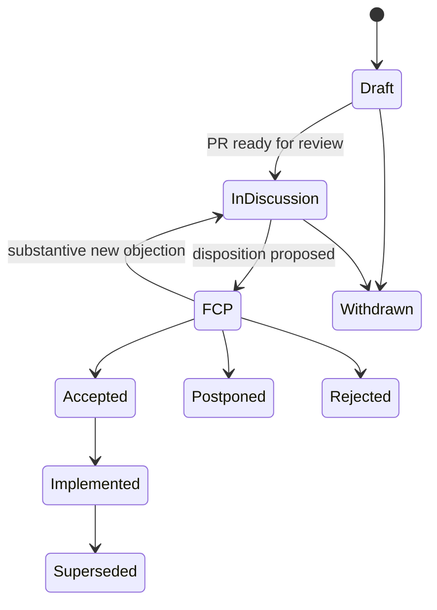

# Requests for comments (RFCs)

> **Status:** Baseline v1 (2026-10-18). **Owner:** Project lead.
> **Related:** [RFC template](0000-template.md) · [architecture decision records](../decisions/README.md) · [GOVERNANCE.md](../../GOVERNANCE.md) · [04-sonification-spec §7](../architecture/04-sonification-spec.md#7-versioning-and-compatibility) · [05-compiler-and-score-ir](../architecture/05-compiler-and-score-ir.md) · [Definition of Ready and Done](../sdlc/definition-of-ready-and-done.md) · [CONTRIBUTING.md](../../CONTRIBUTING.md)

An RFC is a written proposal for a change that affects several parts of SONARITHM or people outside the core team: spec authors, engine and plugin developers, downstream tools, researchers who cite our outputs. The process is modelled on Rust RFCs, scaled down for a small team.

## 1. When an RFC is required

| Area | RFC required for | Not required for |
|---|---|---|
| Spec language | Any major `specVersion` bump ([04 §7](../architecture/04-sonification-spec.md#7-versioning-and-compatibility) requires an RFC and a migration). A new top-level section, substrate, mark kind or channel kind. A change to how existing fields are interpreted. | A new optional field or enum value inside an existing construct (a minor bump through a normal PR that meets the [spec-change DoD](../sdlc/definition-of-ready-and-done.md#33-spec-changes)) |
| Score IR | Breaking changes: removing or renaming fields, changing units or semantics, changing the invariants in [05 §4.2](../architecture/05-compiler-and-score-ir.md#42-invariants-property-tested), or anything that forces engines, sinks or navigation to change. | Additive fields, and snapshot-format changes that only bump `ir_version` |
| Plugin WIT world (Stage D) | The first published WIT world, and any later change to it | Host-internal changes behind the world |
| IPC protocol | The IPC versioning policy, and breaking changes to commands or channels that tests, plugins or external consumers depend on | Adding commands, or changes internal to one release of the desktop app |
| Cross-engine contracts | Changes to capability traits in `sonarithm-core`, to engine registry rules ([05 §3](../architecture/05-compiler-and-score-ir.md#3-engine-registry-and-capability-traits)), or to the `DataBundle`, `Annotations` and `Score` contracts engines share | Changes inside one engine |
| Engines | Adding an engine to the nine in the [engine catalogue](../product/engines.md) (also needs an ADR) | New capabilities inside an existing engine |
| Persisted formats | Breaking changes to the project bundle (`.sonarithm`) or the render manifest | Additive, backward-compatible fields |
| Governance | Changes to the decision process, maintainer roles, the RFC process itself, or the code of conduct's enforcement | Editorial fixes |

Also not RFC material: bug fixes, refactors without contract changes, performance work, dependency upgrades that change no contract, and decisions local to one crate (record those as an ADR). When unsure, open an issue and ask; a maintainer decides.

## 2. Lifecycle

1. **Draft PR.** Copy [`0000-template.md`](0000-template.md) to `docs/rfcs/0000-<slug>.md` and open a draft PR. An optional issue beforehand helps test whether the idea needs an RFC at all.
2. **Number.** When the PR leaves draft, rename the file to the next free four-digit number (`NNNN-<slug>.md`), fill in the metadata table and add a row to the index below. Numbers are never reused.
3. **Discussion.** Review happens in the PR. The author revises the text; open points are kept current in "Unresolved questions", so the document, not the comment thread, carries the state.
4. **Final comment period (FCP-lite).** When discussion converges, the approver named in [GOVERNANCE.md](../../GOVERNANCE.md#decision-making) (the project lead during Stages A and B) proposes a disposition: accept, postpone or reject. The proposal is posted on the PR with a short summary and announced in the project's discussion channel. The FCP lasts **7 calendar days**. A substantive new objection returns the RFC to discussion.
5. **Outcome.** After the FCP the RFC is merged with its final status (Accepted, Postponed or Rejected) and a short rationale, so the reasoning stays searchable whatever the result.
6. **After acceptance.** An ADR records the decision in [docs/decisions](../decisions/README.md) and links the RFC; the RFC links the ADR back. Implementation issues are created with phase IDs and must meet the [Definition of Ready](../sdlc/definition-of-ready-and-done.md#1-definition-of-ready).
7. **Implemented.** When the implementation lands, the status changes to Implemented with links to the PRs.
8. **Amendments.** Clarifications are made by PR. A substantive change is a new RFC that supersedes the old one.

## 3. RFCs and ADRs

| | RFC | ADR |
|---|---|---|
| Purpose | Proposal and discussion | Recorded outcome |
| Lives in | `docs/rfcs/` | `docs/decisions/` (MADR) |
| Length | As long as the design needs | Short |
| Changes after acceptance | Superseded by a new RFC | Superseded by a new ADR |

Every accepted RFC produces an ADR. Many ADRs have no RFC: a decision that does not need broad discussion goes straight to an ADR.

## 4. Statuses

| Status | Meaning |
|---|---|
| Draft | Being written; not ready for review |
| In discussion | Ready for review; open for comment |
| FCP | Disposition proposed; 7-day final comment period running |
| Accepted | Approved; an ADR records it |
| Postponed | Good idea, wrong time; may be revived with a new FCP |
| Rejected | Not adopted; rationale recorded |
| Withdrawn | Withdrawn by the author before a disposition |
| Implemented | Accepted and shipped |
| Superseded | Replaced by a later RFC |

## 5. Index

| RFC | Title | Status | ADR | Phase |
|---|---|---|---|---|
| [0001](0001-spec-v0.1.md) | Spec v0.1 freeze | Accepted (2026-10-19) | [ADR-0005](../decisions/0005-declarative-spec-and-score-ir.md), [ADR-0015](../decisions/0015-spec-v0.1-frozen.md) | A03 |
| [0002](0002-project-format-v1.md) | Project format v1 (`.sonarithm` bundles) | Accepted (2026-10-21, coordinator under owner delegation; FCP waived) | [ADR-0018](../decisions/0018-project-format-v1.md) | B05 |
| [0004](0004-spec-v0.2.md) | Spec v0.2: `template`, `instruments`, `lint`, chart calibration and corrections, AXONOTE vocabularies | Accepted (2026-10-26, coordinator under owner delegation; FCP waived; three amendments) | [ADR-0021](../decisions/0021-spec-v0.2.md) | C01 |
| [0005](0005-chart-correction-file.md) | The chart correction file (`sonarithm-corrections` v1): portable, hash-bound, history-keeping corrections for extracted charts | Accepted (2026-10-30, coordinator under owner delegation; FCP waived; three amendments) | [ADR-0026](../decisions/0026-chart-correction-file.md) | C02 |
