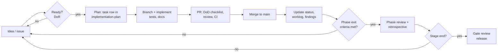

# SDLC: How This Project Is Run

> **Status:** Baseline v1 (2026-10-18). **Owner:** Project lead.

This folder holds the **living records** of the software development life cycle. Planning documents say what we intend; these files say what is actually happening.

## 1. The life cycle at a glance

## 2. Records and when to update them

| Record | Path | Update when | Who |
|---|---|---|---|
| **Status board** | [status.md](status.md) | A task or phase changes state; weekly at the latest | Whoever changes the state (human or agent) |
| **Worklog** | [worklog/](worklog/README.md) | After each working session (one file per session or week) | Contributor or agent session |
| **Phase reviews** | [reviews/](reviews/README.md) | When a phase's exit criteria are believed met | Phase owner |
| **Gate reviews** | [reviews/](reviews/README.md) | At the end of each stage | Project lead |
| **Retrospectives** | [retrospectives/](retrospectives/README.md) | After each phase | Team |
| **Definition of Ready / Done** | [definition-of-ready-and-done.md](definition-of-ready-and-done.md) | Changes by PR only | Project lead |
| **Traceability matrix** | [traceability-matrix.md](traceability-matrix.md) | A requirement's design, phase, test or status changes | Implementer |
| **Decisions** | [../decisions/](../decisions/README.md) | A significant decision is made | Decision owner |
| **Open decisions** | [../planning/open-decisions.md](../planning/open-decisions.md) | A decision is raised or resolved | Project lead |
| **Risks** | [../planning/risk-register.md](../planning/risk-register.md) | At every phase review; whenever a trigger fires | Risk owner |
| **Findings** | [../research-paper/findings-log.md](../research-paper/findings-log.md) | Anything measured, surprising or evidence-relevant | Anyone |
| **Benchmarks** | [../research-paper/benchmarks-log.md](../research-paper/benchmarks-log.md) | A phase that touches a PB budget; every release | Implementer |
| **Changelog** | [../../CHANGELOG.md](../../CHANGELOG.md) | Generated from Conventional Commits by release-plz (from A07); manual until then | Release lead |

## 3. Roles

| Role | Responsibility | Initially held by |
|---|---|---|
| Project lead | Scope, roadmap, gates, final decisions | @DuhItzAniket |
| Architecture lead | ADRs, crate boundaries, tech stack review | Project lead (until delegated) |
| Audio lead | Render engine, RT safety, latency | Project lead (until delegated) |
| Accessibility lead | Conformance plan, AT testing, co-design | To recruit (Stage B) |
| Research lead | Paper track, studies, ethics | Project lead (until delegated) |
| Release lead | CI/CD, signing, releases | Project lead (until delegated) |

[GOVERNANCE.md](../../GOVERNANCE.md) describes how roles are assigned and how decisions are made.

## 4. Quality gates summary

| Level | Gate | Evidence |
|---|---|---|
| PR | Definition of Done + required CI checks + 1 review | PR checklist |
| Phase | Exit criteria in the [roadmap](../planning/roadmap.md) | Phase review file |
| Stage | Gate criteria + release checklist + risk review | Gate review file, release notes, ACR (UI stages) |
